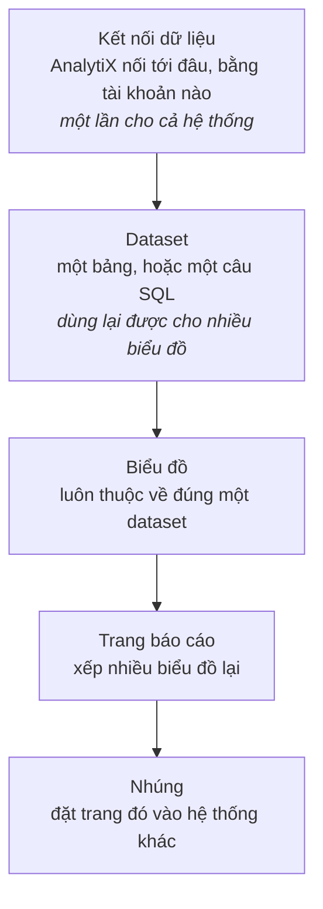

# AnalytiX là gì

Dành cho người mới nghe tên sản phẩm. Không cần chuẩn bị gì.

## Câu trả lời ngắn

AnalytiX là **công cụ trực quan hoá dữ liệu**: nối vào cơ sở dữ liệu của bạn,
viết truy vấn, dựng biểu đồ, xếp biểu đồ thành trang báo cáo, rồi nhúng trang
đó vào hệ thống khác nếu cần.

Nó là **một sản phẩm độc lập**. Cài bằng một lệnh, chạy trên một máy, không đòi
thêm dịch vụ nào — không Redis, không message queue, không cụm tính toán.

Nó được xây trên Apache Superset 6.1.0, với **53 bản vá** riêng cho phần giao
diện, thương hiệu, bảng màu, và bộ dựng thẻ KPI.

## Vấn đề nó giải

Dữ liệu đã nằm trong database, nhưng người cần đọc nó thì không viết SQL. Hai
cách thường gặp đều dở:

- **Dựng báo cáo bằng tay mỗi lần** — người biết SQL thành cái cổ chai, và số
  liệu luôn cũ hơn thực tế.
- **Mua một công cụ BI lớn** — trả tiền theo người dùng, dữ liệu phải đẩy lên
  hạ tầng của họ, và muốn đổi gì cũng phải chờ họ.

AnalytiX ở giữa: người biết SQL khai báo dữ liệu **một lần** thành *dataset*,
sau đó người không biết SQL tự dựng biểu đồ trên dataset đó.

## Bốn lớp, đi theo đúng thứ tự

Đây là mô hình quan trọng nhất cần hiểu. Không nhảy cóc được — mỗi lớp chỉ thấy
thứ lớp dưới đã tạo ra.

Phần lớn lỗi của người mới là nhầm lớp: cố dựng biểu đồ khi chưa có dataset, hoặc
sửa dữ liệu ở lớp biểu đồ thay vì lớp dataset.

## Hai cách cài, chọn một

| | Docker | Cài thực trên máy |
|:---|:---|:---|
| Cần sẵn | Docker | Python 3.10, 3.11 **hoặc** 3.12 |
| Lệnh | `docker run -p 8088:8088 analytix:<bản>` | `./cai-tren-may.sh` |
| Cài vào đâu | trong container, `/app/analytix` | `$HOME/analytix` (đổi được) |
| Nghe ở | `0.0.0.0` trong container — biên là container | `127.0.0.1` — chỉ máy đó |
| Giữ dữ liệu qua lần chạy sau | phải gắn volume vào `/app/analytix` | mặc định đã giữ |

Cả hai dùng **cùng một bộ cài**, cùng thứ tự cài đặt — cố ý, để bản container và
bản cài tay không thể lệch nhau.

## Những gì nó cố ý KHÔNG làm

Đây là chỗ cần đọc kỹ trước khi quyết dùng.

**Không mang theo driver database nào ngoài SQLite.** Cài xong, AnalytiX query
được tệp SQLite — và gần như chỉ thế. Nối Postgres, MySQL, Trino hay bất cứ gì
khác đều phải cài thêm driver bằng tay. Xem
[Thêm driver cho nguồn dữ liệu](../how-to/them-driver-du-lieu.md).

**Không phải bản sẵn sàng cho môi trường thật.** Cả hai đường cài đều chạy bằng
web server dành cho phát triển, không có reverse proxy, không HTTPS. Xem
[Vì sao bản cài chưa sẵn sàng cho môi trường thật](./chua-san-sang-cho-production.md).

**Không có hẹn giờ, không có gửi báo cáo tự động.** Những tính năng đó cần một
tiến trình chạy việc nền và một hàng đợi — bộ cài không dựng chúng.

**Không ảnh chụp biểu đồ.** Việc đó cần một trình duyệt không giao diện, bộ cài
không mang theo.

**Không có tài khoản mặc định.** Đây là chủ ý, không phải thiếu sót: mật khẩu
quản trị được **sinh ngẫu nhiên và in ra một lần duy nhất** lúc cài. Không có
`admin/admin` để ai dò cũng vào được.

## Điểm yếu của cách làm này

**Bản vá phải biên dịch, không đắp được vào bản đang chạy.** 45 trong 53 bản vá
nằm ở phần giao diện web, nên sản phẩm phải build lại — không thể lấy Superset
gốc rồi thả vài tệp vào.

**Theo sau thượng nguồn là việc có giá.** Mỗi lần Apache Superset lên bản mới,
53 bản vá phải áp lại và kiểm lại. Bù lại là không bị mắc kẹt ở một bản cũ.

**SQLite làm nơi lưu metadata sẽ chặn đường mở rộng.** Nó đủ cho một máy, một
nhóm người dùng. Nhiều người dùng đồng thời thì phải chuyển sang Postgres — mà
driver Postgres lại không có sẵn.

**Giao diện vẫn còn chữ của nhà cung cấp cũ.** Vài bảng màu còn mang nhãn mang
tên công ty phát triển, người dùng cuối nhìn thấy được.

## Liên quan

- [Cài AnalytiX lần đầu](../tutorials/cai-dat-analytix.md) — đi từ đầu đến cuối
- [Cài bằng Docker](../how-to/cai-dat-bang-docker.md)
- [Cài thực trên máy](../how-to/cai-dat-tren-may.md)
- [Yêu cầu hệ thống](../reference/yeu-cau-he-thong.md)
