# Vì sao bản cài chưa sẵn sàng cho môi trường thật

Dành cho người định đưa AnalytiX cho nhiều người dùng. Đọc trước khi mở nó ra
ngoài máy của bạn.

## Câu trả lời ngắn

Bộ cài dựng được **một bản chạy đúng, nhanh, một người dùng**. Nó cố ý **không**
dựng những thứ một hệ thống nhiều người dùng cần: web server chịu tải, HTTPS,
bộ đệm, tiến trình chạy việc nền, và một database metadata chịu được nhiều ghi
đồng thời.

Nó cũng tạo tài khoản quản trị mặc định `admin` / `admin` để lần cài đầu không
phải đi tìm mật khẩu trong log — đổi nó là việc của bạn.

Dùng để thử, để dựng báo cáo, để một người làm việc — đủ. Mở cho cả phòng dùng —
chưa đủ, và bảy chỗ dưới đây là lý do.

## Vấn đề

Bộ cài có một mục tiêu rõ: `./cai-tren-may.sh` hoặc `docker run` là ra một bản chạy
được, không hỏi gì thêm, không cần dịch vụ phụ. Mục tiêu đó va với mục tiêu
"chịu tải nhiều người dùng" — thứ hai đòi thêm ít nhất bốn thành phần nữa, mỗi
thành phần là một thứ phải cấu hình và phải trông.

Bộ cài chọn mục tiêu thứ nhất. Đó là lựa chọn đúng cho việc *giao sản phẩm*, và
là lý do bạn phải tự làm phần còn lại.

## Bộ cài dựng gì, và thiếu gì

```mermaid
flowchart LR
    subgraph CO["Bộ cài dựng sẵn"]
        W["Flask dev server<br/>HTTP, một tiến trình"]
        M["SQLite<br/>làm metadata"]
        AD["Tài khoản admin/admin<br/>chờ bạn đổi"]
    end
    subgraph THIEU["Dùng thật còn cần"]
        N["nginx + HTTPS"]
        G["Gunicorn nhiều worker"]
        C["Redis làm bộ đệm"]
        Q["Celery chạy việc nền"]
        P["PostgreSQL<br/>làm metadata"]
        U["Chạy dưới user thường<br/>không phải root"]
        A["Mật khẩu quản trị<br/>đã đổi khỏi admin"]
    end
    CO -.->|"đủ cho một người thử"| THIEU
    style CO fill:#dcfce7,stroke:#16a34a
    style THIEU fill:#fef2f2,stroke:#dc2626
```



## Bảy chỗ cụ thể

### 1. Web server là bản dành cho phát triển

Cả hai đường cài đều chạy `superset run --with-threads` — đó là web server tích
hợp của Flask, bản thân nó in cảnh báo *"This is a development server. Do not use
it in a production deployment."*

`gunicorn` **có** trong bộ gói đã cài, nhưng không script nào gọi nó. Đưa vào
dùng thật thì chạy AnalytiX bằng gunicorn và đặt nginx phía trước.

### 2. Không có HTTPS

Không reverse proxy, không chứng chỉ. Đăng nhập đi qua mạng dưới dạng không mã
hoá. Trong một mạng nội bộ tin cậy thì tạm được; qua bất cứ đường nào khác thì
không.

### 3. Không có tiến trình chạy việc nền

Không có worker, không có hàng đợi. Hệ quả cụ thể — **các tính năng này không
hoạt động** dù giao diện vẫn hiện chúng:

- Cảnh báo và gửi báo cáo theo lịch
- Truy vấn bất đồng bộ (câu nặng sẽ chặn request)
- Ảnh thu nhỏ của biểu đồ và trang báo cáo

Giao diện không nói chúng đang tắt, nên người dùng sẽ bật rồi chờ mãi không thấy
gì.

### 4. Không có bộ đệm

Cấu hình đệm để ở mặc định thượng nguồn là **không đệm gì**. Mỗi lần mở một trang
báo cáo là mọi biểu đồ trên đó truy vấn lại database.

Mười người cùng mở một trang có tám biểu đồ là tám mươi truy vấn.

### 5. SQLite làm nơi lưu metadata

Database metadata là một tệp SQLite. SQLite cho **một người ghi tại một thời
điểm**, và AnalytiX ghi vào đó liên tục — nhật ký truy vấn, trạng thái bộ lọc.

Vài người dùng thì không thấy gì. Nhiều người dùng đồng thời thì bắt đầu gặp lỗi
khoá database. Chuyển sang PostgreSQL là cách giải — nhưng
[driver Postgres không có sẵn](../how-to/cai-dat-van-hanh/them-driver-du-lieu.md), phải cài thêm.

### 6. Container chạy bằng `root`

Ảnh không khai `USER`. Trong môi trường thật thì chạy với user thường và chỉ cấp
quyền ghi vào thư mục dữ liệu.

### 7. Tài khoản quản trị mặc định là `admin` / `admin`

Không đặt `ANALYTIX_ADMIN_PASSWORD` thì bộ cài tạo đúng cặp đó và chỉ nhắc đổi:

```
[analytix] administrator: admin / admin
[analytix] CHANGE IT at first login: Settings -> Info -> Reset my password.
```

Đây là đổi hướng có chủ ý: trước đây mật khẩu sinh ngẫu nhiên và in một lần, nên
người cài hay mất nó trong `docker logs`. Giá phải trả là một thông tin đăng nhập
mà **mọi bot quét mạng đều thử trước tiên**.

Hai chốt giảm nhẹ nó, và cần biết rõ từng chốt chặn tới đâu:

| Chốt | Chặn được gì | **Không** chặn được gì |
|:---|:---|:---|
| `khoi-dong.sh` từ chối chạy khi `ANALYTIX_BIND` khác loopback mà mật khẩu vẫn là `admin` | bản cài tay bị mở ra mạng trước khi đổi mật khẩu | mật khẩu yếu khác (`123456` thì nó cho qua); reverse proxy đặt trước một bản đang nghe `127.0.0.1`; đường container, vì container không dùng script này |
| `cai.sh` mở cổng Docker trên `127.0.0.1` theo mặc định | container vô tình phơi cổng ra mọi giao diện mạng | `docker run -p` gõ tay; ánh xạ cổng đã đóng cứng từ container tạo trước đó; `ANALYTIX_BIND=0.0.0.0` do chính bạn đặt |

Nói gọn: hai chốt chỉ giữ **những đường ra mạng do bộ cài tự dựng**. Mọi lớp mạng
bạn thêm vào — nginx, `-p` tay, port forward — đều đi vòng qua chúng, và lúc đó
`admin/admin` là một tài khoản quản trị mở.

Việc đầu tiên sau khi cài, trước cả nginx: đổi mật khẩu đó.

## Thứ bộ cài làm ĐÚNG về bảo mật

Để công bằng — có ba chỗ nó làm tốt hơn mặc định thường gặp:

**Mật khẩu mặc định không đi kèm một cổng mở.** Nhiều sản phẩm vừa đặt
`admin/admin` vừa nghe `0.0.0.0` ngay lần chạy đầu. Ở đây mặc định là loopback ở
cả hai đường cài, và bản cài tay còn **từ chối khởi động** nếu bạn mở ra mạng mà
chưa đổi mật khẩu — chốt so hash trong `superset.db` với đúng chuỗi `admin`, nên
đổi xong là nó tự mở.

**Khoá bí mật sinh riêng cho từng bản cài**, lưu ở tệp quyền `600`, và **không
bị sinh lại** khi cài lần hai. Nhiều sản phẩm dùng chung một khoá mặc định công
khai — đó là lỗi nặng, và bộ cài này không mắc.

**Bản cài tay nghe `127.0.0.1`**, không phải `0.0.0.0`. Phải cố ý mới mở ra mạng
được, và chỗ đổi có kèm ghi chú nhắc đổi mật khẩu trước.

## Cần gì để dùng thật

Thứ tự theo mức độ quan trọng:

| # | Việc | Vì sao |
|:--|:---|:---|
| 1 | Đổi mật khẩu quản trị khỏi `admin` | Mất năm giây, và là thứ bot thử đầu tiên |
| 2 | nginx + HTTPS phía trước | Mật khẩu không đi qua mạng dạng thô |
| 3 | gunicorn thay web server phát triển | Chịu được nhiều request đồng thời |
| 4 | PostgreSQL cho metadata | Bỏ giới hạn một-người-ghi của SQLite |
| 5 | unit `systemd` | Tự chạy lại sau khi khởi động máy, sau khi sập |
| 6 | Redis + worker nền | Mở lại cảnh báo, báo cáo theo lịch, ảnh thu nhỏ |
| 7 | Sao lưu `superset.db` và `superset_config.py` | **Mất khoá bí mật là hỏng mọi session và mọi dashboard đã nhúng** |

Hạng 1 làm trước mọi thứ khác — đặt nginx lên trước một bản còn `admin/admin` là
vô hiệu hoá chính chốt đang che nó. Hạng 1–5 là bắt buộc. Hạng 6 chỉ cần nếu bạn
dùng những tính năng đó. Hạng 7 làm ngay từ ngày đầu, không phải sau khi mất.

## Điểm yếu của chính cách nhìn này

Danh sách trên **chưa được kiểm thật** ở đây — nó suy ra từ việc đọc bộ cài và
cấu hình mặc định, không phải từ một lần chạy tải thật. Con số cụ thể (bao nhiêu
người dùng đồng thời thì SQLite bắt đầu hỏng) phụ thuộc cách dùng, và cần đo mới
biết.

Riêng mục 7 thì có chạy thử (04-11-2026): đường `--may` in `admin / admin`, đăng
nhập được, `ANALYTIX_BIND=0.0.0.0` bị từ chối, đổi mật khẩu xong thì nghe
`0.0.0.0`; đường `--docker` mở cổng ở `127.0.0.1`. Nhưng "chốt chạy đúng" không
có nghĩa là "mặc định đã an toàn" — nó chỉ xác nhận chốt chặn đúng cái nó hứa
chặn, mà phần *không* chặn ở bảng trên lại là phần lớn hơn.

Và bản thân "sẵn sàng cho môi trường thật" không có một mốc duy nhất: mười người
trong một mạng nội bộ khác hẳn một nghìn người qua Internet.

## Liên quan

- [AnalytiX là gì](./analytix-la-gi.md)
- [Cài thực trên máy](../how-to/cai-dat-van-hanh/cai-dat-tren-may.md)
- [Cài bằng Docker](../how-to/cai-dat-van-hanh/cai-dat-bang-docker.md)
- [Thêm driver cho nguồn dữ liệu](../how-to/cai-dat-van-hanh/them-driver-du-lieu.md)
- [Biến môi trường](../reference/bien-moi-truong.md#analytix_bind) — `ANALYTIX_BIND` và chốt mật khẩu
- [Yêu cầu hệ thống](../reference/yeu-cau-he-thong.md)
