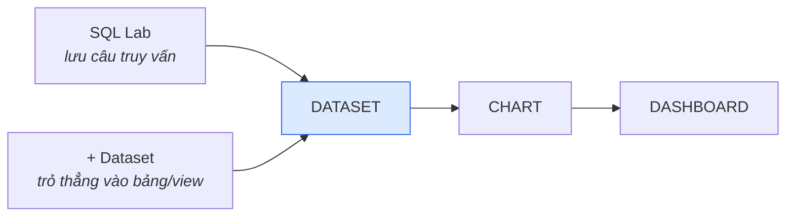

# Vì sao có hai cách tạo dataset

## Câu trả lời ngắn

Biểu đồ **chỉ** đọc được dataset, không đọc thẳng database. Có hai đường tới một
dataset: lưu một câu SQL từ SQL Lab, hoặc trỏ thẳng vào một bảng/view. Khác nhau
ở chỗ **định nghĩa dữ liệu sống ở đâu** — trong AnalytiX, hay trong database.

## Vấn đề

Logic "lấy dữ liệu từ đâu, lọc gì, cột tên là gì" phải nằm ở một chỗ nào đó. Đặt
sai chỗ thì sáu tháng sau không ai tìm ra nó.

## Cách giải, và vì sao chọn cách đó

AnalytiX không bắt chọn một đường. Nó cho cả hai, và để bạn quyết theo tuổi thọ
của logic.

Biểu đồ **chỉ** đọc được dataset. SQL Lab không phải cửa thứ hai vào dữ liệu — nó là chỗ thử
câu SQL, và là nút tắt để biến câu đó thành dataset.

| | Qua SQL Lab → `Save dataset` | Datasets → `+ Dataset` |
|---|---|---|
| Ra loại dataset | **Virtual** — định nghĩa là câu SQL bạn viết | **Physical** — trỏ thẳng vào một bảng hoặc view |
| Định nghĩa nằm ở | Trong Superset | Trong Postgres |
| Ai nhìn thấy logic | Chỉ người mở Superset | Cả tổ chức, qua schema `mart` |
| Sửa nguồn | Sửa ô SQL — không có bản nháp, mọi biểu đồ đổi theo ngay | Sửa view trong database, mọi biểu đồ cập nhật theo |
| Hợp khi | Cần nối bảng, lọc sẵn, hoặc thêm cột tính riêng cho một trang | View `mart` đã có đúng thứ bạn cần |
| Làm ở bước nào | Bước 7 của bài hướng dẫn — `mart.chi_tieu` | Bước 10 của bài hướng dẫn — `mart.coverage` |

Tài liệu dẫn bạn đi **cả hai** đường, mỗi đường một lần, để bạn tự so.

> **Physical hay Virtual không khóa cứng lúc tạo.** Mở dataset → `Edit` → tab `Source` có hai
> ô chọn `Physical (table or view)` và `Virtual (SQL)`, đổi qua lại được bất cứ lúc nào. Nên
> thực chất đây là một loại object với hai chế độ nguồn, không phải hai thứ khác nhau.

> **Mặc định của dự án này: `+ Dataset` trên `mart`.** Schema `mart` đã là bảy view dựng sẵn
> cho việc báo cáo, nên phần lớn lúc bạn không cần viết SQL. Để SQL Lab cho việc dùng một lần,
> hoặc cho lúc thăm dò. Nguyên tắc chung: logic nào sống lâu thì đẩy xuống thành view trong
> Postgres rồi tạo dataset physical trỏ vào nó — vừa viết SQL thoải mái, vừa để logic ở chỗ
> cả tổ chức nhìn thấy.

## Phương án đã loại, vì sao loại

**Chỉ dùng virtual dataset, bỏ hẳn view.** Nhanh lúc đầu: không phải xin quyền
tạo view trong database. Nhưng logic nằm trong AnalytiX thì chỉ người mở AnalytiX
đọc được nó, và không công cụ nào khác dùng lại được — báo cáo Excel, job ETL,
hay một BI thứ hai đều phải viết lại câu SQL đó từ đầu.

**Chỉ dùng physical dataset, cấm SQL Lab.** Sạch về nguyên tắc, nhưng mọi câu hỏi
dùng một lần cũng phải qua một vòng đổi database. Thực tế là người ta sẽ tải dữ
liệu về Excel để tránh vòng đó, và thế là mất luôn dấu vết.

## Điểm yếu của cách đang dùng

**Virtual dataset không có bản nháp.** Sửa ô SQL là mọi biểu đồ đọc nó đổi theo
ngay, không qua bước duyệt, không hoàn tác được bằng một nút. Dataset nào nhiều
biểu đồ phụ thuộc thì nên đẩy xuống thành view.

**Hai lối vào cùng một thứ gây nhầm.** Người mới hay tưởng đây là hai loại object
khác nhau. Không phải — mở dataset → `Edit` → tab `Source` đổi qua lại được bất
cứ lúc nào.

**Ranh giới "logic nào sống lâu" không có ai gác.** Nó là thói quen, không phải
quy tắc hệ thống bắt buộc. Thực tế là virtual dataset tích tụ dần cho tới lúc có
người ngồi dọn.

## Liên quan

- [Từ database tới biểu đồ](../tutorials/tu-database-toi-bieu-do.md) — bài dẫn đi cả hai đường, mỗi đường một lần
- [Viết SQL an toàn](../how-to/dung-bao-cao/viet-sql-an-toan.md)
- [Bảng thuật ngữ](../reference/bang-thuat-ngu.md)
