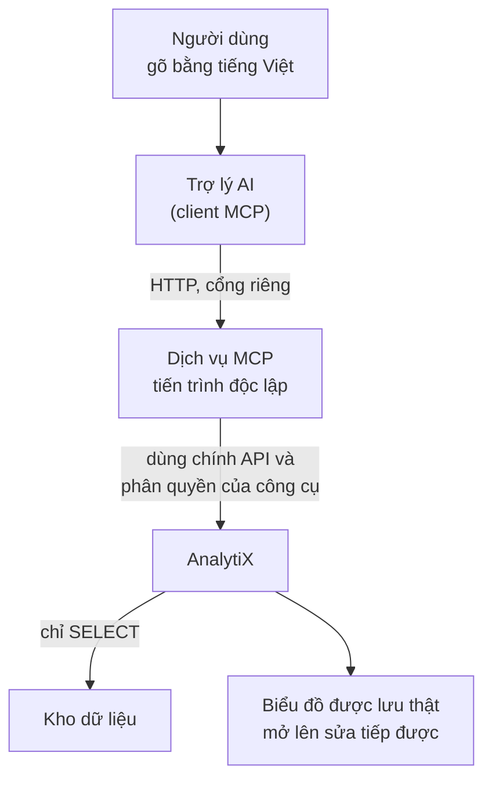

# Vì sao MCP là một dịch vụ riêng

Dành cho người muốn hiểu MCP nằm ở đâu trong AnalytiX và vì sao nó không nằm trong
AnalytiX. Không cần chuẩn bị gì — trang này không có bước làm.

## Câu trả lời ngắn

MCP là **một tiến trình riêng**, chạy cạnh AnalytiX và nói chuyện với
nó qua chính API của nó. Nó không phải một tính năng bật/tắt bên trong giao diện
web, và không phải một đường đi vòng qua phân quyền.

Nó cho phép người dùng mô tả bằng lời — *"vẽ biểu đồ doanh thu theo tháng"* — và
biểu đồ được tạo thật, lưu vào AnalytiX, sửa tiếp được bằng tay như mọi
biểu đồ khác.

## Vấn đề

Dựng một biểu đồ trong AnalytiX đòi bốn lớp, đúng thứ tự: kết nối
database → dataset → chart → dashboard (xem
[Kiến trúc dữ liệu](./analytix-la-gi.md)). Mỗi lớp có vài chục lựa chọn:
chọn kiểu biểu đồ nào, cột nào làm trục, hàm tổng hợp nào, mốc thời gian nào.

Người thạo công cụ làm việc đó trong vài phút. Người không thạo thì **không làm
được**, và đó là phần lớn người cần báo cáo. Kết quả thực tế: họ đi nhờ người
khác, hoặc không có báo cáo.

MCP tồn tại để đóng khoảng đó: người dùng nói ý muốn, phần chọn-lựa-kỹ-thuật để
máy làm.

## Cách giải, và vì sao chọn cách đó

Ba điều quan trọng trong sơ đồ trên:

**Tiến trình riêng, không phải tính năng trong web.** Dịch vụ MCP khởi động bằng
lệnh riêng, nghe trên cổng riêng, và dừng được độc lập. AnalytiX vẫn
chạy bình thường nếu MCP tắt — và ngược lại. Không có cờ cấu hình nào trong giao
diện web bật nó lên.

**Đi qua phân quyền, không đi vòng.** MCP không nói chuyện trực tiếp với kho dữ
liệu. Mọi thao tác đi qua lớp phân quyền của AnalytiX, kể cả các luật
lọc theo dòng (RLS). Nghĩa là MCP **không làm được gì** mà tài khoản nó chạy
dưới vốn không được làm.

**Chỉ đọc, chặn ở tầng kết nối.** Quyền ghi bị tắt ngay trên khai báo kết nối dữ
liệu, không dựa vào việc MCP "tự giữ mình". Một câu `DELETE` hay `CREATE TABLE`
gửi qua MCP bị từ chối bởi chính AnalytiX, trước khi tới database.

## Phương án đã loại, và vì sao

| Phương án | Vì sao loại |
|:---|:---|
| **Nhét MCP vào tiến trình web** | Web dùng một tiến trình worker duy nhất vì metadata lưu trên SQLite. Một phiên MCP chạy truy vấn dài sẽ chặn cả giao diện web. Tách ra thì hai bên hỏng độc lập. |
| **Tự viết MCP server từ đầu** | Không cần. AnalytiX đã có sẵn dịch vụ MCP trong mã nguồn từ bản 6.1.0, kèm 24 công cụ và phân quyền đã nối sẵn. Tự viết là viết lại tầng API và tầng quyền — chỗ dễ sai nhất. |
| **Cho MCP nối thẳng vào engine truy vấn** | Nhanh hơn một chặng, nhưng mất toàn bộ phân quyền, mất RLS, và phải quản một bộ tài khoản thứ hai. Một đường đi vòng qua kiểm soát là một đường không ai kiểm được. |
| **Tạo tài khoản chỉ-đọc riêng trên engine truy vấn** | Giải đúng bài toán chặn ghi, nhưng giải sai chỗ: khai báo kết nối của AnalytiX đã có sẵn công tắc tắt quyền ghi. Thêm tài khoản là thêm thứ phải nhớ xoay vòng mật khẩu. |

## Điểm yếu của cách đang dùng

**Máy đoán, và đoán sai được.** MCP tự chọn hàm tổng hợp (`SUM` hay `AVG`), tự
chọn cột làm trục thời gian. Nó chọn theo tên cột và kiểu dữ liệu, không theo ý
nghĩa nghiệp vụ. Biểu đồ nó dựng nên coi là **bản nháp để kiểm**, không phải số
liệu đem đi họp ngay.

**Thêm một tiến trình phải trông.** Thêm một cổng, một log, một thứ có thể chết
lúc 2 giờ sáng. Cái giá của việc tách tiến trình là phải vận hành nó.

**Chế độ dev không xác thực.** Ở cấu hình mặc định cho máy cá nhân, dịch vụ MCP
không kiểm token — nó chạy dưới một tài khoản cố định. An toàn **chỉ vì** nó
nghe trên `127.0.0.1`, tức biên bảo mật là ranh giới máy, không phải token. Mở
ra ngoài localhost mà không đổi sang JWT là mở một cửa không khoá; xem
[Đổi xác thực MCP sang JWT](../how-to/tro-ly-ai/mcp-doi-sang-jwt.md).

**Quyền hiện là của một tài khoản, không của người đang hỏi.** Mọi người dùng
chung một danh tính phía MCP, nên ai hỏi cũng thấy đúng những gì tài khoản đó
thấy. Muốn mỗi người chỉ thấy phần dữ liệu của mình thì phải chuyển sang xác
thực theo người dùng.

## Liên quan

- [Bật dịch vụ MCP](../how-to/tro-ly-ai/bat-mcp.md) — các bước bật
- [Tạo biểu đồ bằng lời](../tutorials/tao-bieu-do-bang-loi.md) — bài học đi từ đầu
- [Cấu hình MCP](../reference/mcp-cau-hinh.md) — bảng biến cấu hình
- [Công cụ MCP](../reference/mcp-cong-cu.md) — 24 công cụ và cách gọi
