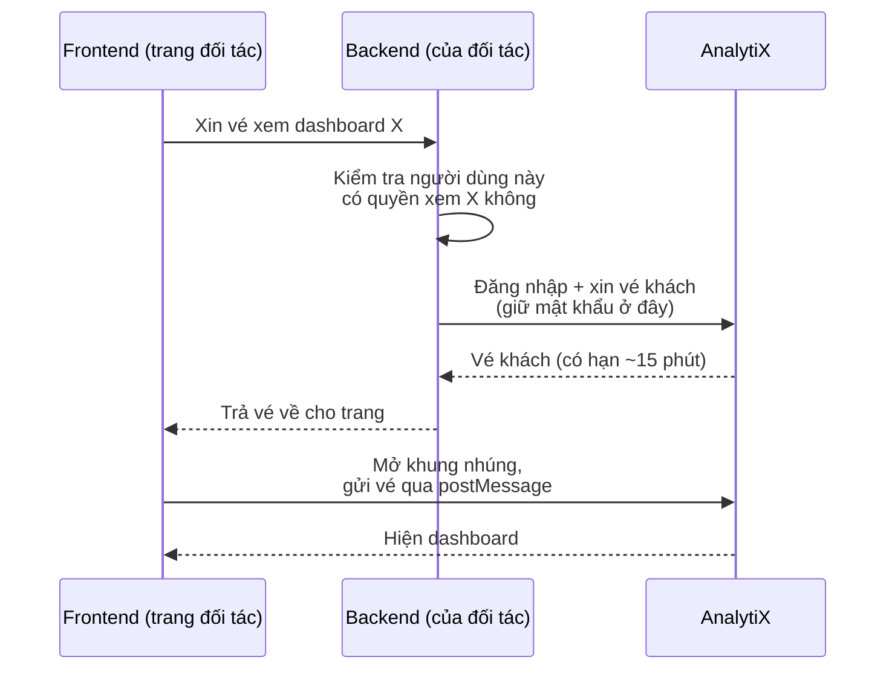

# Vì sao nhúng dashboard cần vé khách, không thể chỉ dán UUID

Khi bật chế độ nhúng cho một dashboard, AnalytiX cấp một **UUID** (mã định
danh nhúng). Phản xạ tự nhiên là dán thẳng UUID đó vào một `iframe` rồi
xong — nhưng cách đó **không hoạt động**.

## Câu trả lời ngắn

**Không dán được UUID thẳng vào `iframe src`.** Đường dẫn dạng
`/embedded/<uuid>` không nhận phiên đăng nhập qua cookie thông thường; nó mở
ra một khung **rỗng**, rồi đứng chờ một **vé khách** (guest token) được gửi
vào từ bên ngoài qua cơ chế `postMessage` của trình duyệt. Mở thẳng địa chỉ
đó — kể cả bằng trình duyệt thật, kể cả bằng `curl` — chỉ trả về một khung
HTML rỗng, không có cách nào bỏ qua bước này.

Có hai cách nhúng khác nhau, và không trộn lẫn được:

| | Nhúng bằng iframe thường | Nhúng bằng SDK + vé khách |
|---|---|---|
| Dùng UUID? | Không | Có |
| Người xem cần gì | Phiên đăng nhập sẵn có, hoặc vai trò đọc công khai | Không cần đăng nhập — ứng dụng tự cấp vé |
| Cần lập trình phía bạn? | Không, chỉ một thẻ HTML | Có — một endpoint phía máy chủ của bạn, cộng vài dòng JavaScript |
| Phân quyền theo từng người xem | Không làm được | Làm được |
| Phù hợp khi | Dùng nội bộ, không cần phân quyền chi tiết | Nhúng cho nhiều khách hàng/đối tác, dữ liệu cần phân quyền |

## Kiến trúc: ba bên, không bên nào bỏ qua được

**Điểm quan trọng nhất, và hay bị làm sai nhất: frontend gọi backend của
chính nó, không bao giờ gọi thẳng sang AnalytiX.** Hai lý do, cả hai đều là rào
chắn kỹ thuật thật sự, không phải quy ước có thể lách:

1. **AnalytiX không trả header CORS cho endpoint xin vé.** Một yêu cầu
   `OPTIONS` gửi thẳng từ JavaScript chạy trong trình duyệt sẽ bị trình
   duyệt tự chặn trước khi tới được máy chủ — đây là cơ chế bảo vệ chuẩn của
   mọi trình duyệt hiện đại (same-origin policy), không phải lỗi cấu hình
   cần "sửa".
2. **Mật khẩu/tài khoản xin vé phải nằm ở máy chủ, không được lộ ra trình
   duyệt.** Gọi thẳng từ frontend nghĩa là nhúng thông tin đăng nhập vào mã
   nguồn mà bất kỳ ai mở DevTools cũng đọc được.

Vì hai rào chắn này luôn đúng, nên **phải có một dịch vụ cấp vé phía máy chủ
của bên nhúng** — không có cách tắt nào bỏ qua được bước đó.

## Vé mang theo quyền, không chỉ một định danh

Nội dung vé khách gồm **ai đang xem** và **được xem tài nguyên nào** — hai
thông tin này do bên xin vé tự khai khi gọi, AnalytiX chỉ ký xác nhận chứ không
tự biết ai đang đăng nhập ở phía đối tác. Hệ quả: **nơi đặt luật phân quyền
đúng là dịch vụ cấp vé phía đối tác**, không phải phía AnalytiX — AnalytiX chỉ
thực thi đúng những gì vé đã khai, không kiểm tra lại danh tính người xem
thật.

Vé có thời hạn ngắn (thường vài trăm giây tới vài chục phút, tuỳ cấu hình),
nên ứng dụng nhúng phải tự xin vé mới khi vé cũ sắp hết hạn — không có vé
"dùng một lần cho mãi mãi".

Cách triển khai cụ thể (endpoint mẫu, mã nguồn, tham số) xem ở
**Cách làm → Nhúng dashboard qua SDK cho đối tác ngoài**.
