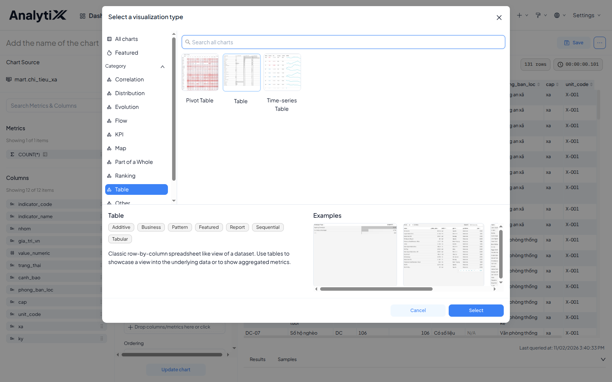
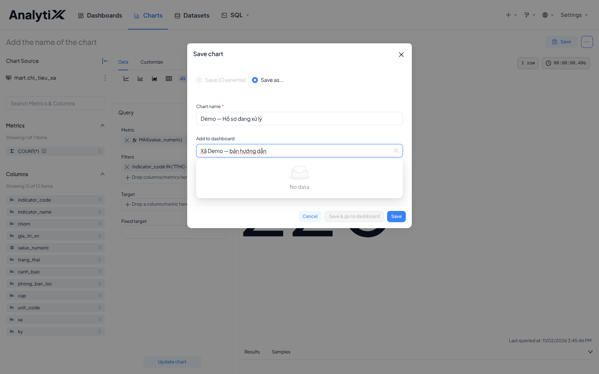
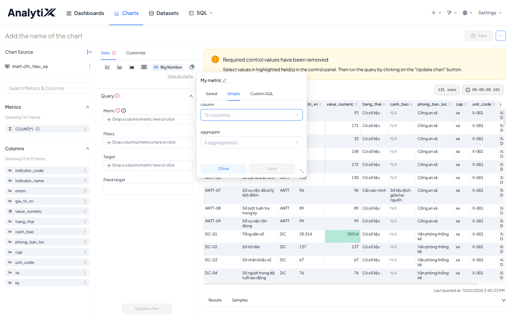
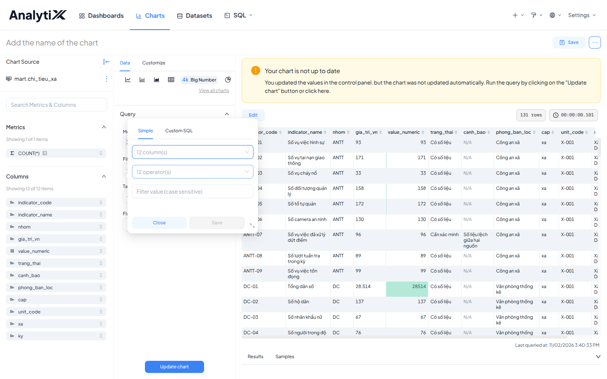
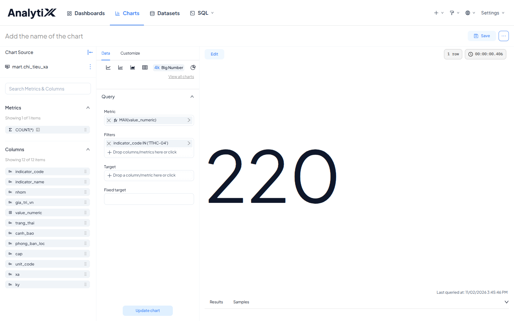
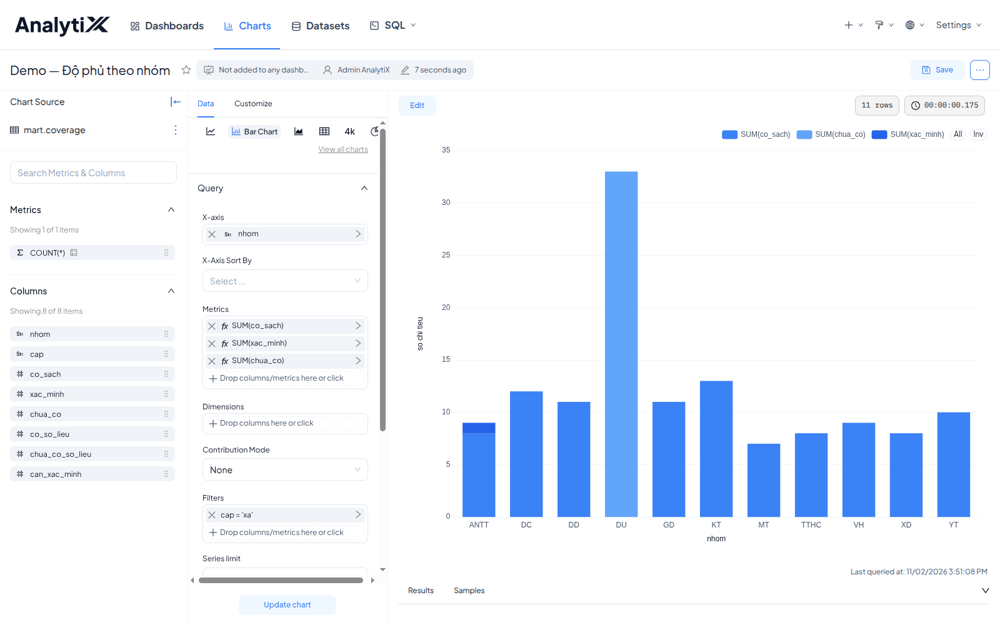
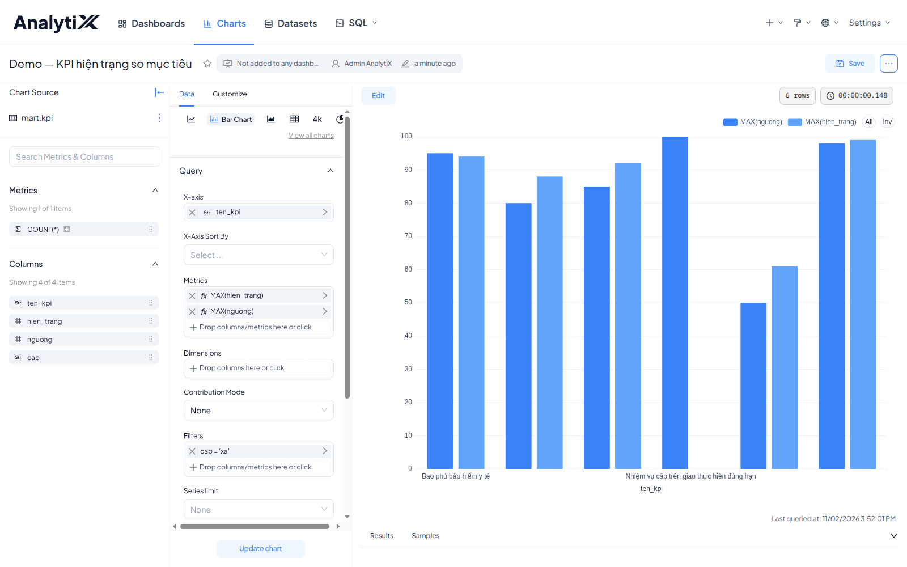
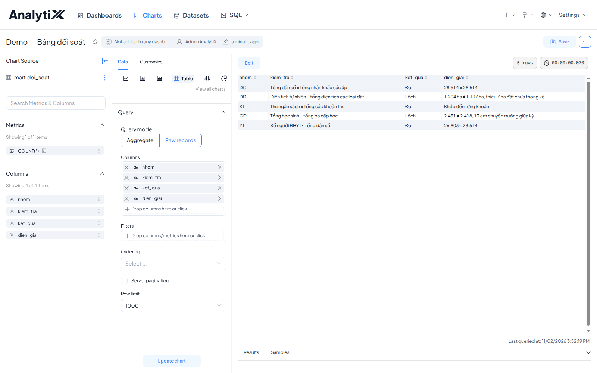

# Tạo biểu đồ

Trang này dựng một biểu đồ từ dataset đã có: chọn loại, khai dữ liệu, lưu lại. Biểu đồ chỉ đọc
dataset, không đọc thẳng database — chưa có dataset thì sang [Tạo dataset](../dataset/tao-dataset.md)
trước. Cần bố cục không loại nào có sẵn thì không dùng cách này, xem
[Dựng biểu đồ tuỳ chỉnh](./bieu-do-tuy-chinh-html.md).

Dành cho người làm báo cáo. Cần có trước: một dataset đã lưu, và quyền đọc dataset đó.

## Chọn loại biểu đồ theo việc

Bốn loại là bốn cách AnalytiX đòi khai dữ liệu. Nắm đủ bốn thì loại thứ năm tự suy ra được.

| Cần gì | Loại | Khai cái gì |
|---|---|---|
| Một con số duy nhất | **Big Number** | Một metric + bộ lọc thu kết quả về một dòng |
| So nhiều nhóm, mỗi nhóm nhiều thành phần | **Bar Chart** nhiều chuỗi | Một X-axis + nhiều metric |
| So hiện trạng với mục tiêu | **Bar Chart** hai chuỗi | Hai metric trên cùng một trục |
| Xem nguyên dòng dữ liệu | **Table** (Raw records) | Chọn cột, không tính toán |

## Các bước

Đường đi giống nhau cho mọi loại biểu đồ.

1. Mở màn **Explore**: bấm tên dataset ở **Datasets**, hoặc **Save & Explore** trong SQL Lab.
2. Bấm **View all charts** dưới hàng icon loại biểu đồ.
3. **Gõ tên loại vào ô tìm kiếm** thay vì lần theo danh mục — nhanh hơn nhiều. Chọn loại
   rồi bấm nút chọn.
4. Khai các ô bắt buộc ở panel giữa — xem mục tương ứng bên dưới.
5. Bấm **Create chart**. Nút còn mờ là còn ô bắt buộc chưa khai; ô đó có dấu chấm than đỏ.
6. Bấm **Save** ở góc trên phải, đặt tên vào ô **Chart name**, bấm **Save**.





**Ô `Add to dashboard` chỉ chọn được dashboard đã tồn tại.** Ở bản 6.1.0 nó không còn tạo
dashboard mới từ tên bạn gõ — gõ tên chưa có thì danh sách trả về `No data`. Lưu biểu đồ trước,
dựng dashboard sau rồi gắn vào: [Xếp biểu đồ thành dashboard](../dashboard/xep-bieu-do-thanh-dashboard.md).

### Ba tab khai metric



| Tab | Khi nào dùng |
|---|---|
| **Saved** | Metric đã khai sẵn ở tầng dataset, dùng lại cho nhiều biểu đồ |
| **Simple** | Một cột cộng một phép tổng hợp. Dùng cho hầu hết trường hợp |
| **Custom SQL** | Công thức riêng, ví dụ `SUM(a) / NULLIF(SUM(b), 0)` |

### Khai cho Big Number

Một metric, một bộ lọc. Ví dụ với dataset chỉ tiêu:

```
Metric     MAX(value_numeric)
Filters    indicator_code IN TTHC-04
```





> **Dùng `MAX` chứ không dùng `SUM`.** Lọc còn đúng một dòng thì `MAX`, `MIN`, `SUM`, `AVG`
> đều ra cùng kết quả. Nhưng bộ lọc hụt, còn hai dòng, thì `SUM` cộng chúng lại và cho một con
> số sai mà trông vẫn hợp lý. `MAX` thì không — nó vẫn trả về một giá trị thật có trong dữ liệu.

### Khai cho Bar Chart nhiều chuỗi

Một cột làm trục ngang, mỗi thành phần một metric — ba metric thêm lần lượt, mỗi lần mở lại
ô **Metrics**. Ví dụ với dataset độ phủ:

```
X-axis     nhom
Metrics    SUM(co_sach)     SUM(xac_minh)     SUM(chua_co)
Filters    cap = 'xa'
```



:::warning Kiểm các chuỗi có chồng lấn nhau không
`co_sach`, `xac_minh`, `chua_co` rời nhau và cộng lại đúng bằng tổng số chỉ tiêu của nhóm —
xếp chồng được. Đừng thay bằng `co_so_lieu`, `chua_co_so_lieu`, `can_xac_minh`: ba cột đó
chồng lấn, vì một chỉ tiêu bị gắn cờ thường vẫn có giá trị, nên biểu đồ vẽ ra tổng lớn hơn số
thật. Dữ liệu của bạn kiểm cùng cách: tổng các chuỗi phải bằng con số bạn biết là tổng.
:::

### Khai cho Bar Chart hai chuỗi so sánh

Cùng loại **Bar Chart**, nhưng hai metric trên một trục. Ví dụ với dataset KPI:

```
X-axis     ten_kpi
Metrics    MAX(hien_trang)     MAX(nguong)
Filters    cap = 'xa'
```



Mỗi mục hai cột cạnh nhau. Cột hiện trạng thấp hơn cột mục tiêu là mục chưa đạt.

> **Radar Chart không dùng được cho việc này.** AnalytiX đọc Radar ngược với trực giác:
> **Metrics là các trục**, **Dimensions là các đường**. Khai `ten_kpi` làm Dimension và hai
> metric thì được sáu đường trên hai trục; muốn radar sáu trục KPI phải khai sáu metric riêng,
> mỗi metric một câu `CASE WHEN`.

### Khai cho Table (Raw records)

Chọn loại **Table**, chuyển **Query mode** sang **Raw records**, rồi thả các cột cần xem
vào ô **Columns**:

```
Query mode    Raw records
Columns       nhom     kiem_tra     ket_qua     dien_giai
```



**`Aggregate` hay `Raw records`.** *Aggregate* nhóm dữ liệu rồi tính — dùng khi cần tổng,
trung bình, đếm. *Raw records* hiện nguyên dòng — dùng khi dữ liệu đã ở đúng mức chi tiết cần
xem. Chọn sai chế độ là nguyên nhân phổ biến nhất khiến bảng ra một dòng duy nhất, hoặc ra
số liệu cộng dồn vô nghĩa.

## Kiểm tra là đã đúng

Nhìn số `N rows` ở góc phải màn **Explore** — nó nói ngay biểu đồ có khai đúng hay không.

| Biểu đồ | Phải thấy |
|---|---|
| Big Number | `1 row`, và con số đúng bằng giá trị trong dữ liệu (ví dụ demo: `220`) |
| Bar Chart nhiều chuỗi | Số dòng bằng số nhóm trên trục (ví dụ demo: `11 rows`, 11 cột nhóm, ba chuỗi) |
| Bar Chart hai chuỗi | Mỗi mục đúng hai cột cạnh nhau |
| Table (Raw records) | Đủ số dòng có trong dữ liệu (ví dụ demo: 5 dòng, ba **Đạt** hai **Lệch**) |

## Lỗi hay gặp

| Hiện tượng | Nguyên nhân | Cách sửa |
|---|---|---|
| `DB engine Error` không nói gì thêm | Bộ lọc được lưu khi chưa chọn giá trị | Xoá bộ lọc, làm lại, kiểm có giá trị trước khi bấm Save |
| Big Number ra số lạ | Bộ lọc chưa thu về một dòng | Xem `N rows` ở góc phải; phải là `1 row` |
| Biểu đồ cột chỉ có một cột | Quên khai X-axis | Thả một cột vào ô **X-axis** |
| Bảng ra đúng một dòng | `Query mode` đang là **Aggregate** | Chuyển sang **Raw records** |
| Tổng cột chồng lớn hơn số thật | Dùng các cột chồng lấn nhau | Dùng `co_sach` + `xac_minh` + `chua_co` |
| Nút **Create chart** mờ | Thiếu một ô bắt buộc, có dấu chấm than đỏ | Tìm ô có dấu chấm than trong panel giữa |

## Liên quan

- [Tạo dataset](../dataset/tao-dataset.md)
- [Xếp biểu đồ thành dashboard](../dashboard/xep-bieu-do-thanh-dashboard.md)
- [Dựng biểu đồ tuỳ chỉnh bằng HTML trong SQL](./bieu-do-tuy-chinh-html.md)
- [Lỗi theo bước](../../reference/loi-theo-buoc.md)
- [Từ database tới biểu đồ](../../tutorials/tu-database-toi-bieu-do.md)
