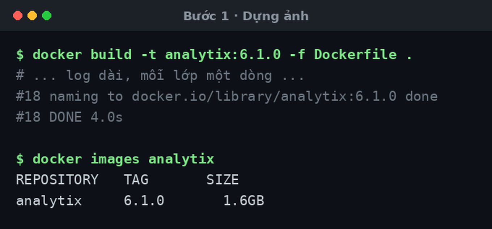
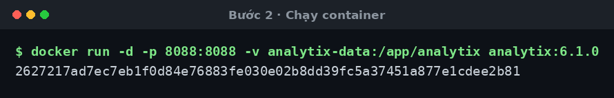
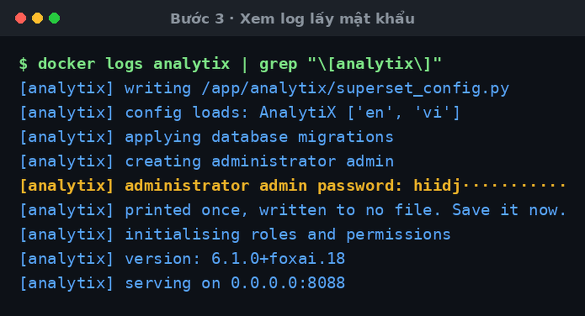
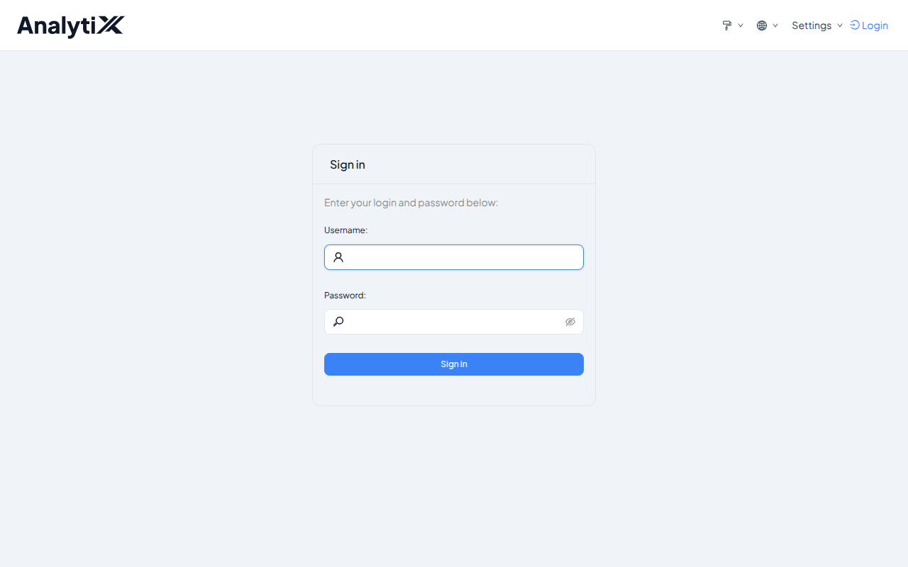
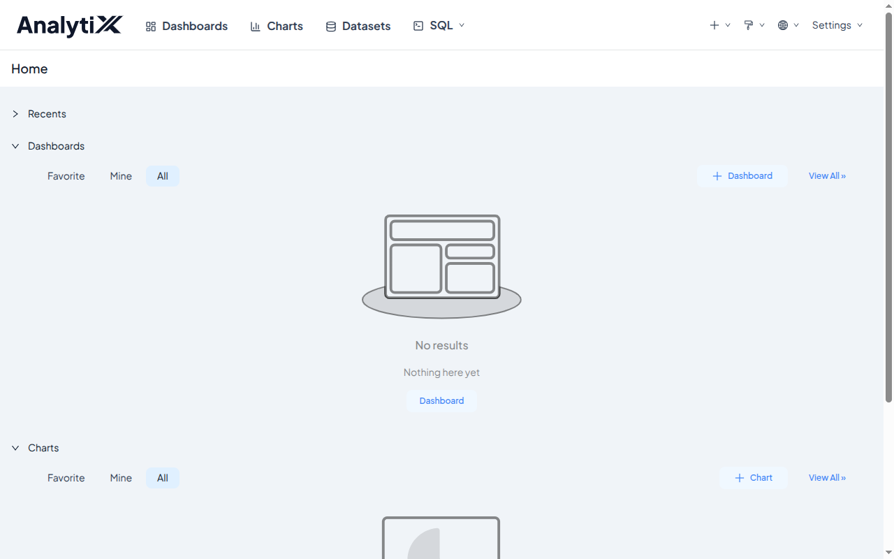

# Cài bằng Docker

Dựng ảnh container từ bản đóng gói và chạy. Không cần Python trên máy đích.

Dành cho người quản trị. Cần có trước: Docker, và bản đóng gói
`analytix-<bản>` (thư mục đã giải nén — nó chính là build context).

Chưa cài lần nào thì đi [Cài AnalytiX lần đầu](../tutorials/cai-dat-analytix.md)
trước; trang này là bản tra cứu nhanh và các tình huống lệch khỏi đường thẳng.

## Các bước

### 1 · Dựng ảnh từ thư mục bundle

```bash
cd analytix-<bản>
docker build -t analytix:<bản> -f Dockerfile .
```

Thư mục bundle **là** build context — `Dockerfile` `COPY` wheel, `requirements/`,
`superset-core/`, `workspace_x_theme.py` và `entrypoint.sh` từ chính nó. Dựng từ
chỗ khác sẽ thiếu tệp.



### 2 · Chạy container

```bash
docker run -d --name analytix \
  -p 8088:8088 \
  -v analytix-data:/app/analytix \
  analytix:<bản>
```

Docker in ra mã container rồi trả lại dấu nhắc ngay — ứng dụng khởi tạo ở phía sau.



### 3 · Lấy mật khẩu từ log

```bash
docker logs analytix | grep '\[analytix\]'
```



:::danger[Mật khẩu chỉ in một lần]
Nó nằm trong log của lần khởi tạo đầu tiên. `docker logs` còn đọc lại được tới
khi nào container chưa bị xoá — nhưng đừng dựa vào đó, lưu ngay.
:::

### 4 · Mở `http://127.0.0.1:8088`



### 5 · Đăng nhập rồi đổi mật khẩu

Tài khoản `admin`. Vào xong: **Settings** → **Info** → **Reset my password**.



## Biến môi trường

| Biến | Mặc định | Ghi chú |
|:---|:---|:---|
| `ANALYTIX_ADMIN_USER` | `admin` | |
| `ANALYTIX_ADMIN_PASSWORD` | *sinh ngẫu nhiên, in một lần* | Đặt tay thì nó nằm trong lịch sử shell |
| `ANALYTIX_PORT` | `8088` | **Đọc kỹ cảnh báo dưới** |
| `ANALYTIX_SECRET_KEY` | *sinh ngẫu nhiên lần chạy đầu* | Chỉ có ở đường container |
| `ANALYTIX_HOME` | `/app/analytix` | Đổi thì phải gắn volume theo đường dẫn mới |

Bảng đầy đủ: [Biến môi trường](../reference/bien-moi-truong.md).

:::danger[Đổi `ANALYTIX_PORT` làm healthcheck báo sai]
Healthcheck trong ảnh **ghim cứng** `http://127.0.0.1:8088/health`. Đổi
`ANALYTIX_PORT` sang cổng khác thì ứng dụng chạy đúng nhưng Docker báo
`unhealthy` mãi.

Muốn đổi cổng phía ngoài thì đổi phần ánh xạ, **đừng** đổi cổng bên trong:

```bash
docker run -p 9000:8088 ...        # đúng
docker run -p 9000:9000 -e ANALYTIX_PORT=9000 ...   # sẽ báo unhealthy
```
:::

## Giữ dữ liệu qua lần chạy sau

Ảnh **không khai báo `VOLUME`**. Không gắn volume thì mỗi lần `docker rm` là mất
cả database metadata, tài khoản, **và khoá bí mật** — mất khoá nghĩa là mọi
session và mọi dashboard đã nhúng đều hỏng.

```bash
-v analytix-data:/app/analytix
```

Thư mục đó chứa `superset.db`, `superset_config.py` (có khoá bí mật) và
`workspace_x_theme.py`.

## Kiểm tra là đã đúng

```bash
docker ps --filter name=analytix --format '{{.Status}}'      # mong: Up ... (healthy)
curl -fsS http://127.0.0.1:8088/health                        # mong: OK
```

Mở trang và xác nhận góc trên trái là chữ **AnalytiX**. Thấy "Superset" tức
theme chưa nạp — và entrypoint lẽ ra đã phải dừng với lỗi, nên đó là dấu hiệu ảnh
được dựng sai.

## Lỗi hay gặp

| Hiện tượng | Nguyên nhân | Cách sửa |
|:---|:---|:---|
| Build hỏng ở `cachelib ... != pin` | Bộ giải phụ thuộc đã ghi đè một phiên bản đã ghim | Bản đóng gói sai hoặc `requirements/base.txt` bị sửa. Đóng gói lại, đừng cố cài tiếp |
| Build hỏng `ModuleNotFoundError: No module named 'superset_core'` | Build context thiếu thư mục `superset-core/` | Dựng từ **trong** thư mục bundle |
| Container khởi động rồi thoát, log có `theme module missing` | `workspace_x_theme.py` không có trong `/app/analytix` | Ảnh dựng sai — dựng lại từ bundle đầy đủ |
| `docker ps` mãi `unhealthy` nhưng web mở được | Đã đổi `ANALYTIX_PORT` | Giữ cổng trong là 8088, chỉ đổi ánh xạ ngoài |
| Chạy lại thì mất tài khoản và dữ liệu | Không gắn volume | Gắn `-v ... :/app/analytix` và cài lại |
| Không thấy dòng mật khẩu trong log | Tài khoản đã tồn tại từ lần chạy trước | Đặt lại bằng `docker exec analytix superset fab reset-password --username admin` |
| Nối database bên ngoài báo thiếu driver | Chỉ SQLite có sẵn | [Thêm driver cho nguồn dữ liệu](./them-driver-du-lieu.md) |

## Hai điều phải biết

**Container chạy bằng `root`.** Ảnh không có chỉ thị `USER`. Đưa ra môi trường
thật thì nên chạy với user thường và chỉ cấp quyền ghi vào `/app/analytix`.

**Bên trong nghe `0.0.0.0`.** Đó là điều kiện để `-p` hoạt động, và biên bảo mật
là ranh giới container chứ không phải địa chỉ nghe. Ánh xạ ra ngoài thì cân nhắc
`-p 127.0.0.1:8088:8088` để chỉ máy đó vào được.

## Liên quan

- [Cài AnalytiX lần đầu](../tutorials/cai-dat-analytix.md)
- [Cài thực trên máy](./cai-dat-tren-may.md) — đường không dùng Docker
- [Thêm driver cho nguồn dữ liệu](./them-driver-du-lieu.md)
- [Biến môi trường](../reference/bien-moi-truong.md)
- [Vì sao bản cài chưa sẵn sàng cho môi trường thật](../explanation/chua-san-sang-cho-production.md)
