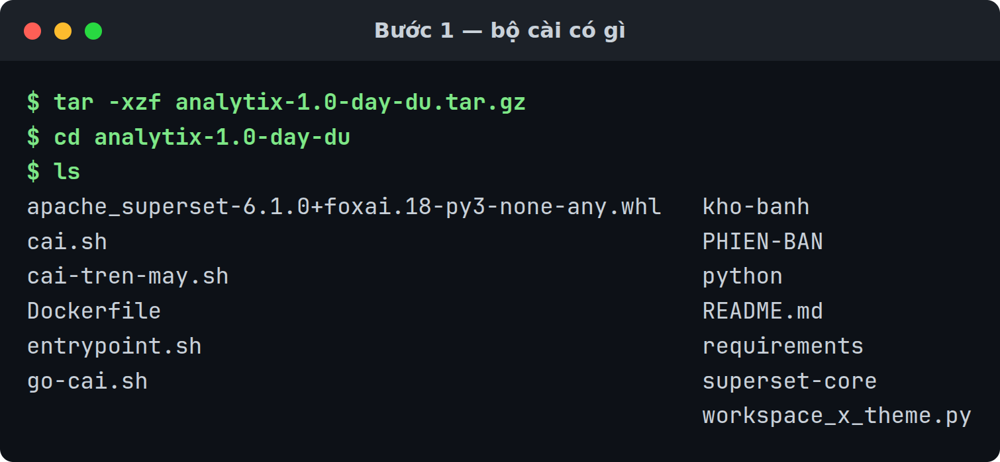
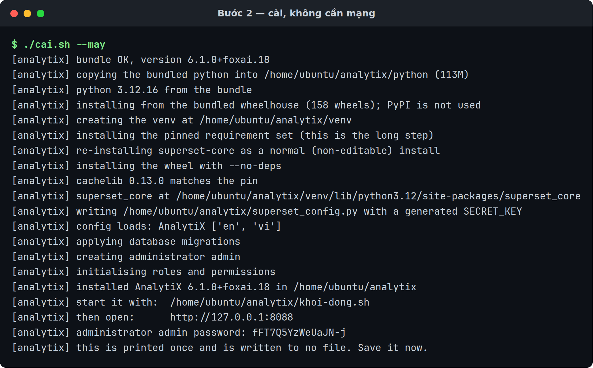
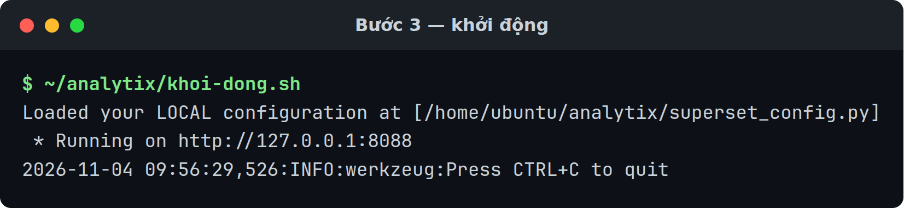
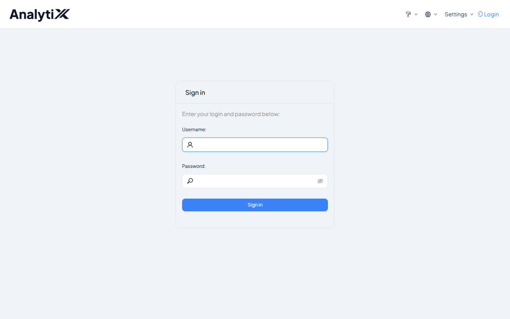
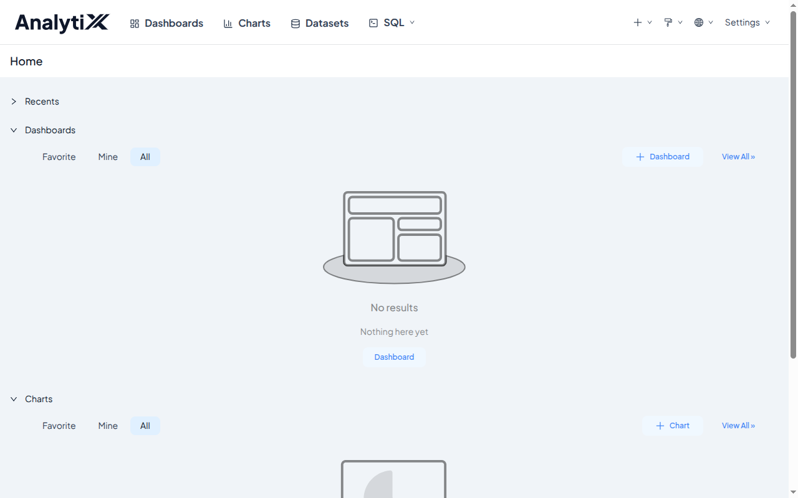
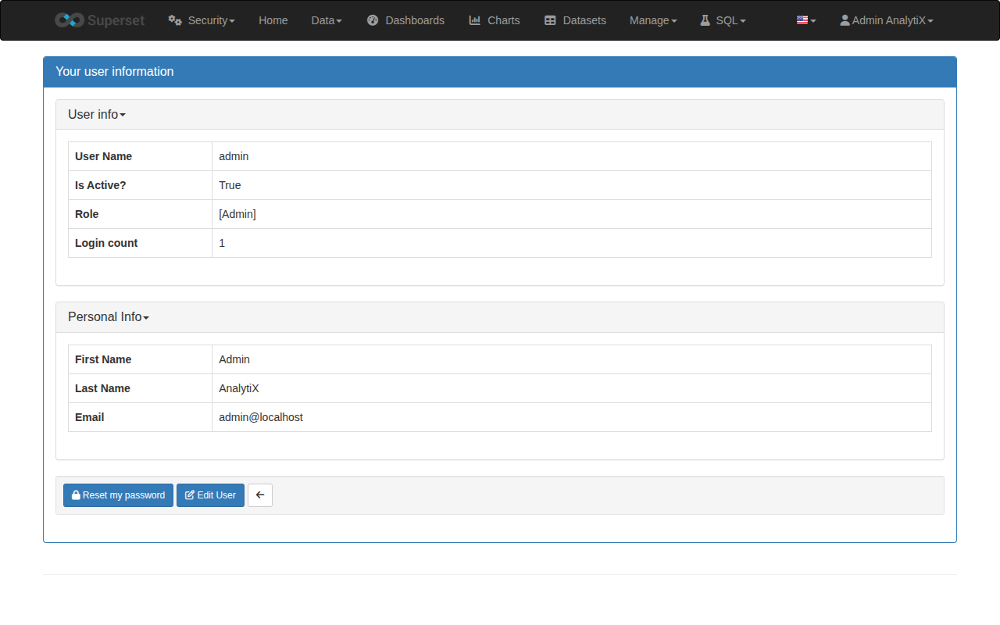
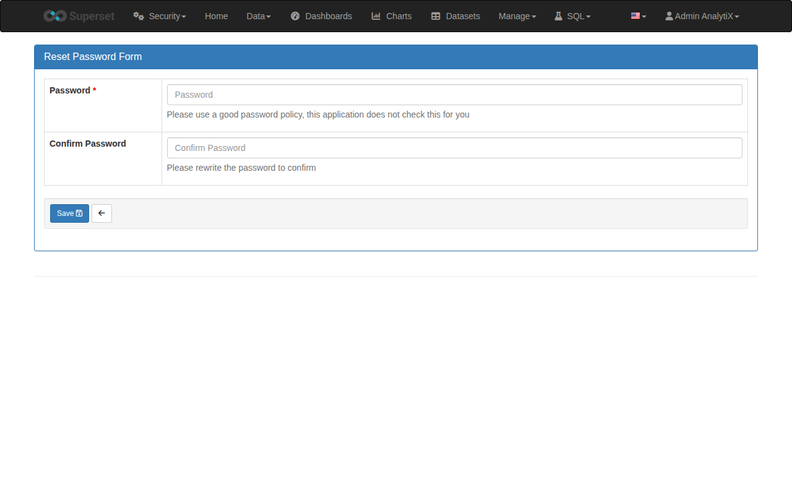
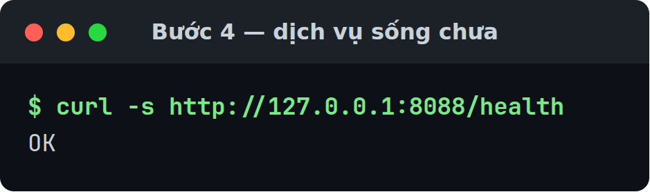
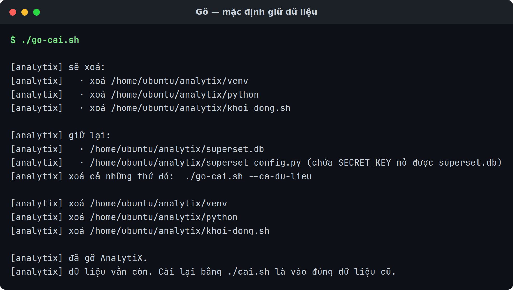

# Cài thực trên máy

Cài AnalytiX vào một môi trường ảo Python trên chính máy đó, không qua Docker.

Dành cho người quản trị. Thứ duy nhất bạn cần chuẩn bị là **bản đóng gói đã
giải nén** — không phải cài sẵn gì trên máy.

Có hai kiểu bản đóng gói, và chúng đòi hỏi khác hẳn nhau:

| Bản | Nặng | Máy đích cần gì |
|:---|:---|:---|
| **Đầy đủ** `analytix-<bản>-day-du` | ~274 MB | **Không cần gì.** Mang sẵn Python 3.12.16 và cả 158 gói đã ghim |
| Thường `analytix-<bản>` | ~105 MB | Python 3.10/3.11/3.12, gói `python3-venv`, và mạng ra PyPI |

Bản đầy đủ cài được trên máy **chưa có Python và không có mạng**: giải nén rồi
chạy, hết. Nó chở theo cây Python của riêng nó nên cũng không đụng tới Python
của hệ điều hành, và không cần gói `python3-venv` mà Debian/Ubuntu tách riêng.

Không cần `sudo` ở cả hai bản: mọi thứ nằm trong thư mục của bạn.

Chưa có bản đóng gói thì dựng nó trước — [Đóng gói bản phát
hành](./dong-goi-ban-phat-hanh.md):

```bash
bo-cai/dong-goi.sh --day-du <đường-dẫn-tới-wheel>   # bản đầy đủ
bo-cai/dong-goi.sh          <đường-dẫn-tới-wheel>   # bản thường
```

Kết quả nằm ở `/var/tmp/analytix-ban-phat-hanh/`: một thư mục và một bản nén
`.tar.gz` của chính thư mục đó.

:::warning[Bản đầy đủ khoá vào một kiến trúc CPU]
Cây Python đi kèm được dựng cho kiến trúc của máy đóng gói. Đóng gói trên
`x86_64` thì chỉ cài được lên `x86_64`. Máy đích khác kiến trúc thì phải đóng
gói lại trên đúng kiến trúc đó.
:::

:::tip[Chỉ muốn nó chạy thì có đường ngắn hơn]
`./cai.sh --may` làm đúng mọi bước trang này mô tả, trong một lệnh, rồi khởi
động luôn. Xem [Bắt đầu nhanh](../tutorials/cai-dat-analytix.md).

Trang này dành cho khi bạn cần biết từng bước làm gì — để sửa khi nó hỏng, hoặc
để đổi một tham số mà `cai.sh` không mở ra.
:::

## Các bước

### 1 · Giải nén bản đóng gói

```bash
tar xzf analytix-<bản>.tar.gz
cd analytix-<bản>
```

Bản đầy đủ có **mười ba** mục; bản thường có mười một, thiếu `python/` và
`kho-banh/`. Thiếu mục nào khác thì bộ cài dừng ngay ở bước sau và nói thiếu gì.



Hai mục chỉ bản đầy đủ mới có:

| Mục | Là gì |
|:---|:---|
| `python/` | Cây CPython 3.12.16 chạy được ngay, mang sẵn `venv`, `ssl`, `sqlite3` |
| `kho-banh/` | 158 gói đã ghim, dạng wheel — pip cài từ đây, không đụng PyPI |

### 2 · Chạy bộ cài

```bash
./cai-tren-may.sh
```

Bộ cài tự làm sáu việc: kiểm bản đóng gói, chọn trình thông dịch, dựng venv và
cài **đúng thứ tự**, viết cấu hình, tạo database và tài khoản quản trị, rồi viết
script khởi động.



Bốn dòng đáng nhìn:

| Dòng | Nó chứng minh gì |
|:---|:---|
| `python 3.12.16 from the bundle` | Dùng Python đi kèm, không phải Python của máy |
| `installing from the bundled wheelhouse (158 wheels); PyPI is not used` | Không một lần ra mạng |
| `cachelib 0.13.0 matches the pin` | Thứ tự cài đúng — xem *Lỗi hay gặp* nếu dòng này khác |
| `config loads: AnalytiX ['en', 'vi']` | Theme nạp được |

Dòng đầu tiên, `copying the bundled python into ...`, chép khoảng 113 MB. Nó cố
ý: venv ghi lại đường dẫn trình thông dịch đã tạo ra nó, nên nếu dựng thẳng từ
thư mục bộ cài thì xoá thư mục đó đi là bản cài chết. Chép vào trước rồi mới
dựng venv thì bộ cài là thứ dùng xong vứt được.

Trên **bản thường** hai dòng đầu khác đi: nó báo `python 3.12 from the machine`,
không có dòng kho wheel, và bước cài bộ pin tải từ PyPI nên lâu hơn nhiều.

### 3 · Khởi động

```bash
~/analytix/khoi-dong.sh
```



Nó chạy ở tiền cảnh và giữ cửa sổ này. Mở cửa sổ thứ hai để làm tiếp.

### 4 · Mở địa chỉ nó in ra



### 5 · Đăng nhập

Tài khoản `admin`, mật khẩu ở Bước 2.



### 6 · Đổi mật khẩu

Menu **Settings** → **Info** → nút **Reset my password**.





Phải vào từ nút, **đừng gõ thẳng URL** — gõ `/resetmypassword/form` vào thanh
địa chỉ sẽ ra `Access is Denied`.

Hai trang trên chưa mang thương hiệu: chúng vẫn hiện logo và chữ *Superset* —
giao diện quản trị kế thừa, bộ vá thương hiệu chưa phủ tới. Chức năng không ảnh
hưởng.

## Chọn chỗ cài và tài khoản

Đặt biến **trước** khi chạy:

```bash
ANALYTIX_HOME=/opt/analytix \
ANALYTIX_ADMIN_USER=quantri \
ANALYTIX_PORT=9000 \
PYTHON=python3.12 \
./cai-tren-may.sh
```

| Biến | Mặc định |
|:---|:---|
| `ANALYTIX_HOME` | `$HOME/analytix` |
| `ANALYTIX_ADMIN_USER` | `admin` |
| `ANALYTIX_ADMIN_PASSWORD` | *sinh ngẫu nhiên, in một lần* |
| `ANALYTIX_PORT` | `8088` |
| `PYTHON` | `python3` |

`ANALYTIX_BIND` **không** dùng lúc cài — nó chỉ được `khoi-dong.sh` đọc, xem phần
dưới. Bảng đầy đủ: [Biến môi trường](../reference/bien-moi-truong.md).

:::danger[Mật khẩu in một lần, không ghi vào tệp nào]
Dòng cuối của bộ cài:

```
[analytix] administrator admin password: <chuỗi>
[analytix] this is printed once and is written to no file. Save it now.
```

Lưu ngay. Mất thì đặt lại bằng:

```bash
~/analytix/venv/bin/superset fab reset-password --username admin
```

Không có tài khoản mặc định nào — đây là chủ ý của sản phẩm, không phải thiếu sót.
:::

## Cài vào đâu

| Đường dẫn | Là gì |
|:---|:---|
| `$ANALYTIX_HOME/venv/` | môi trường ảo Python |
| `$ANALYTIX_HOME/superset_config.py` | cấu hình, **quyền 600**, chứa khoá bí mật |
| `$ANALYTIX_HOME/workspace_x_theme.py` | theme — cấu hình `exec()` tệp này |
| `$ANALYTIX_HOME/superset.db` | database metadata (SQLite) |
| `$ANALYTIX_HOME/khoi-dong.sh` | script khởi động |

Theme là tệp thứ hai, không nằm trong wheel: `superset_config.py` có dòng
`exec(open(.../workspace_x_theme.py).read())`. Nghĩa là **xoá tệp theme là mất
thương hiệu** và AnalytiX trở lại thành Superset. Hai tệp phải đi cùng nhau.

## Cho máy khác truy cập

`khoi-dong.sh` mặc định nghe `127.0.0.1` — chỉ chính máy đó vào được. Mở ra mạng:

```bash
ANALYTIX_BIND=0.0.0.0 ~/analytix/khoi-dong.sh
```

:::danger[Đổi mật khẩu quản trị TRƯỚC khi mở ra mạng]
Và biết rằng bạn đang mở một web server dành cho phát triển, không có HTTPS. Xem
[Vì sao bản cài chưa sẵn sàng cho môi trường thật](../explanation/chua-san-sang-cho-production.md).
:::

## Kiểm tra là đã đúng

Bộ cài tự in ba dòng xác nhận trong lúc chạy:

```
[analytix] bundle OK, version 6.1.0+foxai.18
[analytix] config loads: AnalytiX ['en', 'vi']
[analytix] installed AnalytiX 6.1.0+foxai.18 in /home/<bạn>/analytix
```

Dòng giữa là dòng quan trọng — nó chứng minh theme nạp được và tên sản phẩm đúng.

Số in ra ở hai dòng kia là **phiên bản kỹ thuật**, suy từ tên tệp wheel, nên nó
không trùng với phiên bản sản phẩm trên tên bản đóng gói (`analytix-1.0`). Cả hai
nằm cạnh nhau trong tệp `PHIEN-BAN`.

Rồi tự kiểm:

```bash
~/analytix/khoi-dong.sh &
sleep 15
curl -fsS http://127.0.0.1:8088/health          # mong: OK
```



Không có `sleep` thì `curl` thường chạy trước khi web server kịp mở cổng, và bạn
nhận một lỗi kết nối của chính mình chứ không phải lỗi của bản cài.

Với **bản đầy đủ** còn một phép thử đáng giá hơn: xoá hẳn thư mục bộ cài rồi
chạy lại. Bản cài phải sống tiếp, vì nó đã chép Python vào `$ANALYTIX_HOME`.

```bash
rm -rf ~/analytix-1.0-day-du
~/analytix/khoi-dong.sh &
sleep 15
curl -fsS http://127.0.0.1:8088/health          # vẫn phải là OK
```

## Cài lại lần nữa thì sao

Chạy `./cai-tren-may.sh` lần hai là **an toàn**:

- venv có rồi thì dùng lại, không dựng lại
- `superset_config.py` có rồi thì **giữ nguyên** — khoá bí mật không bị sinh lại
- tài khoản quản trị có rồi thì không tạo lại, không in mật khẩu mới
- `db upgrade` chạy lại, và nó vốn an toàn khi chạy nhiều lần

Nên nâng cấp lên bản mới chính là: giải nén bundle mới, chạy lại `./cai-tren-may.sh`
với cùng `ANALYTIX_HOME`.

## Gỡ ra khỏi máy

Đừng `rm -rf ~/analytix` — bundle có sẵn một lệnh gỡ:

```bash
./go-cai.sh                 # gỡ, GIỮ dữ liệu
./go-cai.sh --ca-du-lieu    # gỡ, xoá luôn dữ liệu
```

Nó in danh sách sắp xoá rồi hỏi `[y/N]`; không có bàn phím mà không có `-y` thì
nó dừng chứ không xoá.



| Trong `$ANALYTIX_HOME` | Mặc định | `--ca-du-lieu` |
|:---|:---|:---|
| `venv/` | xoá | xoá |
| `python/` (chỉ bản đầy đủ) | xoá | xoá |
| `khoi-dong.sh` | xoá | xoá |
| `superset.db` | **giữ** | xoá |
| `superset_config.py` | **giữ** | xoá |
| `workspace_x_theme.py` | **giữ** | xoá |

`python/` nằm ở cột xoá vì nó là phần chương trình, không phải dữ liệu của bạn.

`--ca-du-lieu` xoá cả thư mục `$ANALYTIX_HOME`.

Có tiến trình đang chạy từ `$ANALYTIX_HOME/venv` thì nó dừng tiến trình đó trước
khi xoá — không cần tự tắt.

Cùng một lệnh gỡ được cả ba đường cài: nó không có flag chọn đường, mà tự ngó
container `analytix`, volume `analytix-data`, ảnh `analytix:*` và thư mục
`$ANALYTIX_HOME`. Nên trên máy vừa có bản cài thực vừa có bản chạy bằng Docker,
`./go-cai.sh` xoá luôn container và ảnh — chỉ volume `analytix-data` là được giữ
tới khi có `--ca-du-lieu`. Danh sách nó in ra trước khi hỏi `[y/N]` là đúng
những gì nó sắp xoá; đọc danh sách đó, đừng gõ `y` theo phản xạ.

Hai tệp giữ lại phải giữ **cùng nhau**: `SECRET_KEY` trong `superset_config.py`
mã hoá mật khẩu các kết nối database đã lưu trong `superset.db`. Xoá một cái và
giữ cái kia thì những kết nối đó mở không ra nữa, và lỗi nổ ở lần cài sau.

Đặt `ANALYTIX_HOME` khi cài ở chỗ khác mặc định thì phải đặt lại lúc gỡ:

```bash
ANALYTIX_HOME=/opt/analytix ./go-cai.sh
```

Lúc gỡ, `ANALYTIX_HOME` phải là **đường dẫn tuyệt đối** — đường dẫn tương đối bị
từ chối thẳng. Script cũng từ chối khi nó trỏ vào `/` hoặc vào thư mục nhà, và
chỉ coi một thư mục là bản cài khi trong đó có `venv/bin/superset` hoặc
`superset_config.py`.

## Lỗi hay gặp

| Hiện tượng | Nguyên nhân | Cách sửa |
|:---|:---|:---|
| `python3 not found; set PYTHON to a 3.10, 3.11 or 3.12 interpreter` | Không có `python3` trong `PATH` | `PYTHON=/usr/bin/python3.12 ./cai-tren-may.sh` |
| `python 3.13 is not supported` | Bản Python ngoài khoảng được kiểm | Dùng 3.10, 3.11 hoặc 3.12. Bộ pin chỉ được chứng minh trên 3.10 và 3.12 |
| `no apache_superset-*.whl beside this script` | Chạy không đúng thư mục, hoặc bundle thiếu | `cd` vào thư mục bundle rồi chạy `./cai-tren-may.sh` |
| `cachelib is X but the pin is Y; the resolver overrode a pin` | Thứ tự cài bị phá | Đừng cài tiếp. Đóng gói lại — sai thứ tự làm `superset fab create-admin` hỏng về sau |
| Dừng ở bước cài gói, lỗi mạng | Không ra được PyPI | Bundle **không** mang theo gói. Cần mạng, hoặc dựng một kho gói nội bộ |
| `AssertionError` ở bước `config loads` | Theme không nạp được, hoặc tên/ngôn ngữ sai | Kiểm `workspace_x_theme.py` có trong bundle và đọc được |
| Nối database bên ngoài báo thiếu driver | Chỉ SQLite có sẵn | [Thêm driver cho nguồn dữ liệu](./them-driver-du-lieu.md) |
| Mất mật khẩu quản trị | Nó chỉ in một lần | `~/analytix/venv/bin/superset fab reset-password --username admin` |
| `./go-cai.sh` in `không tìm thấy gì để gỡ.` | Cài ở chỗ khác mặc định, hoặc thư mục đó không còn `venv/bin/superset` lẫn `superset_config.py` | Chỉ rõ chỗ cài: `ANALYTIX_HOME=/opt/analytix ./go-cai.sh`. Dòng `đã ngó:` ngay dưới cho biết nó vừa tìm ở đâu |
| `ANALYTIX_HOME phải là đường dẫn tuyệt đối, đang là '...'` | Gỡ với đường dẫn tương đối | Gõ đường dẫn tuyệt đối, ví dụ `/opt/analytix` |

## Những gì bộ cài KHÔNG tạo

Không có unit `systemd`, không nginx, không HTTPS, không Redis, không tiến trình
chạy việc nền, không tệp `.env`. Chỉ có `khoi-dong.sh`.

Muốn nó tự chạy lại sau khi khởi động máy thì phải tự viết unit `systemd` gọi
`khoi-dong.sh`.

## Liên quan

- [Cài bằng Docker](./cai-dat-bang-docker.md) — không cần Python trên máy đích
- [Thêm driver cho nguồn dữ liệu](./them-driver-du-lieu.md)
- [Đóng gói bản phát hành](./dong-goi-ban-phat-hanh.md)
- [Biến môi trường](../reference/bien-moi-truong.md)
- [Yêu cầu hệ thống](../reference/yeu-cau-he-thong.md)
