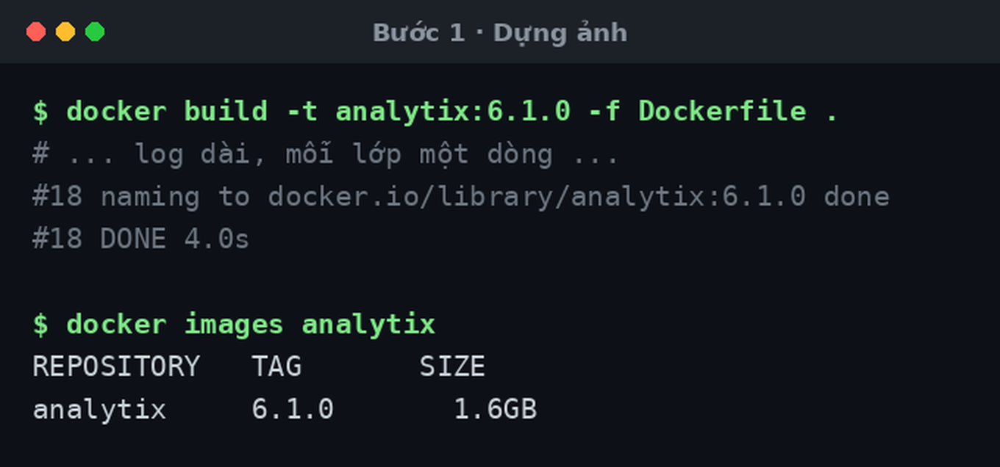
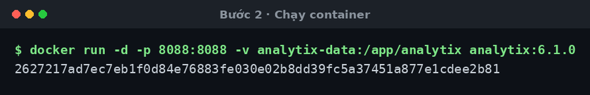
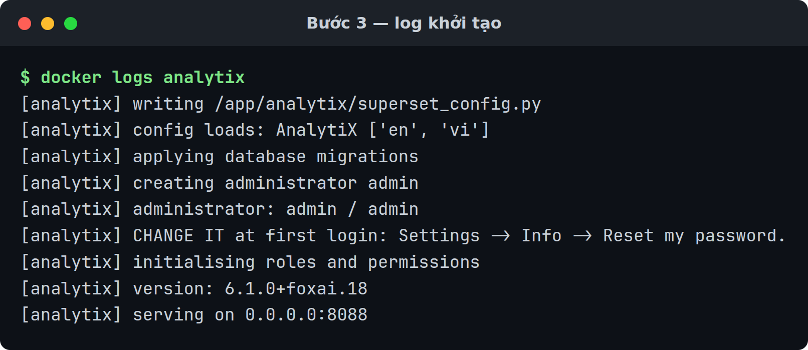
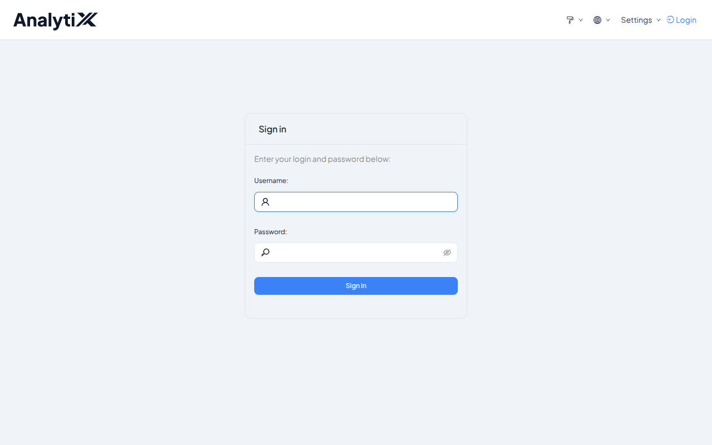
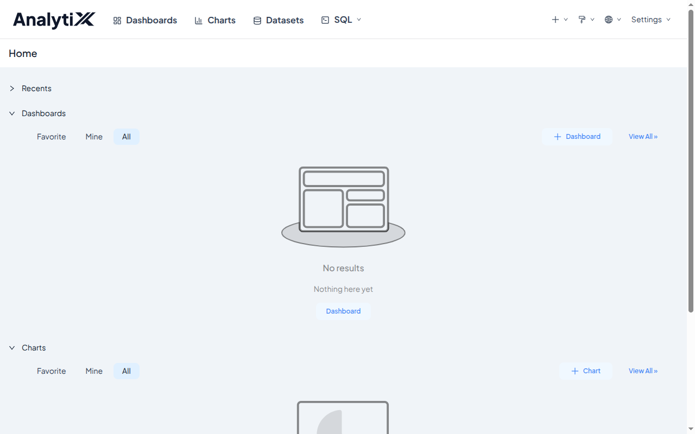

# Cài bằng Docker

Dựng ảnh container từ bản đóng gói và chạy. Không cần Python trên máy đích.

Dành cho người quản trị. Cần có trước: Docker, và bản đóng gói
`analytix-<bản>` (thư mục đã giải nén — nó chính là build context).

Chưa có bản đóng gói thì dựng nó trước — [Đóng gói bản phát
hành](./dong-goi-ban-phat-hanh.md). `bo-cai/dong-goi.sh` để kết quả ở
`/var/tmp/analytix-ban-phat-hanh/`: thư mục `analytix-<bản>/` và bản nén
`analytix-<bản>.tar.gz` (khoảng 105 MB) của chính thư mục đó.

:::tip[Chỉ muốn nó chạy thì có đường ngắn hơn]
`./cai.sh --docker` làm đúng mọi bước trang này mô tả, trong một lệnh: dựng ảnh,
tạo container, chờ healthy, in địa chỉ và tài khoản quản trị. Xem [Bắt đầu
nhanh](../../tutorials/cai-dat-analytix.md).

Trang này dành cho khi bạn cần biết từng bước làm gì — để sửa khi nó hỏng, hoặc
để đổi một tham số mà `cai.sh` không mở ra.
:::

Chưa cài lần nào thì đi [Cài AnalytiX lần đầu](../../tutorials/cai-dat-analytix.md)
trước; trang này là bản tra cứu nhanh và các tình huống lệch khỏi đường thẳng.

## Các bước

### 1 · Dựng ảnh từ thư mục bundle

```bash
cd analytix-<bản>
docker build -t analytix:<bản> -f Dockerfile .
```

Thư mục bundle **là** build context — `Dockerfile` `COPY` wheel, `requirements/`,
`superset-core/`, `workspace_x_theme.py` và `entrypoint.sh` từ chính nó. Dựng từ
chỗ khác sẽ thiếu tệp.

`<bản>` là dòng `ANALYTIX_VERSION=` trong tệp `PHIEN-BAN` của bundle — bản `1.0`
thì thẻ tag là `analytix:1.0`. Đó cũng là thẻ `./cai.sh --docker` tự suy ra, nên
dùng đúng nó thì sau này `./go-cai.sh` dọn được ảnh (nó tìm `analytix:*`). Thẻ
tag của Docker không chứa được dấu `+`, nên **đừng** lấy phiên bản kỹ thuật
`6.1.0+foxai.18` trong `PHIEN-BAN` làm thẻ tag.



### 2 · Chạy container

```bash
docker run -d --name analytix \
  -p 127.0.0.1:8088:8088 \
  -v analytix-data:/app/analytix \
  analytix:<bản>
```

`127.0.0.1` ở đầu phần ánh xạ là cố ý: tài khoản quản trị mặc định là `admin` /
`admin`, nên cổng chỉ nên mở trên chính máy đó. `-p 8088:8088` trần mở trên
**mọi** giao diện mạng của máy chủ. `./cai.sh` mặc định làm đúng như dòng trên,
và chỉ mở ra mạng khi bạn gõ rõ `ANALYTIX_BIND=0.0.0.0 ./cai.sh`.

Docker in ra mã container rồi trả lại dấu nhắc ngay — ứng dụng khởi tạo ở phía sau.



### 3 · Đọc log khởi tạo

```bash
docker logs analytix | grep '\[analytix\]'
```

Lần chạy đầu in ra:

```
[analytix] writing /app/analytix/superset_config.py
[analytix] config loads: AnalytiX ['en', 'vi']
[analytix] applying database migrations
[analytix] creating administrator admin
[analytix] administrator: admin / admin
[analytix] CHANGE IT at first login: Settings -> Info -> Reset my password.
[analytix] initialising roles and permissions
[analytix] version: 6.1.0+foxai.18
[analytix] serving on 0.0.0.0:8088
```

`serving on 0.0.0.0:8088` là dòng cuối. Chưa thấy nó thì container còn đang
khởi tạo — lần đầu khoảng 40 giây. Những lần chạy sau không có dòng `writing`
và hai dòng tài khoản nữa, chỉ còn `administrator admin already exists`.



:::danger[Mật khẩu mặc định là `admin` — đổi ngay lần đăng nhập đầu]
`admin` / `admin` là cặp ai cũng đoán được, và nó giống nhau trên mọi bản cài.
Đổi nó ở lần đăng nhập đầu tiên: **Settings → Info → Reset my password**.

Đổi trước khi mở cổng ra mạng. Container bên trong vẫn nghe `0.0.0.0`, nên thứ
quyết định ai vào được là phần ánh xạ `-p` — `127.0.0.1:8088:8088` ở Bước 2,
hoặc mặc định `127.0.0.1` của `./cai.sh`.
:::

### 4 · Mở `http://127.0.0.1:8088`



### 5 · Đăng nhập rồi đổi mật khẩu — bắt buộc

Tài khoản `admin`, mật khẩu `admin`. Vào xong thì đổi ngay: **Settings** →
**Info** → **Reset my password**. Đây là bước bắt buộc, không phải tuỳ chọn —
mật khẩu mặc định giống nhau trên mọi bản cài.



## Biến môi trường

| Biến | Mặc định | Ghi chú |
|:---|:---|:---|
| `ANALYTIX_ADMIN_USER` | `admin` | |
| `ANALYTIX_ADMIN_PASSWORD` | `admin` — đổi ngay lần đăng nhập đầu | Đặt tay thì nó nằm trong lịch sử shell |
| `ANALYTIX_PORT` | `8088` | **Đọc kỹ cảnh báo dưới** |
| `ANALYTIX_SECRET_KEY` | *sinh ngẫu nhiên lần chạy đầu* | Chỉ có ở đường container |
| `ANALYTIX_HOME` | `/app/analytix` | Đổi thì phải gắn volume theo đường dẫn mới |

`ANALYTIX_BIND` **không** phải biến của container: `./cai.sh` đọc nó để quyết
định địa chỉ máy chủ mà cổng Docker mở lên, mặc định `127.0.0.1`. Dựng tay bằng
`docker run` thì chính phần `-p` bạn viết quyết định việc đó.

Bảng đầy đủ: [Biến môi trường](../../reference/bien-moi-truong.md).

Đổi `ANALYTIX_PORT` làm healthcheck báo sai. Healthcheck trong ảnh **ghim cứng**
`http://127.0.0.1:8088/health`, nên đổi `ANALYTIX_PORT` sang cổng khác thì ứng
dụng chạy đúng nhưng Docker báo `unhealthy` mãi. Muốn đổi cổng phía ngoài thì
đổi phần ánh xạ, **đừng** đổi cổng bên trong:

```bash
docker run -p 9000:8088 ...        # đúng
docker run -p 9000:9000 -e ANALYTIX_PORT=9000 ...   # sẽ báo unhealthy
```

## Giữ dữ liệu qua lần chạy sau

Ảnh **không khai báo `VOLUME`**. Không gắn volume thì mỗi lần `docker rm` là mất
cả database metadata, tài khoản, **và khoá bí mật** — mất khoá nghĩa là mọi
session và mọi dashboard đã nhúng đều hỏng.

```bash
-v analytix-data:/app/analytix
```

Thư mục đó chứa `superset.db`, `superset_config.py` (có khoá bí mật) và
`workspace_x_theme.py`.

## Gỡ ra khỏi máy

Đừng gõ tay `docker rm` rồi `docker volume rm` — bộ cài có sẵn một lệnh gỡ:

```bash
./go-cai.sh                 # gỡ, GIỮ dữ liệu
./go-cai.sh --ca-du-lieu    # gỡ, xoá luôn dữ liệu
```

`go-cai.sh` **không** có flag chọn đường: nó tự ngó container `$ANALYTIX_NAME`,
volume `$ANALYTIX_VOLUME`, ảnh `analytix:*` và thư mục `$ANALYTIX_HOME`, rồi dọn
đúng những thứ tìm thấy. Nó in danh sách sắp xoá và hỏi `[y/N]` trước khi xoá;
không có bàn phím mà không có `-y` thì nó dừng chứ không xoá.

| | Mặc định | `--ca-du-lieu` |
|:---|:---|:---|
| container `analytix` | xoá | xoá |
| ảnh `analytix:*` | xoá, trừ ảnh còn container khác dùng | như bên trái |
| volume `analytix-data` | **giữ** | xoá |

Nên mặc định là đường nâng cấp: gỡ rồi `./cai.sh` lại là vào đúng dữ liệu cũ, mật
khẩu cũ vẫn đăng nhập được.

## Kiểm tra là đã đúng

```bash
docker ps --filter name=analytix --format '{{.Status}}'      # mong: Up ... (healthy)
curl -fsS http://127.0.0.1:8088/health                        # mong: OK
```

Healthcheck trong ảnh có `--start-period=90s`, nên trong khoảng 90 giây đầu
`docker ps` hiện `(health: starting)` — đó chưa phải lỗi, chờ thêm rồi xem lại.

Mở trang và xác nhận góc trên trái là chữ **AnalytiX**. Thấy "Superset" tức
theme chưa nạp — và entrypoint lẽ ra đã phải dừng với lỗi, nên đó là dấu hiệu ảnh
được dựng sai.

## Lỗi hay gặp

| Hiện tượng | Nguyên nhân | Cách sửa |
|:---|:---|:---|
| Build hỏng ở `cachelib ... != pin` | Bộ giải phụ thuộc đã ghi đè một phiên bản đã ghim | Bản đóng gói sai hoặc `requirements/base.txt` bị sửa. Đóng gói lại, đừng cố cài tiếp |
| Build dừng ngay ở bước `COPY superset-core ./superset-core` | Build context thiếu thư mục `superset-core/` | Dựng từ **trong** thư mục bundle, đừng dựng từ thư mục khác |
| Build hỏng `ModuleNotFoundError: No module named 'superset_core'` ở bước cuối (`rm -rf /build` rồi `import superset_core`) | Bước cài lại `superset-core` dạng không-editable bị bỏ, nên `superset_core` chỉ còn là con trỏ vào `/build` vừa bị xoá | Đừng sửa `Dockerfile`; dựng lại bằng `Dockerfile` trong bundle |
| Container khởi động rồi thoát, log có `ERROR: theme module missing at /app/analytix/workspace_x_theme.py` | Thư mục `/app/analytix` bị một bind-mount rỗng che mất tệp theme của ảnh, hoặc ảnh dựng từ context thiếu `workspace_x_theme.py` | Gắn **volume có tên** (`-v analytix-data:/app/analytix`), đừng bind-mount thư mục rỗng. Context thiếu tệp thì dựng lại từ bundle đầy đủ |
| `docker ps` mãi `unhealthy` nhưng web mở được | Đã đổi `ANALYTIX_PORT` | Giữ cổng trong là 8088, chỉ đổi ánh xạ ngoài |
| Chạy lại thì mất tài khoản và dữ liệu | Không gắn volume | Gắn `-v ... :/app/analytix` và cài lại |
| Không thấy hai dòng `administrator: admin / admin` và `CHANGE IT at first login` trong log | Tài khoản đã tồn tại từ lần chạy trước (log có `administrator admin already exists`), hoặc bạn đã tự đặt `ANALYTIX_ADMIN_PASSWORD` — mật khẩu tự đặt thì entrypoint không in lại | Mật khẩu cũ vẫn dùng được. Mất thì `docker exec analytix superset fab reset-password --username admin` |
| `LỖI: mật khẩu quản trị vẫn là 'admin'.` | Không phải lỗi của đường Docker: dòng này do `khoi-dong.sh` của đường cài thực trên máy in ra, khi `ANALYTIX_BIND` khác loopback mà mật khẩu còn mặc định | Đổi mật khẩu rồi chạy lại `khoi-dong.sh`. Xem [Cài thực trên máy](./cai-dat-tren-may.md) |
| Máy khác không mở được `http://<máy-chủ>:8088` | Cổng chỉ mở trên `127.0.0.1` — đây là mặc định mới | Đổi mật khẩu quản trị trước, rồi `ANALYTIX_BIND=0.0.0.0 ./cai.sh`; dựng tay thì tự đổi phần `-p` |
| Nối database bên ngoài báo thiếu driver | Chỉ SQLite có sẵn | [Thêm driver cho nguồn dữ liệu](./them-driver-du-lieu.md) |

## Hai điều phải biết

**Container chạy bằng `root`.** Ảnh không có chỉ thị `USER`. Đưa ra môi trường
thật thì nên chạy với user thường và chỉ cấp quyền ghi vào `/app/analytix`.

**Bên trong nghe `0.0.0.0`.** Đó là điều kiện để `-p` hoạt động, và biên bảo mật
là ranh giới container chứ không phải địa chỉ nghe. Thứ quyết định ai vào được là
phần ánh xạ: `-p 127.0.0.1:8088:8088` chỉ máy đó vào được, `-p 8088:8088` trần
mở trên mọi giao diện mạng. `./cai.sh` mặc định làm cái thứ nhất.

## Liên quan

- [Cài AnalytiX lần đầu](../../tutorials/cai-dat-analytix.md)
- [Cài thực trên máy](./cai-dat-tren-may.md) — đường không dùng Docker
- [Cài trên máy không có internet](./cai-tren-may-khong-co-mang.md) — máy đích không ra được PyPI
- [Đóng gói bản phát hành](./dong-goi-ban-phat-hanh.md) — lấy bản đóng gói ở đâu
- [Thêm driver cho nguồn dữ liệu](./them-driver-du-lieu.md)
- [Biến môi trường](../../reference/bien-moi-truong.md)
- [Vì sao bản cài chưa sẵn sàng cho môi trường thật](../../explanation/chua-san-sang-cho-production.md)
