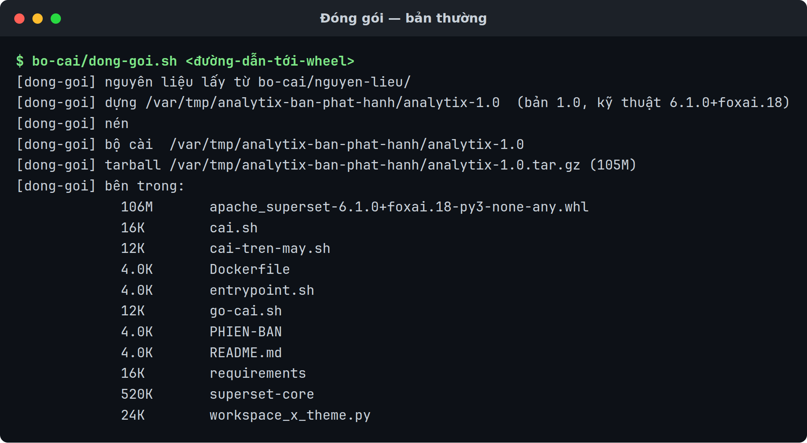
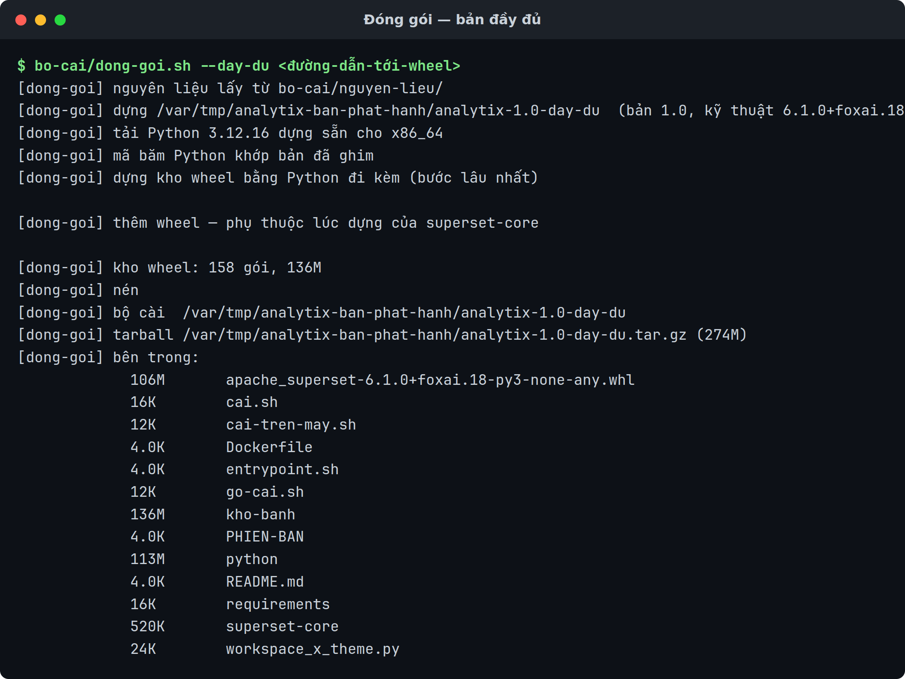

# Đóng gói bản phát hành

Tạo bản đóng gói để giao cho người khác cài.

Dành cho người bảo trì AnalytiX. Cần có trước: mã nguồn AnalytiX, một tệp wheel
`apache_superset-<bản>-py3-none-any.whl` đã build, và **mạng trên chính máy đóng
gói**.

Trang này **không** nói cách build wheel — đó là việc khác, cần Node.js và một
máy build riêng.

## Ba kiểu bản phát hành

Chọn kiểu theo thứ máy đích có, không theo thứ máy đóng gói có:

| Lệnh dựng | Ra thư mục | Tarball | Máy đích cần gì |
|:---|:---|:---|:---|
| `bo-cai/dong-goi.sh --day-du <wheel>` | `analytix-<bản>-day-du/` | ~274 MB | **không cần gì** |
| `bo-cai/dong-goi.sh <wheel>` | `analytix-<bản>/` | ~105 MB | Python 3.10/3.11/3.12 + `python3-venv` + mạng ra PyPI, **hoặc** Docker + mạng |
| `bo-cai/dong-goi-ban-offline.sh <thư-mục-bộ-cài>` | `analytix-<bản>-khong-can-mang/` | ~433 MB | Docker |

Hai kiểu đi tới được máy cách ly, và chúng khác nhau ở chỗ máy đó có Docker hay
không. Máy cách ly **không có Docker** thì chỉ `--day-du` đi tới.

`dong-goi-ban-offline.sh` ăn đầu ra của `dong-goi.sh`, nên nó là bước thứ hai chứ
không phải một lệnh song song — xem cuối trang.

## Các bước

```bash
bo-cai/dong-goi.sh --day-du <đường-dẫn-tới-wheel> [thư-mục-đích]   # bản đầy đủ
bo-cai/dong-goi.sh          <đường-dẫn-tới-wheel> [thư-mục-đích]   # bản thường
```

`--day-du` phải là **đối số đầu tiên**; script chỉ nhìn nó ở vị trí đó.

Thư mục đích mặc định `/var/tmp/analytix-ban-phat-hanh`. Kết quả:

```
<đích>/analytix-<bản>/          thư mục bundle
<đích>/analytix-<bản>.tar.gz    bản nén, khoảng 105 MB
```

Với `--day-du`, cả hai tên mang thêm hậu tố `-day-du`, và tarball khoảng 274 MB
(thư mục chưa nén khoảng 354 MB).



Với `--day-du` nó làm thêm ba việc trước khi nén — tải Python đã ghim, đối chiếu
mã băm, rồi dựng kho wheel bằng chính Python vừa tải:



## Bản đóng gói chứa gì

| Trong bundle | Lấy từ |
|:---|:---|
| `apache_superset-<bản>-py3-none-any.whl` | tham số bạn truyền vào |
| `requirements/base.txt` | `src/requirements/base.txt`, hoặc `bo-cai/nguyen-lieu/requirements/base.txt` |
| `superset-core/` | `src/superset-core`, hoặc `bo-cai/nguyen-lieu/superset-core` (cả cây) |
| `workspace_x_theme.py` | `theme/workspace_x_theme.py` |
| `cai.sh` | `bo-cai/cai.sh` |
| `go-cai.sh` | `bo-cai/go-cai.sh` |
| `cai-tren-may.sh` | `bo-cai/cai-tren-may.sh` |
| `entrypoint.sh` | `bo-cai/entrypoint.sh` |
| `Dockerfile` | `bo-cai/Dockerfile` |
| `PHIEN-BAN` | sinh tự động — xem mục dưới |
| `README.md` | sinh tự động |

Mười một mục đó là bản thường. `--day-du` thêm hai mục nữa, thành mười ba:

| Chỉ có ở `--day-du` | Là gì | Nặng |
|:---|:---|:---|
| `python/` | cây CPython 3.12.16 dựng sẵn, tải về rồi giải nén vào bundle | 113 MB |
| `kho-banh/` | 158 wheel — toàn bộ bộ pin, cộng `wheel` | 136 MB |

**Không** có trong bundle: `patches/`, `translations/` (đã biên dịch vào wheel),
`gates/`, `tools/`.

`requirements/base.txt` và `superset-core/` có hai nguồn vì repo sản phẩm không
chứa `src/` (320 MB mã nguồn Superset), nên nó giữ sẵn bản sao 540 KB ở
`bo-cai/nguyen-lieu/`. Script tự chọn: có `src/` thì cắt từ cây nguồn vừa build, không
thì dùng `bo-cai/nguyen-lieu/`. Dòng nó in ra cho biết đã chọn đường nào.

`bo-cai/nguyen-lieu/CUT-FROM` ghi version của wheel mà bản sao đó được cắt ra cùng. Đưa
wheel khác thế hệ vào thì script dừng — xem bảng Lỗi hay gặp.

Bundle vừa là bộ cài vừa là build context: `Dockerfile` `COPY` wheel,
`requirements/`, `superset-core/`, `workspace_x_theme.py` và `entrypoint.sh` từ
**chính thư mục bundle**. Nên cùng một thư mục dùng được cho cả hai đường cài,
và chúng **không thể lệch nhau**. Đó là lý do build context của `docker build`
phải là chính thư mục bundle: `cai.sh --docker` chạy `docker build -t
analytix:<bản> -f Dockerfile .` sau khi đã `cd` vào đó, còn
`dong-goi-ban-offline.sh` truyền thẳng thư mục bundle làm context.

## `--day-du` lấy `python/` và `kho-banh/` ở đâu

Bản Python được ghim trong `bo-cai/PYTHON-GHIM`, không ghim trong script:

```
PBS_RELEASE=20261026
PBS_PYTHON=3.12.16
PBS_SHA256_x86_64=ce4f6d0a…
PBS_SHA256_aarch64=bb4b6392…
```

Script đọc `uname -m` rồi lấy dòng `PBS_SHA256_<kiến-trúc>` tương ứng. Không có
dòng cho kiến trúc đang đứng thì nó dừng — xem *Lỗi hay gặp*.

Tệp tải về là một bản dựng sẵn của python-build-standalone:

```
cpython-<bản>+<release>-<kiến-trúc>-unknown-linux-gnu-install_only_stripped.tar.gz
```

**Script kiểm SHA256 trước khi giải nén**, không phải sau. Một cây Python tải từ
Internet rồi đem giao cho khách thì phải chứng minh được nó đúng là bản đã ghim,
và lúc chứng minh được phải là lúc nó còn là một tệp nén chưa ai chạy. Mã băm
khớp thì script in `mã băm Python khớp bản đã ghim` rồi mới `tar -xzf`.

Giải nén xong nó chạy `import venv, ssl, sqlite3` bằng chính cây vừa bung. Thiếu
một trong ba là bộ cài sẽ chết ở máy đích chứ không chết ở đây: `venv` để dựng
môi trường ảo, `ssl` cho pip, `sqlite3` cho database metadata.

Kho wheel được dựng **bằng chính Python đi kèm**, không bằng Python của máy đóng
gói:

```
[dong-goi] dựng kho wheel bằng Python đi kèm (bước lâu nhất)
[dong-goi] thêm wheel — phụ thuộc lúc dựng của superset-core
[dong-goi] kho wheel: 158 gói, 136M
```

Lý do là ABI. Wheel nhị phân gắn với phiên bản và ABI của trình thông dịch đã
dựng ra nó; dựng bằng trình thông dịch khác là mang về một kho mà máy đích cài
không được — và lỗi đó chỉ lộ ra ở máy đích, nơi không còn mạng để chữa.

Hai chỗ kho wheel không trùng khít với `requirements/base.txt`:

- Dòng `-e ./superset-core` bị cắt ra trước khi gọi `pip wheel`. Đó là mã nguồn
  đã nằm trong bundle, không phải gói tải về, và `pip wheel` từ chối dòng
  editable.
- `wheel` được xin thêm một lượt riêng. `superset-core` cài từ nguồn, và
  `pyproject.toml` của nó khai `requires = ["setuptools>=76.0.0", "wheel"]`; pip
  dựng nó trong môi trường cách ly nên hai gói đó phải có sẵn trong kho.
  `setuptools` đã nằm trong bộ pin, `wheel` thì không. Nên 156 dòng pin ra
  158 tệp wheel.

Cả hai bước này **cần mạng trên máy đóng gói** — một lượt ra GitHub lấy Python,
một lượt ra PyPI dựng kho. Máy đích thì không cần gì.

## Hai phiên bản, đừng lẫn

Tên bản đóng gói mang **phiên bản sản phẩm**, không mang phiên bản kỹ thuật.

| Gọi là | Ví dụ | Lấy từ đâu | Dùng để |
|:---|:---|:---|:---|
| Phiên bản sản phẩm | `1.0` | dòng `ANALYTIX_VERSION` trong `UPSTREAM` | đặt tên tệp giao cho người dùng |
| Phiên bản kỹ thuật | `6.1.0+foxai.18` | tên tệp wheel | truy nguồn: Superset nào, bản vá thứ mấy |

Tách ra vì chuỗi `6.1.0+foxai.18` nói đúng thứ người bảo trì cần mà người nhận
không đọc được. Người nhận thấy `analytix-1.0.tar.gz`; bạn vẫn truy được nó dựng
từ đâu.

Sợi dây nối hai cái nằm trong tệp `PHIEN-BAN` của mỗi bundle:

```
ANALYTIX_VERSION=1.0
FOXAI_VERSION=6.1.0+foxai.18
WHEEL=apache_superset-6.1.0+foxai.18-py3-none-any.whl
```

Lên bản mới thì sửa `ANALYTIX_VERSION` trong `UPSTREAM` **trước khi** đóng gói.
Quên sửa thì bundle mới đè lên tên cũ.

🔴 `bo-cai/dong-goi-ban-offline.sh` đọc phiên bản sản phẩm từ chính tệp
`PHIEN-BAN` này, không suy ra từ tên thư mục — đổi tên thư mục bundle đi thì nó
vẫn chạy đúng, nhưng xoá tệp đó đi thì nó dừng.

## Kiểm tra là đã đúng

Ba dòng cuối script in ra là đường dẫn bundle, đường dẫn tarball kèm kích thước,
rồi danh sách nội dung:

```
[dong-goi] bộ cài  /var/tmp/analytix-ban-phat-hanh/analytix-1.0
[dong-goi] tarball /var/tmp/analytix-ban-phat-hanh/analytix-1.0.tar.gz (105M)
[dong-goi] bên trong:
```

Danh sách bên dưới phải có 11 mục. Kiểm lại bằng tay:

```bash
cd /var/tmp/analytix-ban-phat-hanh/analytix-<bản>
ls apache_superset-*.whl requirements/base.txt superset-core workspace_x_theme.py \
   cai.sh go-cai.sh cai-tren-may.sh entrypoint.sh Dockerfile PHIEN-BAN README.md
```

Đủ 11 mục là bundle hoàn chỉnh.

Bản `--day-du` phải có 13 mục — thêm `python/` và `kho-banh/`:

```bash
cd /var/tmp/analytix-ban-phat-hanh/analytix-<bản>-day-du
./python/bin/python3 -V                 # mong: Python 3.12.16
ls kho-banh | wc -l                     # mong: 158
```

Kiểm thật thì giải nén tarball ra một thư mục khác rồi cài vào một
`ANALYTIX_HOME` tạm. Với bản thường, bước này cần mạng ra PyPI; với bản
`--day-du` thì không:

```bash
tar xzf /var/tmp/analytix-ban-phat-hanh/analytix-<bản>.tar.gz -C /var/tmp
cd /var/tmp/analytix-<bản>
ANALYTIX_HOME=/var/tmp/thu-analytix ./cai-tren-may.sh
```

Gọi thẳng `cai-tren-may.sh`, đừng gọi `./cai.sh --may`: `cai.sh` cài xong là
`exec` sang `khoi-dong.sh` và chiếm terminal để chạy máy chủ, còn ở đây ta chỉ cần
bước cài.

Bộ cài tự khẳng định bộ pin không bị resolver đè, theme nạp được và tên sản phẩm
đúng. Thấy đủ ba dòng này là đạt (`cai-tren-may.sh` in tiếng Anh):

```
[analytix] cachelib 0.13.0 matches the pin
[analytix] config loads: AnalytiX ['en', 'vi']
[analytix] installed AnalytiX <kỹ-thuật> in /var/tmp/thu-analytix
```

Thử bản `--day-du` thì nhìn thêm hai dòng nữa, ở đầu lượt chạy:

```
[analytix] python 3.12.16 from the bundle
[analytix] installing from the bundled wheelhouse (158 wheels); PyPI is not used
```

Thấy `python 3.12 from the machine` thay cho dòng đầu nghĩa là `python/` không
vào được bundle, và bạn vừa thử một bản thường đội lốt bản đầy đủ. Muốn chắc nó
thật sự không chạm mạng thì chạy lượt thử sau một proxy trỏ vào cổng chết, hoặc
cắt mạng của máy thử.

Dọn bản thử: `rm -rf /var/tmp/thu-analytix /var/tmp/analytix-<bản>`. **Đừng** dùng
`./go-cai.sh` để dọn nó — `go-cai.sh` cũng ngó container `analytix`, volume
`analytix-data` và mọi ảnh `analytix:*` trên máy, nên nó có thể chạm vào bản cài
thật chứ không chỉ bản thử.

## Lỗi hay gặp

| Hiện tượng | Nguyên nhân | Cách sửa |
|:---|:---|:---|
| `src/ còn thay đổi chưa commit` | `src/` còn thay đổi chưa commit | Commit trước. Đây là **chủ ý**: wheel mang mã băm git của nguồn, nên nguồn phải ở trạng thái xác định được |
| `không có wheel ở <đường-dẫn>` | Đường dẫn không trỏ tới một tệp — gõ sai, hoặc truyền thư mục | Truyền đúng tệp `.whl` |
| `<tên> không phải wheel apache_superset` | Tên không khớp `apache_superset-*-py3-none-any.whl` | Truyền đúng tệp wheel; script nhận dạng theo tên nên đừng đổi tên nó |
| `cách dùng: bo-cai/dong-goi.sh ...` | Gọi script không có đối số | `bo-cai/dong-goi.sh <đường-dẫn-wheel>` |
| `bo-cai/nguyen-lieu/ cắt từ X nhưng wheel là Y` | Wheel khác thế hệ với bản sao trong `bo-cai/nguyen-lieu/` | Làm mới `bo-cai/nguyen-lieu/` theo `bo-cai/nguyen-lieu/README.md`, rồi sửa `CUT-FROM` |
| `thiếu .../nguyen-lieu/requirements/base.txt` | Không có `src/` mà `bo-cai/nguyen-lieu/` cũng thiếu | Lấy lại hai mảnh đó — `bo-cai/nguyen-lieu/README.md` ghi cách |
| `UPSTREAM không có dòng ANALYTIX_VERSION=` | Thiếu dòng phiên bản sản phẩm | Thêm `ANALYTIX_VERSION=<bản>` vào cuối `UPSTREAM` |
| Bundle cài được nhưng mất thương hiệu | `workspace_x_theme.py` không được chép vào | Kiểm `theme/workspace_x_theme.py` có trong mã nguồn |

Riêng đường `--day-du`. Mọi lỗi dưới đây đều dừng script, và thư mục bundle dở
dang vẫn nằm lại ở `<đích>/analytix-<bản>-day-du/` — chạy lại là nó `rm -rf` rồi
dựng lại từ đầu, không cần tự dọn:

| Hiện tượng | Nguyên nhân | Cách sửa |
|:---|:---|:---|
| `thiếu bo-cai/PYTHON-GHIM` | Tệp ghim bản Python không có trong cây mã nguồn | Lấy lại `bo-cai/PYTHON-GHIM` từ repo. Không có nó thì không bản Python nào được ghim, và script từ chối đoán |
| `PYTHON-GHIM không ghim bản Python cho kiến trúc <kiến-trúc>` | `uname -m` trả về một kiến trúc mà tệp ghim không có dòng `PBS_SHA256_` tương ứng | Hiện chỉ ghim `x86_64` và `aarch64`. Đóng gói trên một trong hai, hoặc thêm dòng mã băm mới cho kiến trúc đó |
| `không tải được <tệp>` | `curl` không ra được GitHub, hoặc release/phiên bản trong `PYTHON-GHIM` không còn tệp đó | Kiểm mạng trước. Vẫn hỏng thì mở trang release của `PBS_RELEASE` xem tên tệp còn đúng không |
| `mã băm Python không khớp: <đo-được>, ghim là <đã-ghim>` | Tệp tải về không phải tệp đã ghim — tải thiếu, hoặc bản phát hành đã bị thay | **Đừng đi vòng.** Tải lại một lượt; vẫn lệch thì dừng hẳn và xác minh lại mã băm từ `SHA256SUMS` của chính bản phát hành đó trước khi sửa `PYTHON-GHIM` |
| `cây Python vừa giải nén thiếu venv/ssl/sqlite3` | Ghim nhầm sang một biến thể rút gọn của python-build-standalone | Ghim đúng biến thể `install_only_stripped` của kiến trúc nền (`x86_64`, không phải `x86_64_v2/v3/v4`) |
| `dựng kho wheel thất bại` | `pip wheel` không phân giải nổi bộ pin — thường là mất mạng ra PyPI giữa chừng, hoặc một pin không có wheel cho 3.12 | Chạy lại lệnh `pip wheel` bằng `<bundle>/python/bin/python3` không kèm `--quiet` để đọc lỗi thật |
| `không lấy được phụ thuộc lúc dựng` | Bước xin riêng gói `wheel` thất bại | Cùng cách chữa như trên. Thiếu gói này thì máy đích dừng ở `ERROR: Could not find a version that satisfies the requirement wheel` khi dựng `superset-core` |

Riêng `bo-cai/dong-goi-ban-offline.sh` — bước cắt bản offline ở cuối trang:

| Hiện tượng | Nguyên nhân | Cách sửa |
|:---|:---|:---|
| `cách dùng: bo-cai/dong-goi-ban-offline.sh <thư-mục-bộ-cài> [thư-mục-đích]` | Gọi không có đối số | Truyền thư mục bundle, không truyền tarball |
| `không có thư mục bộ cài ở <đường-dẫn>` | Đối số 1 không phải một thư mục | Truyền `<đích>/analytix-<bản>/`, tức thư mục `dong-goi.sh` vừa dựng |
| `<thư-mục> không có Dockerfile; nó có phải bộ cài do dong-goi.sh dựng không?` | Trỏ vào thư mục khác, hoặc bundle bị cắt mất tệp | Trỏ vào `<đích>/analytix-<bản>/`, hoặc dựng lại bằng `dong-goi.sh` |
| `không có wheel apache_superset trong <thư-mục>` | Bundle thiếu wheel | Dựng lại bundle bằng `dong-goi.sh` |
| `<thư-mục> không có tệp PHIEN-BAN; dựng lại bộ cài bằng bo-cai/dong-goi.sh` | Tệp `PHIEN-BAN` bị xoá khỏi bundle | Dựng lại bundle. Nó đọc phiên bản sản phẩm từ tệp đó, không từ tên thư mục |
| `không tìm thấy docker; script này dựng và lưu một ảnh` | Máy đóng gói chưa có Docker | Cắt bản offline trên máy có Docker — script phải `docker build` rồi `docker save` |
| `CẢNH BÁO: đang dựng trên <kiến-trúc>; bản phát hành chỉ chạy được trên <kiến-trúc>` | Máy đóng gói không phải `x86_64` | Chỉ là cảnh báo, script vẫn chạy. Nhưng ảnh đã lưu không chạy chéo kiến trúc, nên phải dựng trên máy cùng kiến trúc với máy đích |

Nó từ chối `src/` bẩn vì wheel mang theo mã băm git của nguồn đã build ra nó.
`src/` còn thay đổi chưa commit thì mã băm đó mô tả một trạng thái không ai lấy
lại được — và khi khách báo lỗi, bạn không dựng lại được đúng bản họ đang chạy.
Đây là **chốt đáng giữ**, đừng tìm cách đi vòng.

## Giao cho người khác

Gửi tarball kèm hai câu:

```bash
tar xzf analytix-<bản>.tar.gz && cd analytix-<bản>
./cai.sh
```

`cai.sh` dò bộ cài có gì và máy có gì rồi chọn đường, nên người nhận không phải
tự quyết. Bản `--day-du` luôn rơi vào `--may` với lý do in ra là `bộ cài mang sẵn
Python và toàn bộ gói, không cần mạng`. Ép đường cụ thể bằng `--docker` hoặc
`--may`.

Bundle có sẵn `README.md` sinh tự động, và nội dung mục "Cần gì" của nó **khác
nhau giữa hai kiểu bản**:

| Bản | `README.md` nói máy đích cần gì |
|:---|:---|
| `--day-du` | "không cần gì cả — không Python, không Docker, không mạng", kèm một dòng đỏ **chỉ chạy trên `<kiến-trúc>`** |
| Thường | "Docker gọi được không cần sudo, hoặc Python 3.10/3.11/3.12", kèm một dòng đỏ **cả hai đường đều cần mạng ra PyPI** |

Phần còn lại giống nhau: cách gỡ, lệnh kiểm `curl -s
http://127.0.0.1:8088/health` phải trả về `OK`, mật khẩu quản trị chỉ in một
lần, và cài xong chỉ query được SQLite. Bốn điều đó bạn không phải nhắc lại.

Một điều `README.md` **không** nói, ở cả hai bản: **máy chủ web đi kèm là bản
phát triển của Flask**, không phải WSGI cho vận hành thật. Dùng nội bộ thì được,
mở ra Internet thì chưa.

Cần driver cho Postgres/MySQL/Trino thì chỉ người nhận sang
[Thêm driver](./them-driver-du-lieu.md) — bộ pin không mang driver nào.

:::danger[Bản thường cần mạng ra PyPI, ở cả hai đường cài]
Bundle thường mang theo **danh sách** 156 gói đã ghim, không mang theo chính các
gói đó. `cai-tren-may.sh` và `docker build` đều phân giải danh sách ấy với PyPI,
nên máy đích không ra được internet là cả hai dừng giữa chừng. Bản `--day-du`
không có chuyện này: nó mang cả 158 wheel và cài với `--no-index`.

Máy đích không có mạng thì có hai lối, chọn theo chỗ đó có Docker hay không.
Không có Docker thì dùng `--day-du` ở đầu trang. Có Docker thì cắt thêm một bước
nữa từ một bundle thường:

```bash
bo-cai/dong-goi-ban-offline.sh /var/tmp/analytix-ban-phat-hanh/analytix-<bản>
```

Ra `/var/tmp/analytix-ban-phat-hanh/analytix-<bản>-khong-can-mang/` khoảng
433 MB — sáu tệp: ảnh đã dựng sẵn `analytix-<bản>-anh.tar.gz`, `cai.sh`,
`go-cai.sh`, `PHIEN-BAN`, `README.md` và `SHA256SUMS` (5 dòng: ảnh, `cai.sh`,
`go-cai.sh`, `PHIEN-BAN`, `README.md`). Chép nguyên thư mục đó sang máy đích.
Người nhận vẫn chỉ `./cai.sh` — cùng một tệp với bộ cài thường, nó thấy tệp ảnh
bên cạnh nên tự đi đường `--offline`. Xem [Cài trên máy không có
internet](./cai-tren-may-khong-co-mang.md).
:::

## Liên quan

- [Cài trên máy không có internet](./cai-tren-may-khong-co-mang.md)
- [Cài thực trên máy](./cai-dat-tren-may.md)
- [Cài bằng Docker](./cai-dat-bang-docker.md)
- [Thêm driver cho nguồn dữ liệu](./them-driver-du-lieu.md)
- [AnalytiX là gì](../../explanation/analytix-la-gi.md)
