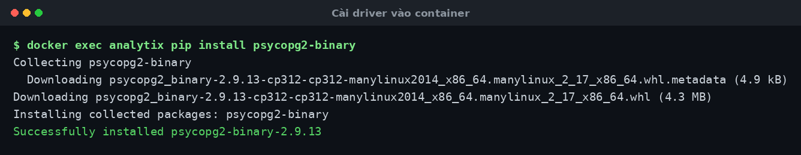
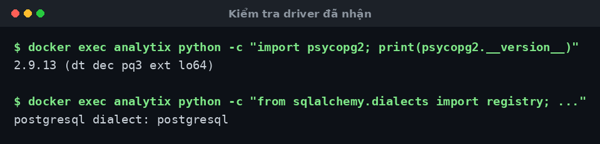
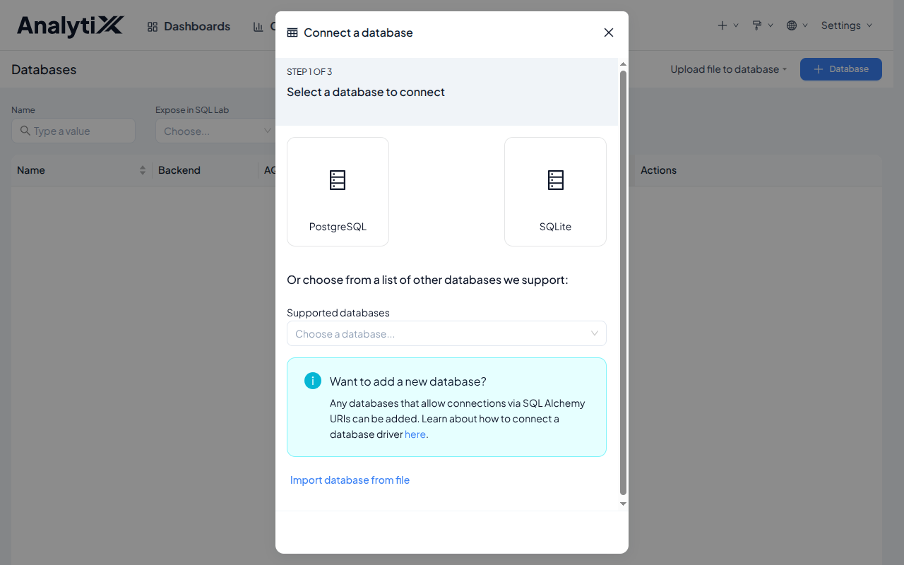

# Thêm driver cho nguồn dữ liệu

AnalytiX cài xong **chỉ query được SQLite**. Trang này hướng dẫn thêm driver cho
database thật của bạn.

Dành cho người quản trị. Cần có trước: AnalytiX đã cài và chạy được, và mạng ra
được PyPI (hoặc một kho gói nội bộ).

Gần như ai cũng phải làm bước này: bộ 156 gói đã ghim của AnalytiX **không chứa
driver nào** ngoài SQLite. Không `psycopg2`, không `PyMySQL`, không `trino`,
không `pyodbc`, không `clickhouse-connect`, không `snowflake`, không `bigquery`.

Thử nối Postgres mà chưa cài driver thì AnalytiX báo lỗi thiếu module, và thông
báo đó không nói rõ phải cài gói nào.

## Có sẵn những gì

| Nguồn | Trạng thái |
|:---|:---|
| **SQLite** (tệp `.db`) | ✅ dùng được ngay |
| **Shillelagh** (`shillelagh://`) | ⚠️ bản rút gọn — chỉ các adapter không cần thư viện thêm |
| Mọi thứ khác | ❌ phải cài driver |

Google Sheets qua Shillelagh **không** chạy ngay: nó cần bộ phụ thuộc riêng mà
bản rút gọn không có.

## Các bước

### 1. Tìm đúng tên gói

| Database | Gói cần cài |
|:---|:---|
| PostgreSQL | `psycopg2-binary==2.9.9` |
| MySQL / MariaDB | `mysqlclient>=2.1.0,<3` |
| Trino | `trino` |
| ClickHouse | `clickhouse-connect` |
| Microsoft SQL Server | `pymssql` |
| Oracle | `oracledb` |
| DuckDB | `duckdb-engine` |
| BigQuery | `sqlalchemy-bigquery` |
| Snowflake | `snowflake-sqlalchemy` |

Database không có trong bảng: mở `pyproject.toml` của mã nguồn AnalytiX, mục
`[project.optional-dependencies]` — khoảng 55 engine được khai ở đó kèm khoảng
phiên bản đã kiểm.

### 2. Cài vào đúng môi trường ảo

**Cài thực trên máy:**

```bash
~/analytix/venv/bin/pip install "psycopg2-binary==2.9.9"
~/analytix/venv/bin/pip check
```

**Docker** — cài vào container đang chạy là **mất khi dựng lại ảnh**. Cách đúng
là thêm vào ảnh:

```dockerfile
# thêm vào cuối Dockerfile, SAU khi wheel đã được cài
RUN pip install --no-cache-dir "psycopg2-binary==2.9.9"
```

rồi `docker build` lại. Muốn thử nhanh trước thì:

```bash
docker exec analytix pip install "psycopg2-binary==2.9.9"
docker restart analytix
```

và nhớ rằng nó chỉ sống tới lần dựng ảnh kế tiếp.



### 3. Khởi động lại

Driver chỉ được nạp lúc tiến trình khởi động.

```bash
# cài trên máy: dừng khoi-dong.sh rồi chạy lại
# docker:
docker restart analytix
```

### 4. Khai báo kết nối

**Settings → Database Connections → + Database**, chọn loại database, điền chuỗi
kết nối. Bấm **Test Connection** trước khi lưu.

:::danger[Tắt quyền ghi trừ khi thật sự cần]
Bỏ chọn **Allow DML**, **Allow CTAS**, **Allow CVAS**. Đây là chốt chặn thật —
nó chặn ở tầng kết nối, không dựa vào việc người dùng tự giữ mình. Đặc biệt quan
trọng nếu bạn bật [dịch vụ MCP](../tro-ly-ai/bat-mcp.md).
:::

## Kiểm tra là đã đúng



Và trong giao diện, loại database mới xuất hiện ở bước chọn:



```bash
# cài trên máy
~/analytix/venv/bin/python -c "import psycopg2; print(psycopg2.__version__)"
~/analytix/venv/bin/pip check

# docker
docker exec analytix python -c "import psycopg2; print(psycopg2.__version__)"
docker exec analytix pip check
```

`pip check` phải in `No broken requirements found`. Rồi trong giao diện, **Test
Connection** trả về thành công, và SQL Lab chạy được `SELECT 1`.

## 🔴 Đừng cài bằng extra của Superset

```bash
# SAI — có thể phá bộ phiên bản đã ghim
pip install "apache-superset[postgres]"
```

Lệnh đó bắt pip giải lại toàn bộ phụ thuộc của `apache-superset`, và nó có thể
nâng một gói đã được ghim có chủ đích. Đã có tiền lệ thật: bộ giải từng chọn
`cachelib 0.17.0` thay cho pin `0.13.0`, và `superset fab create-admin` hỏng với

```
TypeError: SupersetMetastoreCache.__init__() got an unexpected keyword argument
'ignore_delete_many_errors'
```

Vì vậy bộ cài luôn cài bộ pin **trước**, rồi mới cài wheel bằng `--no-deps`.

**Cài thẳng tên gói driver**, đúng như bảng ở trên. Rồi chạy `pip check`.

## Lỗi hay gặp

| Hiện tượng | Nguyên nhân | Cách sửa |
|:---|:---|:---|
| `Could not load database driver` khi lưu kết nối | Chưa cài driver, hoặc chưa khởi động lại | Cài rồi khởi động lại tiến trình |
| Cài xong vẫn báo thiếu | Cài vào Python hệ thống, không phải venv của AnalytiX | Dùng đúng `~/analytix/venv/bin/pip` |
| `pg_config executable not found` | Đang cài `psycopg2` (bản biên dịch) | Cài `psycopg2-binary` — bản đã biên dịch sẵn |
| Build `mysqlclient` hỏng vì thiếu header | `mysqlclient` cần thư viện hệ thống | Cài `default-libmysqlclient-dev` + `build-essential`, hoặc dùng `PyMySQL` |
| `pip check` báo xung đột sau khi cài | Driver kéo theo bản khác của một gói đã ghim | Gỡ driver, cài lại với phiên bản cụ thể hơn |
| Mất driver sau khi dựng lại ảnh | Cài bằng `docker exec`, không nằm trong `Dockerfile` | Thêm dòng `RUN pip install` vào `Dockerfile` |
| Google Sheets không nối được | Shillelagh bản rút gọn | Cài bộ phụ thuộc Google Sheets của Shillelagh |

## Môi trường không có mạng

Bản đóng gói mang theo **danh sách** gói, không mang theo gói. Máy không ra được
PyPI thì cả bộ cài lẫn việc thêm driver đều không chạy.

Cách làm: ở một máy có mạng, cùng phiên bản Python và cùng hệ điều hành:

```bash
pip download "psycopg2-binary==2.9.9" -d kho-goi/
```

mang `kho-goi/` sang rồi:

```bash
~/analytix/venv/bin/pip install --no-index --find-links kho-goi/ "psycopg2-binary==2.9.9"
```

Cùng cách đó áp dụng được cho cả 156 gói của bộ pin nếu cần cài hoàn toàn offline.

## Liên quan

- [Cài thực trên máy](./cai-dat-tren-may.md)
- [Cài bằng Docker](./cai-dat-bang-docker.md)
- [Viết SQL an toàn với cột dạng chữ](../dung-bao-cao/viet-sql-an-toan.md)
- [Bật dịch vụ MCP](../tro-ly-ai/bat-mcp.md) — chỗ việc tắt quyền ghi quan trọng nhất
- [AnalytiX là gì](../../explanation/analytix-la-gi.md)
