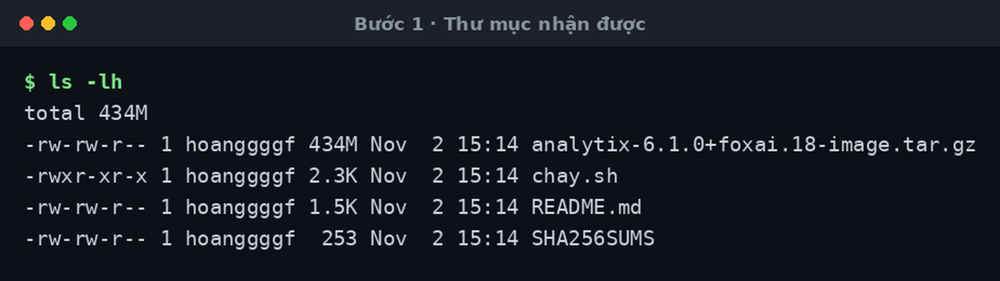
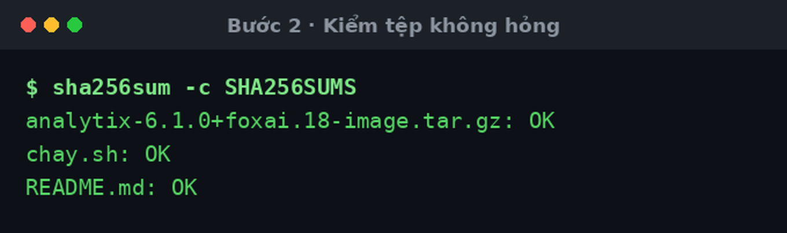
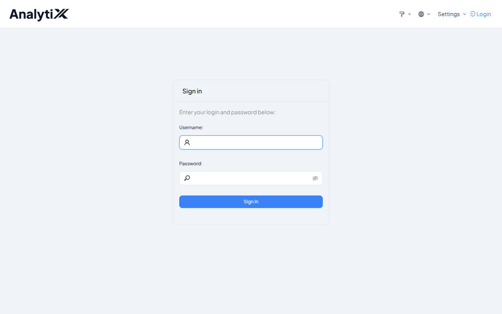
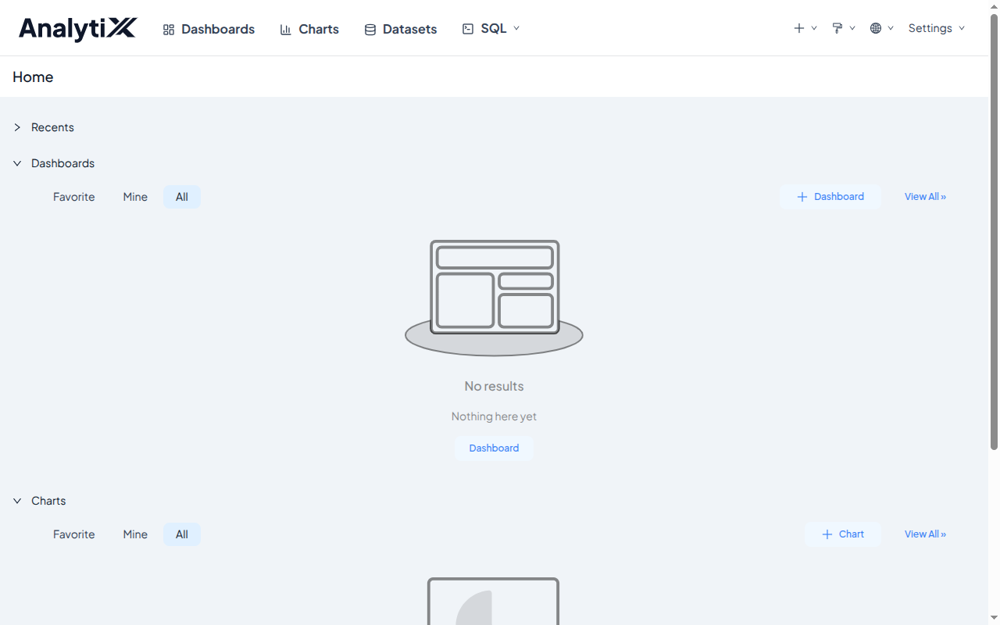
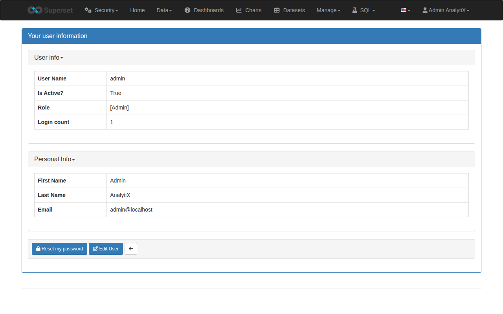
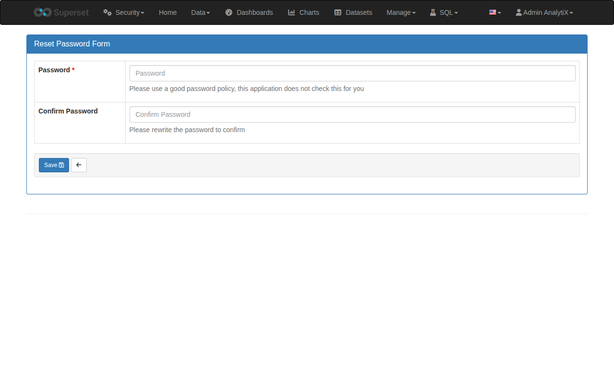

# Cài trên máy không có internet

Máy đích chỉ cần **Docker**. Không Python, không PyPI, không registry.

Đừng dùng cách này khi máy đích có mạng bình thường — [Cài bằng
Docker](./cai-dat-bang-docker.md) nhẹ hơn nhiều.

## Các bước

### 1 · Chép thư mục phát hành sang máy đích

Bốn tệp, khoảng 433 MB. Chép qua USB hay ổ mạng, đường nào cũng được.



### 2 · Kiểm tệp không hỏng dọc đường

```bash
sha256sum -c SHA256SUMS
```

Cả ba dòng phải `OK`. Có dòng `FAILED` thì chép lại — đừng nạp ảnh hỏng.



### 3 · Chạy

```bash
./chay.sh
```

Script tự nạp ảnh, dựng container, chờ sẵn sàng, rồi in địa chỉ và mật khẩu.


:::danger[Mật khẩu chỉ in một lần]
Nó không được ghi vào tệp nào. Lưu ngay khi thấy.
:::

Đổi cổng: `ANALYTIX_PORT=9000 ./chay.sh`

### 4 · Mở địa chỉ script in ra



### 5 · Đăng nhập

Tài khoản `admin`, mật khẩu ở Bước 3.



### 6 · Mở trang tài khoản

Menu **Settings** trên thanh trên → **Info**.



### 7 · Đổi mật khẩu

Bấm **Reset my password**, gõ mật khẩu mới hai lần, bấm **Save**.



:::caution[Phải vào từ nút, không gõ thẳng URL]
Gõ `/resetmypassword/form` vào thanh địa chỉ sẽ ra `Access is Denied`. Đi qua
nút ở Bước 6 thì được.
:::

## Kiểm tra là đã đúng

Đăng nhập lại bằng **mật khẩu mới**. Vào được là xong.

Muốn chắc nó thật sự không cần mạng:

```bash
docker run -d --network none --name thu-cach-ly analytix:6.1.0-foxai.18
sleep 60
docker exec thu-cach-ly curl -s -o /dev/null -w '%{http_code}\n' http://127.0.0.1:8088/health
docker rm -f thu-cach-ly
```

Phải ra `200`.

## Lỗi hay gặp

### Cổng đã có thứ khác dùng

Script dừng và chỉ đúng tiến trình đang giữ cổng:


Chạy lại với cổng khác: `ANALYTIX_PORT=9000 ./chay.sh`

### Các lỗi khác

| Hiện tượng | Nguyên nhân | Cách sửa |
|---|---|---|
| `khong tim thay docker` | Chưa cài Docker | Cài Docker trước |
| `khong goi duoc Docker daemon` | Docker chưa chạy, hoặc tài khoản ngoài nhóm `docker` | `sudo systemctl start docker`, rồi `sudo usermod -aG docker $USER` và đăng nhập lại |
| `thieu ...-image.tar.gz canh script nay` | Chép thiếu tệp, hoặc chạy từ thư mục khác | Chép nguyên thư mục, `cd` vào đó rồi chạy |
| `sha256sum -c` báo `FAILED` | Tệp hỏng lúc chép | Chép lại |
| `exec format error` | Ảnh dựng cho kiến trúc CPU khác | Dựng lại trên máy cùng kiến trúc với máy đích |
| `container ... dang gan cong X, khong phai Y` | Ánh xạ cổng đóng cứng lúc tạo container | `docker rm -f analytix` rồi chạy lại với cổng mới. Dữ liệu nằm trong volume nên không mất |
| Mật khẩu không in ra | Tài khoản đã tạo từ lần chạy trước | Mật khẩu cũ vẫn dùng được. Mất thì `docker rm -f analytix && docker volume rm analytix-data` rồi làm lại |
| Chỉ thấy SQLite | Ảnh không mang driver nào khác | Máy không có mạng thì không cài thêm được — xem [Thêm driver](./them-driver-du-lieu.md) |

:::note[Trang quản trị chưa mang thương hiệu]
Các trang ở Bước 6 và 7 vẫn hiện logo và chữ *Superset*. Đó là giao diện quản
trị kế thừa, bộ vá thương hiệu chưa phủ tới. Chức năng không ảnh hưởng.
:::

## Liên quan

- [Đóng gói bản phát hành](./dong-goi-ban-phat-hanh.md) — bước cắt bundle đứng trước
- [Yêu cầu hệ thống](../reference/yeu-cau-he-thong.md) — cái gì cần mạng, cái gì không
- [Cài bằng Docker](./cai-dat-bang-docker.md) — khi máy đích có mạng
