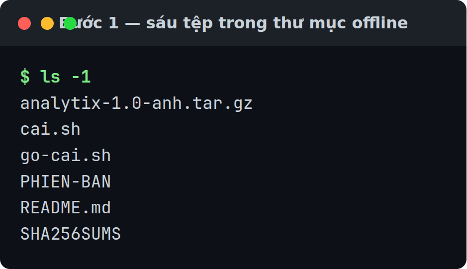
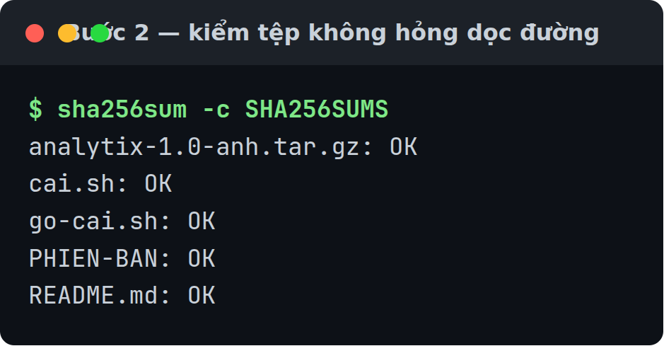
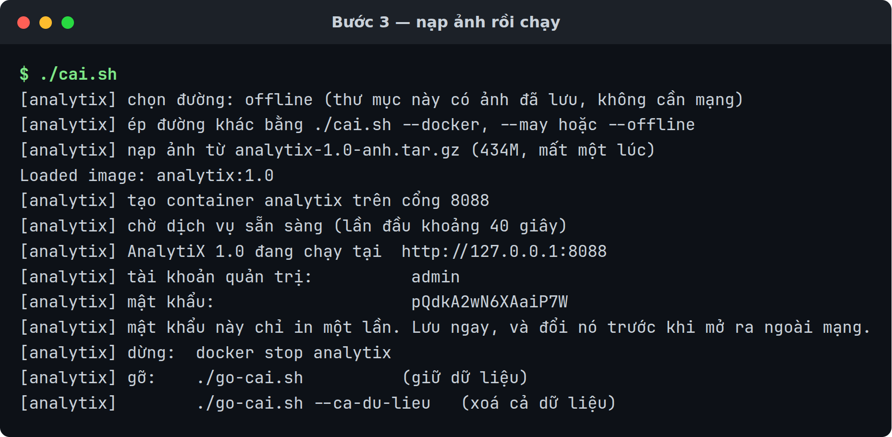
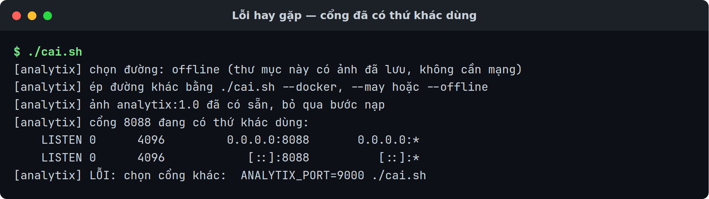

# Cài trên máy không có internet

Máy đích chỉ cần **Docker**. Không Python, không PyPI, không registry.

Đừng dùng cách này khi máy đích có mạng bình thường — [Cài bằng
Docker](./cai-dat-bang-docker.md) nhẹ hơn nhiều.

## Các bước

### 1 · Chép thư mục phát hành sang máy đích

Thư mục đó tên `analytix-<bản>-khong-can-mang/`. Nó không tự có: người bảo trì
cắt nó ra bằng `bo-cai/dong-goi-ban-offline.sh`, và mặc định nó nằm ở
`/var/tmp/analytix-ban-phat-hanh/` trên máy đóng gói — xem [Đóng gói bản phát
hành](./dong-goi-ban-phat-hanh.md). Chưa có thư mục đó thì chưa làm được bước
nào ở dưới.

Sáu tệp, khoảng 433 MB. Chép qua USB hay ổ mạng, đường nào cũng được.



Gần như toàn bộ 433 MB nằm ở `analytix-1.0-anh.tar.gz`; năm tệp còn lại đều nhỏ.

`cai.sh` ở đây là **cùng một tệp** với `cai.sh` trong bộ cài thường. Nó thấy tệp
ảnh nằm bên cạnh nên tự chọn đường offline, nên bạn không phải nhớ hai lệnh khác
nhau cho hai thư mục phát hành.

### 2 · Kiểm tệp không hỏng dọc đường

```bash
sha256sum -c SHA256SUMS
```



Cả năm dòng phải `OK`. Có dòng `FAILED` thì chép lại — đừng nạp ảnh hỏng.

### 3 · Cài

```bash
./cai.sh
```

Script nạp ảnh, dựng container, chờ sẵn sàng, rồi in địa chỉ và mật khẩu.



Dòng đầu là chốt đáng nhìn — `chọn đường: offline (thư mục này có ảnh đã lưu,
không cần mạng)`. Cùng một `cai.sh` đi theo cả hai thư mục phát hành, và ở đây
nó tự biết phải nạp ảnh thay vì dựng ảnh.

Thấy dòng `đang chạy tại` kèm địa chỉ là đạt. Không thấy thì script đã dừng ở
trên — đọc bảng Lỗi hay gặp.

:::danger[Mật khẩu chỉ in một lần]
Nó không được ghi vào tệp nào. Lưu ngay khi thấy.
:::

Đổi cổng: `ANALYTIX_PORT=9000 ./cai.sh`

Nói rõ đường cũng được — `./cai.sh --offline` làm đúng việc trên.

Chạy lần thứ hai thì dòng `nạp ảnh từ ...` không in lại nữa, thay vào đó là
`[analytix] ảnh analytix:1.0 đã có sẵn, bỏ qua bước nạp`. Đó là bình thường: ảnh
đã nằm trong Docker rồi.

### 4 · Mở địa chỉ script in ra


### 5 · Đăng nhập

Tài khoản `admin`, mật khẩu ở Bước 3.


### 6 · Mở trang tài khoản

Menu **Settings** trên thanh trên → **Info**.


### 7 · Đổi mật khẩu

Bấm **Reset my password**, gõ mật khẩu mới hai lần, bấm **Save**.


Phải vào từ nút, **đừng gõ thẳng URL** — gõ `/resetmypassword/form` vào thanh
địa chỉ sẽ ra `Access is Denied`. Đi qua nút ở Bước 6 thì được.

## Kiểm tra là đã đúng

Đăng nhập lại bằng **mật khẩu mới**. Vào được là xong.

Muốn chắc nó thật sự không cần mạng:

```bash
docker run -d --network none --name thu-cach-ly analytix:1.0

# Chờ tới khi Docker báo healthy, tối đa 3 phút.
for _ in $(seq 1 60); do
  [ "$(docker inspect -f '{{.State.Health.Status}}' thu-cach-ly)" = healthy ] && break
  sleep 3
done

docker inspect -f 'NetworkMode: {{.HostConfig.NetworkMode}}' thu-cach-ly
docker exec thu-cach-ly curl -s -o /dev/null -w '%{http_code}\n' http://127.0.0.1:8088/health
docker rm -f thu-cach-ly
```

Phải ra `NetworkMode: none` rồi `200`.

Vòng chờ thay cho một con số `sleep` cứng là có lý do: `HEALTHCHECK` trong ảnh
đặt `--start-period=90s`, nên một con số đoán sẵn sẽ hụt trên máy chậm và bạn
nhận lỗi kết nối thay vì `200` — rồi tưởng bản cài hỏng.

## Gỡ

```bash
./go-cai.sh
```

Nó in danh sách sắp xoá rồi hỏi lại trước khi xoá. Thêm `-y` để bỏ qua câu hỏi.

```
[analytix] sẽ xoá:
[analytix]   · xoá container analytix
[analytix]   · xoá ảnh analytix:1.0

[analytix] giữ lại:
[analytix]   · volume analytix-data (dữ liệu của bản chạy bằng Docker)
[analytix] xoá cả những thứ đó:  ./go-cai.sh --ca-du-lieu

[analytix] đồng ý xoá? [y/N]
```

Chỉ `y`, `Y`, `yes` hay `YES` là đồng ý; gõ gì khác, hay chỉ Enter, thì script in
`huỷ, không xoá gì.` rồi thoát. Đồng ý thì hai dòng cuối là:

```
[analytix] đã gỡ AnalytiX.
[analytix] dữ liệu vẫn còn. Cài lại bằng ./cai.sh là vào đúng dữ liệu cũ.
```

**Mặc định giữ dữ liệu.** Volume `analytix-data` không bị xoá, nên chạy lại
`./cai.sh` là vào đúng dashboard cũ — kể cả mật khẩu quản trị cũ.

Xoá cả dữ liệu:

```bash
./go-cai.sh --ca-du-lieu
```

:::danger[Không lấy lại được]
`--ca-du-lieu` xoá luôn dashboard, biểu đồ, dataset và kết nối database. Script
không tạo bản sao lưu nào.
:::

Ảnh `analytix:*` còn container khác đang dùng thì **không** bị xoá; script nói ra
ảnh nào nó giữ và container nào đang giữ.

## Lỗi hay gặp

### Cổng đã có thứ khác dùng

Script dừng và chỉ đúng tiến trình đang giữ cổng:



Chạy lại với cổng khác: `ANALYTIX_PORT=9000 ./cai.sh`

### Máy đích chưa có Docker

`./cai.sh` không flag thì script thử cả ba đường, in lý do từng đường trượt, rồi
dừng:

```
[analytix] thư mục này chưa cài được trên máy này. Cần MỘT trong ba:
[analytix]   · --offline: bộ cài đủ, nhưng chưa cài Docker. Cài Docker trước, hoặc dùng ./cai.sh --may
[analytix]   · --docker: bộ cài thiếu Dockerfile entrypoint.sh workspace_x_theme.py requirements/base.txt superset-core apache_superset-*-py3-none-any.whl
[analytix]   · --may: bộ cài thiếu cai-tren-may.sh workspace_x_theme.py requirements/base.txt superset-core apache_superset-*-py3-none-any.whl
[analytix] LỖI: không đường nào đi được
```

Đọc dòng `--offline`: nguyên liệu đủ, chỉ thiếu Docker. Cài Docker rồi chạy lại.

Câu `hoặc dùng ./cai.sh --may` trong dòng đó **không áp dụng cho thư mục này**.
Đó là câu chung của `cai.sh`, còn thư mục phát hành offline không mang wheel nên
đường `--may` không đi được — chính hai dòng dưới nói ra điều đó. Thư mục này chỉ
có một đường, và đường đó cần Docker.

### Các lỗi khác

| Hiện tượng | Nguyên nhân | Cách sửa |
|---|---|---|
| `không gọi được Docker daemon` | Docker chưa chạy, hoặc tài khoản ngoài nhóm `docker` | `sudo systemctl start docker`, rồi `sudo usermod -aG docker $USER` và đăng nhập lại |
| `thiếu tệp PHIEN-BAN; đây có phải thư mục bộ cài không?` | Chép thiếu `PHIEN-BAN`, hoặc đang chạy từ thư mục khác | Chép nguyên sáu tệp, `cd` vào thư mục đó rồi chạy |
| `PHIEN-BAN không có dòng ANALYTIX_VERSION=` | Tệp `PHIEN-BAN` bị sửa hoặc chép hỏng | Chép lại `PHIEN-BAN` từ thư mục gốc |
| `đường --offline cần những thứ thư mục này không có: analytix-*-anh.tar.gz` | Chép thiếu tệp ảnh, hoặc chạy từ thư mục khác | Chép nguyên thư mục, `cd` vào đó rồi chạy |
| `không nạp được ...-anh.tar.gz. Tệp có thể chép thiếu hoặc hỏng.` | Tệp ảnh hỏng dọc đường | `sha256sum -c SHA256SUMS` để biết tệp nào, rồi chép lại |
| `sha256sum -c` báo `FAILED` | Tệp hỏng lúc chép | Chép lại |
| `exec format error` | Ảnh dựng cho kiến trúc CPU khác | Dựng lại trên máy cùng kiến trúc với máy đích |
| `container ... đã có sẵn và đang gắn cổng X, không phải Y` | Ánh xạ cổng đóng cứng lúc tạo container | `docker rm -f analytix` rồi chạy lại với cổng mới. Dữ liệu nằm trong volume nên không mất |
| `container báo unhealthy`, hoặc `quá 3 phút vẫn chưa sẵn sàng` | Container dựng được nhưng dịch vụ không lên | Script đã in `docker logs --tail 30` ngay trên dòng lỗi — đọc đoạn đó. Thử lại: `docker rm -f analytix && ./cai.sh` |
| `mật khẩu:                    đã tạo từ trước, không in lại được` | Tài khoản đã tạo từ lần chạy trước | Mật khẩu cũ vẫn dùng được. Mất thì `./go-cai.sh --ca-du-lieu` rồi cài lại |
| `không có bàn phím để hỏi. Thêm -y nếu thật sự muốn xoá.` | Chạy `./go-cai.sh` mà đầu vào không phải bàn phím (script, đường ống) | Thêm `-y`: `./go-cai.sh -y` |
| `không hiểu tham số '...'. Chạy ./cai.sh --giup` | Gõ sai flag | Chỉ có `--docker`, `--may`, `--offline`, `--giup`. `./cai.sh --giup` in đủ danh sách |
| Chỉ thấy SQLite | Ảnh không mang driver nào khác | Máy không có mạng thì không cài thêm được — xem [Thêm driver](./them-driver-du-lieu.md) |

Trang quản trị chưa mang thương hiệu: các trang ở Bước 6 và 7 vẫn hiện logo và
chữ *Superset*. Đó là giao diện quản trị kế thừa, bộ vá thương hiệu chưa phủ
tới. Chức năng không ảnh hưởng.

## Liên quan

- [Đóng gói bản phát hành](./dong-goi-ban-phat-hanh.md) — bước cắt bundle đứng trước
- [Yêu cầu hệ thống](../reference/yeu-cau-he-thong.md) — cái gì cần mạng, cái gì không
- [Cài bằng Docker](./cai-dat-bang-docker.md) — khi máy đích có mạng
