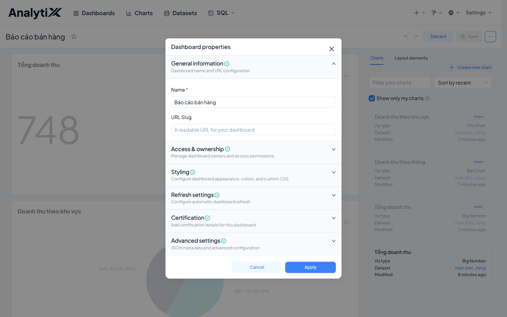

# Đặt quyền và chia sẻ dashboard

Trang này cho người khác xem một dashboard khi họ **có tài khoản AnalytiX**.
Người xem không có tài khoản thì đây là trang sai — việc đó ở
[Nhúng dashboard bằng iframe đơn giản](../nhung/nhung-iframe-don-gian.md).

Dành cho người dựng báo cáo. Cần có trước: một dashboard đã dựng xong, và danh
sách người cần xem nó.

## Các bước

### 1. Mở hộp thuộc tính

Bấm **Edit dashboard** trước, rồi mới **⋯** ở góc trên phải → **Edit properties**.

**Không vào chế độ sửa thì không thấy mục đó.** Menu **⋯** ở chế độ xem chỉ có
*Refresh dashboard*, *Set auto-refresh*, *Enter fullscreen*, *Save as*,
*Download*, *Share*. **Edit properties** chỉ xuất hiện sau khi bấm
**Edit dashboard**.

Ba mục cần tới trong hộp thoại:

| Mục | Ý nghĩa |
|---|---|
| **General information** | Tên trang và URL slug |
| **Access & ownership** | Ai sửa được trang này |
| **Certification** | Đánh dấu trang đã được duyệt, hiện huy hiệu cạnh tiêu đề |

### 2. Chuyển Draft sang Published

Trạng thái này **không** nằm trong hộp thuộc tính — nó là nhãn cạnh tiêu đề
trang. Dashboard mới luôn ở **Draft**; bấm vào chữ đó để chuyển sang
**Published**.

*Draft* chỉ người tạo thấy. *Published* mới hiện trong danh sách chung.

### 3. Chia sẻ

Gửi thẳng URL của trang cho người cần xem.

:::warning[Chia sẻ link không tự cấp quyền]
Người nhận phải có tài khoản AnalytiX **và** có quyền đọc dataset bên dưới.
Thiếu quyền dataset thì họ mở được trang nhưng biểu đồ báo lỗi.
:::

Việc cấp quyền đọc dataset cho một người là **việc của quản trị** — làm ở màn
**Roles**, không làm từ trong dashboard. Cần thì nhờ quản trị cấp.

## URL slug và việc nhúng

URL slug đặt ở **General information** chính là mã trang dùng khi nhúng `iframe`
— xem [Nhúng dashboard bằng iframe đơn giản](../nhung/nhung-iframe-don-gian.md).

## Kiểm tra là đã đúng

Hai thứ phải đúng:

- nhãn cạnh tiêu đề trang đọc là **Published**, không còn là *Draft*;
- một người dùng khác mở URL đó thấy được trang, và thấy đủ số liệu trong các
  biểu đồ.

## Lỗi hay gặp

| Hiện tượng | Nguyên nhân | Cách sửa |
|---|---|---|
| Người khác không thấy trang | Trang vẫn ở trạng thái *Draft* | Bấm chữ *Draft* cạnh tiêu đề để chuyển sang *Published* |
| Người khác mở được trang nhưng biểu đồ lỗi | Họ không có quyền trên dataset | Nhờ quản trị cấp quyền đọc dataset |
| Menu **⋯** không có **Edit properties** | Chưa bấm **Edit dashboard** | Bấm **Edit dashboard** trước, rồi mở lại menu **⋯** |
| Người nhận link bị đẩy về trang đăng nhập | Họ không có tài khoản AnalytiX | Nhúng trang thay vì chia sẻ link — xem [Nhúng dashboard bằng iframe đơn giản](../nhung/nhung-iframe-don-gian.md) |

## Liên quan

- [Xếp biểu đồ thành dashboard](./xep-bieu-do-thanh-dashboard.md) — việc phải làm trước trang này
- [Nhúng dashboard bằng iframe đơn giản](../nhung/nhung-iframe-don-gian.md) — cho người xem không có tài khoản
- [Nhúng dashboard qua SDK cho đối tác ngoài](../nhung/nhung-qua-sdk.md) — khi cần phân quyền theo người xem
- [Lỗi theo bước](../../reference/loi-theo-buoc.md) — bảng lỗi đầy đủ cho lớp Dashboard
