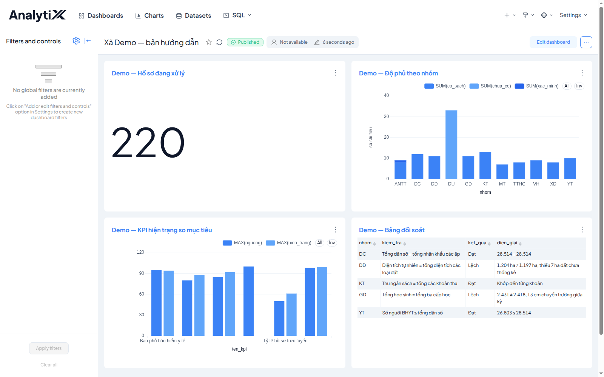
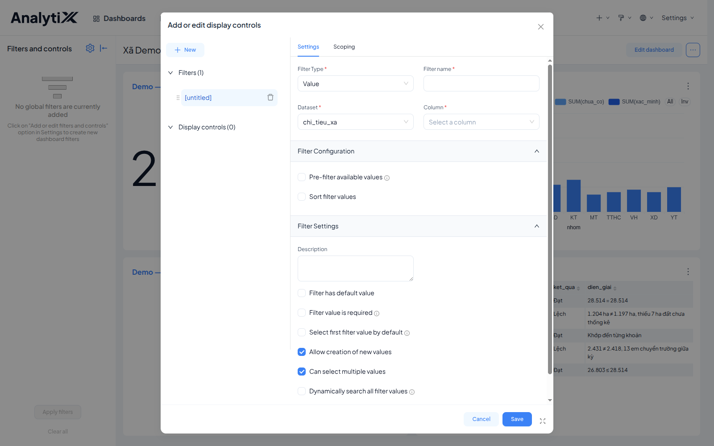
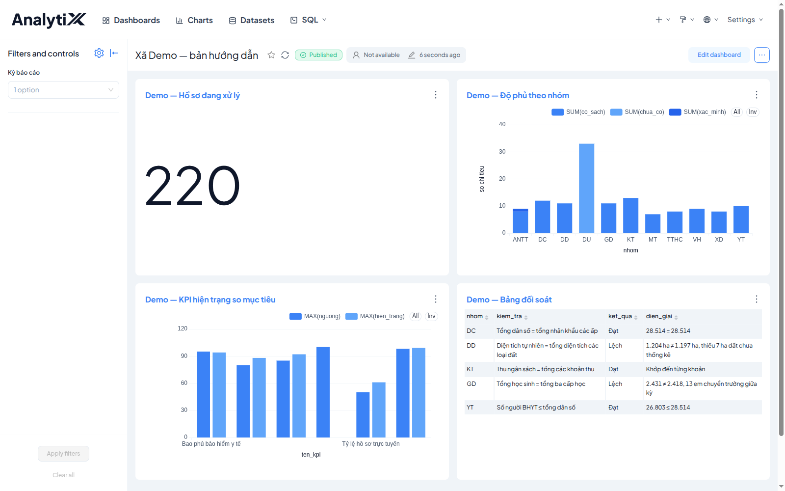

# Thêm bộ lọc dùng chung cho dashboard

Trang này khai một ô lọc đặt ở dashboard, tác động lên **tất cả** biểu đồ cùng
lúc. Nếu chỉ cần lọc đúng một biểu đồ thì không dùng cách này — khai bộ lọc ngay
trong biểu đồ đó, vì bộ lọc khai trong một biểu đồ chỉ tác động lên chính biểu đồ
đó. Bộ lọc dashboard là thứ biến mấy biểu đồ rời rạc thành một trang báo cáo.

Dành cho người dựng báo cáo. Cần có trước: một dashboard đã có biểu đồ, và quyền
sửa dashboard đó.

## Các bước

1. Mở dashboard, rồi mở thanh **Filters and controls** bên trái. Nếu thanh đang
   thu lại, bấm mũi tên để bung ra.

   
2. Bấm icon bánh răng → **Add or edit filters and controls**.

   
3. Khai bốn ô. Ví dụ với dataset `chi_tieu_xa` và cột `ky`:

   ```
   Filter Type    Value
   Filter name    Kỳ báo cáo
   Dataset        chi_tieu_xa
   Column         ky
   ```

   `Filter Type` là `Value` cho ô lọc chọn theo giá trị của một cột — loại dùng
   trong phần lớn trường hợp. Hộp thoại còn các loại khác; trang này không nói về
   chúng. `Filter name` là chữ người đọc thấy trên thanh trái, đặt tuỳ bạn.
   `Dataset` và `Column` là nguồn dữ liệu và cột cần lọc của bạn.
4. Bấm **Save**.

   
5. Lặp lại từ bước 2 cho mỗi cột cần lọc thêm — ví dụ một ô **Đơn vị** trên cột
   `unit_code`.

**Bộ lọc chỉ chạm tới biểu đồ dùng chung dataset với nó.** Đây là chỗ hay kẹt
nhất. Bộ lọc khai trên `chi_tieu_xa` sẽ không lọc được biểu đồ đọc một dataset
khác, ví dụ `mart.coverage`. Muốn một bộ lọc chạm tới cả bốn biểu đồ thì cả bốn
phải đọc cùng một dataset, hoặc bạn khai nhiều bộ lọc song song — mỗi dataset một
bộ. Tab **Scoping** trong cùng hộp thoại cho phép chỉ định bộ lọc này áp vào biểu
đồ nào.

**Danh sách lựa chọn của ô lọc tự cập nhật theo dữ liệu.** Ô `Kỳ báo cáo` ở ảnh
trên chỉ có một lựa chọn vì database mới có một kỳ. Khi kỳ sau được nạp, ô này tự
có thêm lựa chọn mà không phải sửa gì trong dashboard.

## Kiểm tra là đã đúng

Ô lọc vừa khai xuất hiện trên thanh **Filters and controls** bên trái, mang đúng
tên bạn đặt ở `Filter name`.

Chọn một giá trị trong ô đó. Các biểu đồ đọc cùng dataset với bộ lọc phải đổi số
liệu theo. Biểu đồ đọc dataset khác giữ nguyên — đó là hành vi đúng, không phải
lỗi.

## Lỗi hay gặp

| Hiện tượng | Nguyên nhân | Cách sửa |
|---|---|---|
| Bộ lọc không tác động lên một biểu đồ | Biểu đồ đó đọc dataset khác | Kiểm tab *Scoping*, hoặc khai thêm một bộ lọc cho dataset kia |
| Ô lọc không có lựa chọn nào | Cột khai sai, hoặc dataset rỗng | Kiểm lại ô *Column* |
| Chọn giá trị xong nhưng không biểu đồ nào đổi, và ô lọc chỉ hiện khi mở một biểu đồ | Bộ lọc được khai trong biểu đồ, không phải ở dashboard | Khai lại từ icon bánh răng trên thanh *Filters and controls* của dashboard |

## Liên quan

- [Xếp biểu đồ thành dashboard](./xep-bieu-do-thanh-dashboard.md)
- [Tạo biểu đồ](../bieu-do/tao-bieu-do.md)
- [Tạo dataset](../dataset/tao-dataset.md)
- [Lỗi theo bước](../../reference/loi-theo-buoc.md)
