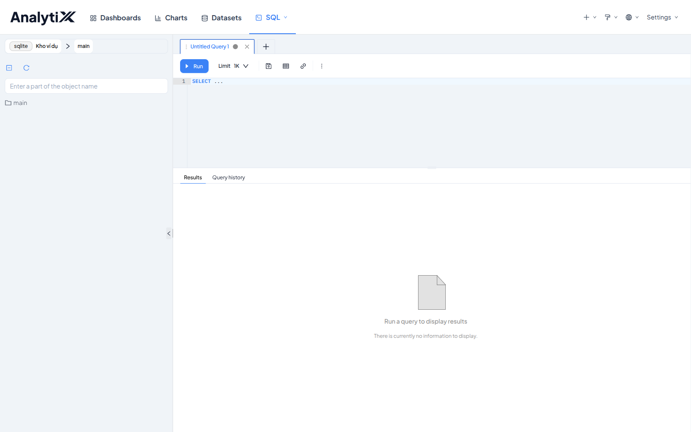
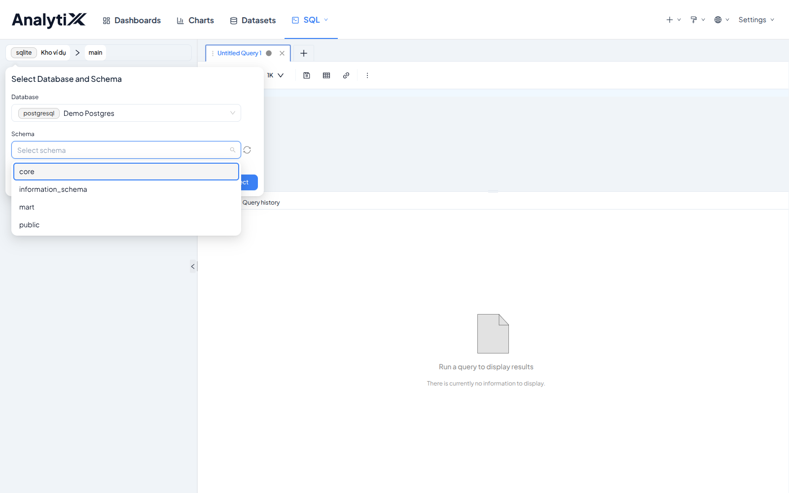
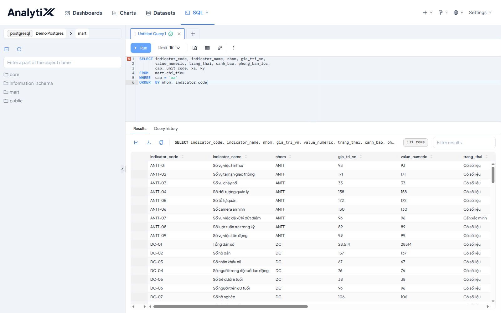
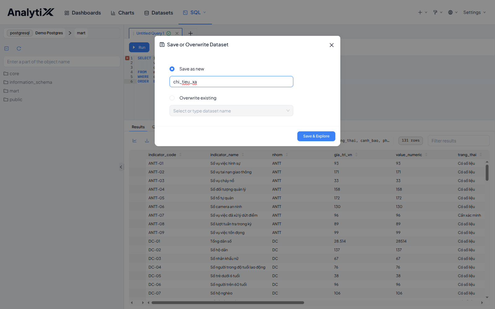
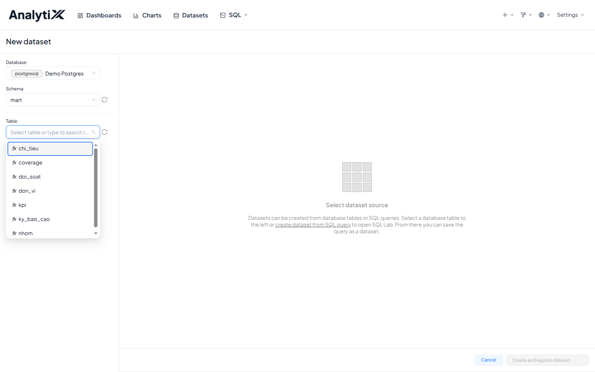

# Tạo dataset

Trang này tạo lớp dataset — thứ duy nhất biểu đồ đọc được — bằng một trong hai
đường: lưu một câu SQL từ SQL Lab, hoặc trỏ thẳng vào một bảng/view có sẵn.
Không dùng trang này khi dataset đã tồn tại và bạn chỉ cần sửa câu SQL của nó:
việc đó làm ở `Edit` → tab `Source` của chính dataset đó.

Dành cho người dựng báo cáo. Cần có trước: một database đã nối vào AnalytiX và
đã bật *Expose database in SQL Lab*, cùng quyền đọc schema chứa dữ liệu.

## Đường nào dùng khi nào

| | Đường A — lưu SQL từ SQL Lab | Đường B — trỏ vào bảng/view |
|---|---|---|
| Ra loại dataset | **Virtual** — định nghĩa là câu SQL bạn viết | **Physical** — trỏ thẳng vào một bảng hoặc view |
| Định nghĩa nằm ở | Trong AnalytiX | Trong database |
| Ai nhìn thấy logic | Chỉ người mở AnalytiX | Cả tổ chức, qua schema của database |
| Hợp khi | Cần nối bảng, lọc sẵn, hoặc thêm cột tính riêng cho một trang | View đã có đúng thứ bạn cần |

Mặc định của dự án này là **Đường B trên schema `mart`** — `mart` đã là các view
dựng sẵn cho báo cáo. Để Đường A cho việc dùng một lần hoặc lúc thăm dò. Lý do
đầy đủ nằm ở [Hai cách tạo dataset](../../explanation/hai-cach-tao-dataset.md).

Loại nguồn không khóa cứng lúc tạo: mở dataset → `Edit` → tab `Source` đổi giữa
`Physical (table or view)` và `Virtual (SQL)` bất cứ lúc nào.

## Đường A — lưu một câu SQL từ SQL Lab

1. Menu **SQL** trên thanh trên → **SQL Lab**.

   

2. Bấm ô chọn database ở góc trên bên trái panel trái, chọn database và schema,
   rồi bấm **Select**.

   

   **SQL Lab nhớ lựa chọn của lần trước.** Nhiều khả năng nó đang trỏ vào một
   database khác — kiểm lại hai ô này trước khi gõ SQL, kể cả khi bạn vừa mở
   SQL Lab hôm qua. Panel trái hiện đúng danh sách schema nghĩa là kết nối ổn;
   panel trống hoặc báo lỗi thì quay lại kiểm ô *Expose database in SQL Lab*.

3. Gõ truy vấn vào khung soạn SQL, bấm **Run**, và đọc số dòng ở góc phải vùng
   Results trước khi lưu.

   ```sql
   SELECT indicator_code, indicator_name, nhom, gia_tri_vn,
          value_numeric, trang_thai, cap, unit_code, xa, ky
   FROM   mart.chi_tieu
   WHERE  cap = 'xa'
   ORDER  BY nhom, indicator_code
   ```

   

   Trong ví dụ trên, `mart.chi_tieu` chứa cả cấp xã lẫn cấp tỉnh nên `WHERE cap = 'xa'`
   là bắt buộc — bỏ nó thì mỗi chỉ tiêu bị đếm hai lần, ra 262 dòng thay vì 131.
   Với dữ liệu của bạn, điều tương đương là: mọi điều kiện lọc cần cho biểu đồ
   phải nằm trong câu SQL này, vì dataset sẽ mang nguyên nó.

4. Bấm icon **Save dataset** trên thanh công cụ, bên phải nút Run.

   

5. Chọn **Save as new**, xóa tên mặc định (`Untitled Query ...`), gõ tên theo
   nội dung — ví dụ `chi_tieu_xa` — rồi bấm **Save & Explore**.

:::warning `Save as new` không phải `Overwrite existing`
Lần đầu luôn là `Save as new`. Về sau khi sửa câu SQL, chọn `Overwrite existing`
để mọi biểu đồ đang dùng dataset đó cập nhật theo. Chọn `Save as new` sẽ tạo một
dataset thứ hai, và các biểu đồ cũ vẫn đọc dataset cũ.
:::

**Đặt tên theo nội dung, không theo thời điểm.** Tên mặc định mang dấu thời gian
của lúc bạn chạy truy vấn; sáu tháng sau nó không nói lên điều gì.

## Đường B — trỏ thẳng vào một bảng hoặc view

1. **Datasets** trên thanh trên → **+ Dataset**.

2. Chọn lần lượt ba ô **Database** → **Schema** → **Table**.

   

   Ô Table liệt kê cả bảng và view của schema đang chọn. Ví dụ trong dự án này:
   `mart` → `coverage`.

3. Bấm **Create and explore dataset**. AnalytiX mở màn chọn loại biểu đồ ngay.

Dataset tạo theo đường này không có ô SQL — mọi điều kiện lọc phải khai ở từng
biểu đồ, hoặc đẩy xuống thành view trong database.

## Kiểm tra là đã đúng

Mở **Datasets** trên thanh trên. Dataset vừa tạo nằm đầu danh sách, đúng tên bạn
đặt, cột `Database` và `Schema` đúng nguồn bạn chọn.

Bấm vào tên nó: màn Explore mở ra, panel trái liệt kê Metrics và Columns, bảng
kết quả bên phải ghi số dòng. Với ví dụ `chi_tieu_xa` số đó là `131 rows` — số
dòng này phải khớp với số dòng SQL Lab trả về ở bước 3.

## Lỗi hay gặp

| Hiện tượng | Nguyên nhân | Cách sửa |
|---|---|---|
| Panel trái không thấy schema nào | SQL Lab đang trỏ database khác | Bấm ô chọn database, đổi sang database đúng |
| `relation "chi_tieu" does not exist` | Thiếu tên schema | Viết đủ `mart.chi_tieu` |
| Số dòng ra 262 thay vì 131 | Thiếu `WHERE cap = 'xa'` | Thêm điều kiện lọc cấp |
| `permission denied for schema` | Nối bằng tài khoản khác tài khoản chỉ-đọc đã cấp | Kiểm lại Username ở bước nối database |
| Nút Save dataset mờ | Chưa chạy truy vấn lần nào | Bấm Run trước |

## Liên quan

- [Hai cách tạo dataset](../../explanation/hai-cach-tao-dataset.md) — vì sao có hai đường, và chọn đường nào
- [Nối vào một database](../ket-noi/noi-vao-mot-database.md) — việc phải làm trước trang này
- [Tạo biểu đồ](../bieu-do/tao-bieu-do.md) — việc làm tiếp sau khi có dataset
- [Viết SQL an toàn với cột dạng chữ](./viet-sql-an-toan.md) — ép kiểu đúng cách cho câu SQL ở Đường A
- [Lỗi theo bước](../../reference/loi-theo-buoc.md) — bảng lỗi đầy đủ cho mọi lớp
