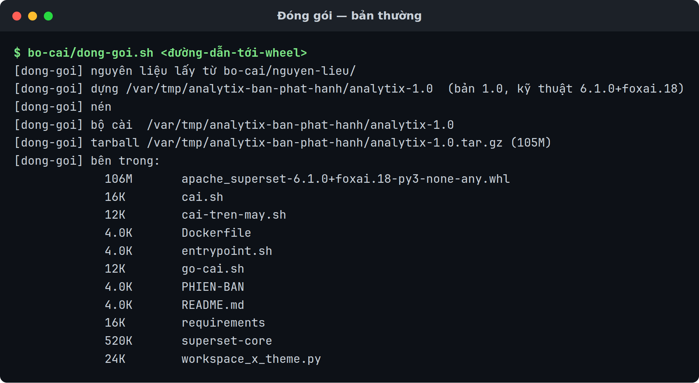

# Đóng gói bản phát hành

Tạo bản đóng gói `analytix-<bản>.tar.gz` để giao cho người khác cài.

Dành cho người bảo trì AnalytiX. Cần có trước: mã nguồn AnalytiX, và một tệp
wheel `apache_superset-<bản>-py3-none-any.whl` đã build.

Trang này **không** nói cách build wheel — đó là việc khác, cần Node.js và một
máy build riêng.

## Các bước

```bash
bo-cai/dong-goi.sh <đường-dẫn-tới-wheel> [thư-mục-đích]
```

Thư mục đích mặc định `/var/tmp/analytix-ban-phat-hanh`. Kết quả:

```
<đích>/analytix-<bản>/          thư mục bundle
<đích>/analytix-<bản>.tar.gz    bản nén, khoảng 105 MB
```



## Bản đóng gói chứa gì

| Trong bundle | Lấy từ |
|:---|:---|
| `apache_superset-<bản>-py3-none-any.whl` | tham số bạn truyền vào |
| `requirements/base.txt` | `src/requirements/base.txt`, hoặc `bo-cai/nguyen-lieu/requirements/base.txt` |
| `superset-core/` | `src/superset-core`, hoặc `bo-cai/nguyen-lieu/superset-core` (cả cây) |
| `workspace_x_theme.py` | `theme/workspace_x_theme.py` |
| `cai.sh` | `bo-cai/cai.sh` |
| `go-cai.sh` | `bo-cai/go-cai.sh` |
| `cai-tren-may.sh` | `bo-cai/cai-tren-may.sh` |
| `entrypoint.sh` | `bo-cai/entrypoint.sh` |
| `Dockerfile` | `bo-cai/Dockerfile` |
| `PHIEN-BAN` | sinh tự động — xem mục dưới |
| `README.md` | sinh tự động |

**Không** có trong bundle: `patches/`, `translations/` (đã biên dịch vào wheel),
`gates/`, `tools/`.

`requirements/base.txt` và `superset-core/` có hai nguồn vì repo sản phẩm không
chứa `src/` (320 MB mã nguồn Superset), nên nó giữ sẵn bản sao 540 KB ở
`bo-cai/nguyen-lieu/`. Script tự chọn: có `src/` thì cắt từ cây nguồn vừa build, không
thì dùng `bo-cai/nguyen-lieu/`. Dòng nó in ra cho biết đã chọn đường nào.

`bo-cai/nguyen-lieu/CUT-FROM` ghi version của wheel mà bản sao đó được cắt ra cùng. Đưa
wheel khác thế hệ vào thì script dừng — xem bảng Lỗi hay gặp.

Bundle vừa là bộ cài vừa là build context: `Dockerfile` `COPY` wheel,
`requirements/`, `superset-core/`, `workspace_x_theme.py` và `entrypoint.sh` từ
**chính thư mục bundle**. Nên cùng một thư mục dùng được cho cả hai đường cài,
và chúng **không thể lệch nhau**. Đó là lý do build context của `docker build`
phải là chính thư mục bundle: `cai.sh --docker` chạy `docker build -t
analytix:<bản> -f Dockerfile .` sau khi đã `cd` vào đó, còn
`dong-goi-ban-offline.sh` truyền thẳng thư mục bundle làm context.

## Hai phiên bản, đừng lẫn

Tên bản đóng gói mang **phiên bản sản phẩm**, không mang phiên bản kỹ thuật.

| Gọi là | Ví dụ | Lấy từ đâu | Dùng để |
|:---|:---|:---|:---|
| Phiên bản sản phẩm | `1.0` | dòng `ANALYTIX_VERSION` trong `UPSTREAM` | đặt tên tệp giao cho người dùng |
| Phiên bản kỹ thuật | `6.1.0+foxai.18` | tên tệp wheel | truy nguồn: Superset nào, bản vá thứ mấy |

Tách ra vì chuỗi `6.1.0+foxai.18` nói đúng thứ người bảo trì cần mà người nhận
không đọc được. Người nhận thấy `analytix-1.0.tar.gz`; bạn vẫn truy được nó dựng
từ đâu.

Sợi dây nối hai cái nằm trong tệp `PHIEN-BAN` của mỗi bundle:

```
ANALYTIX_VERSION=1.0
FOXAI_VERSION=6.1.0+foxai.18
WHEEL=apache_superset-6.1.0+foxai.18-py3-none-any.whl
```

Lên bản mới thì sửa `ANALYTIX_VERSION` trong `UPSTREAM` **trước khi** đóng gói.
Quên sửa thì bundle mới đè lên tên cũ.

🔴 `bo-cai/dong-goi-ban-offline.sh` đọc phiên bản sản phẩm từ chính tệp
`PHIEN-BAN` này, không suy ra từ tên thư mục — đổi tên thư mục bundle đi thì nó
vẫn chạy đúng, nhưng xoá tệp đó đi thì nó dừng.

## Kiểm tra là đã đúng

Ba dòng cuối script in ra là đường dẫn bundle, đường dẫn tarball kèm kích thước,
rồi danh sách nội dung:

```
[dong-goi] bộ cài  /var/tmp/analytix-ban-phat-hanh/analytix-1.0
[dong-goi] tarball /var/tmp/analytix-ban-phat-hanh/analytix-1.0.tar.gz (105M)
[dong-goi] bên trong:
```

Danh sách bên dưới phải có 11 mục. Kiểm lại bằng tay:

```bash
cd /var/tmp/analytix-ban-phat-hanh/analytix-<bản>
ls apache_superset-*.whl requirements/base.txt superset-core workspace_x_theme.py \
   cai.sh go-cai.sh cai-tren-may.sh entrypoint.sh Dockerfile PHIEN-BAN README.md
```

Đủ 11 mục là bundle hoàn chỉnh.

Kiểm thật thì giải nén tarball ra một thư mục khác rồi cài vào một
`ANALYTIX_HOME` tạm. Bước này cần mạng ra PyPI:

```bash
tar xzf /var/tmp/analytix-ban-phat-hanh/analytix-<bản>.tar.gz -C /var/tmp
cd /var/tmp/analytix-<bản>
ANALYTIX_HOME=/var/tmp/thu-analytix ./cai-tren-may.sh
```

Gọi thẳng `cai-tren-may.sh`, đừng gọi `./cai.sh --may`: `cai.sh` cài xong là
`exec` sang `khoi-dong.sh` và chiếm terminal để chạy máy chủ, còn ở đây ta chỉ cần
bước cài.

Bộ cài tự khẳng định bộ pin không bị resolver đè, theme nạp được và tên sản phẩm
đúng. Thấy đủ ba dòng này là đạt (`cai-tren-may.sh` in tiếng Anh):

```
[analytix] cachelib 0.13.0 matches the pin
[analytix] config loads: AnalytiX ['en', 'vi']
[analytix] installed AnalytiX <kỹ-thuật> in /var/tmp/thu-analytix
```

Dọn bản thử: `rm -rf /var/tmp/thu-analytix /var/tmp/analytix-<bản>`. **Đừng** dùng
`./go-cai.sh` để dọn nó — `go-cai.sh` cũng ngó container `analytix`, volume
`analytix-data` và mọi ảnh `analytix:*` trên máy, nên nó có thể chạm vào bản cài
thật chứ không chỉ bản thử.

## Lỗi hay gặp

| Hiện tượng | Nguyên nhân | Cách sửa |
|:---|:---|:---|
| `src/ còn thay đổi chưa commit` | `src/` còn thay đổi chưa commit | Commit trước. Đây là **chủ ý**: wheel mang mã băm git của nguồn, nên nguồn phải ở trạng thái xác định được |
| `không có wheel ở <đường-dẫn>` | Đường dẫn không trỏ tới một tệp — gõ sai, hoặc truyền thư mục | Truyền đúng tệp `.whl` |
| `<tên> không phải wheel apache_superset` | Tên không khớp `apache_superset-*-py3-none-any.whl` | Truyền đúng tệp wheel; script nhận dạng theo tên nên đừng đổi tên nó |
| `cách dùng: bo-cai/dong-goi.sh ...` | Gọi script không có đối số | `bo-cai/dong-goi.sh <đường-dẫn-wheel>` |
| `bo-cai/nguyen-lieu/ cắt từ X nhưng wheel là Y` | Wheel khác thế hệ với bản sao trong `bo-cai/nguyen-lieu/` | Làm mới `bo-cai/nguyen-lieu/` theo `bo-cai/nguyen-lieu/README.md`, rồi sửa `CUT-FROM` |
| `thiếu .../nguyen-lieu/requirements/base.txt` | Không có `src/` mà `bo-cai/nguyen-lieu/` cũng thiếu | Lấy lại hai mảnh đó — `bo-cai/nguyen-lieu/README.md` ghi cách |
| `UPSTREAM không có dòng ANALYTIX_VERSION=` | Thiếu dòng phiên bản sản phẩm | Thêm `ANALYTIX_VERSION=<bản>` vào cuối `UPSTREAM` |
| Bundle cài được nhưng mất thương hiệu | `workspace_x_theme.py` không được chép vào | Kiểm `theme/workspace_x_theme.py` có trong mã nguồn |

Riêng `bo-cai/dong-goi-ban-offline.sh` — bước cắt bản offline ở cuối trang:

| Hiện tượng | Nguyên nhân | Cách sửa |
|:---|:---|:---|
| `cách dùng: bo-cai/dong-goi-ban-offline.sh <thư-mục-bộ-cài> [thư-mục-đích]` | Gọi không có đối số | Truyền thư mục bundle, không truyền tarball |
| `không có thư mục bộ cài ở <đường-dẫn>` | Đối số 1 không phải một thư mục | Truyền `<đích>/analytix-<bản>/`, tức thư mục `dong-goi.sh` vừa dựng |
| `<thư-mục> không có Dockerfile; nó có phải bộ cài do dong-goi.sh dựng không?` | Trỏ vào thư mục khác, hoặc bundle bị cắt mất tệp | Trỏ vào `<đích>/analytix-<bản>/`, hoặc dựng lại bằng `dong-goi.sh` |
| `không có wheel apache_superset trong <thư-mục>` | Bundle thiếu wheel | Dựng lại bundle bằng `dong-goi.sh` |
| `<thư-mục> không có tệp PHIEN-BAN; dựng lại bộ cài bằng bo-cai/dong-goi.sh` | Tệp `PHIEN-BAN` bị xoá khỏi bundle | Dựng lại bundle. Nó đọc phiên bản sản phẩm từ tệp đó, không từ tên thư mục |
| `không tìm thấy docker; script này dựng và lưu một ảnh` | Máy đóng gói chưa có Docker | Cắt bản offline trên máy có Docker — script phải `docker build` rồi `docker save` |
| `CẢNH BÁO: đang dựng trên <kiến-trúc>; bản phát hành chỉ chạy được trên <kiến-trúc>` | Máy đóng gói không phải `x86_64` | Chỉ là cảnh báo, script vẫn chạy. Nhưng ảnh đã lưu không chạy chéo kiến trúc, nên phải dựng trên máy cùng kiến trúc với máy đích |

Nó từ chối `src/` bẩn vì wheel mang theo mã băm git của nguồn đã build ra nó.
`src/` còn thay đổi chưa commit thì mã băm đó mô tả một trạng thái không ai lấy
lại được — và khi khách báo lỗi, bạn không dựng lại được đúng bản họ đang chạy.
Đây là **chốt đáng giữ**, đừng tìm cách đi vòng.

## Giao cho người khác

Gửi tarball kèm hai câu:

```bash
tar xzf analytix-<bản>.tar.gz && cd analytix-<bản>
./cai.sh
```

`cai.sh` dò máy có Docker hay có Python rồi chọn đường, nên người nhận không
phải tự quyết. Ép đường cụ thể bằng `--docker` hoặc `--may`.

Bundle có sẵn `README.md` sinh tự động. Nó nói: hai đường cài ở trên, cách gỡ,
lệnh kiểm `curl -s http://127.0.0.1:8088/health` phải trả về `OK`, và hai điều
cần biết — mật khẩu quản trị chỉ in một lần, và cài xong chỉ query được SQLite.
Nên hai điều đó bạn không phải nhắc lại.

Nhắc người nhận hai điều `README.md` trong bundle **không** nói:

1. **Cả hai đường cài đều cần mạng ra PyPI.** `README.md` chỉ đòi "Docker gọi
   được không cần sudo, hoặc Python 3.10/3.11/3.12" — nó không nói máy đích phải
   ra được internet. Máy đích không có mạng thì cắt thêm bản offline ở dưới.
2. **Máy chủ web đi kèm là bản phát triển của Flask**, không phải WSGI cho vận
   hành thật. Dùng nội bộ thì được, mở ra Internet thì chưa.

Cần driver cho Postgres/MySQL/Trino thì chỉ người nhận sang
[Thêm driver](./them-driver-du-lieu.md) — bộ pin không mang driver nào.

:::danger[Cả hai đường trên đều cần mạng ra PyPI]
Bundle mang theo **danh sách** 156 gói đã ghim, không mang theo chính các gói đó.
`cai-tren-may.sh` và `docker build` đều phân giải danh sách ấy với PyPI, nên máy đích
không ra được internet là cả hai dừng giữa chừng.

Máy đích không có mạng thì cắt thêm một bước nữa:

```bash
bo-cai/dong-goi-ban-offline.sh /var/tmp/analytix-ban-phat-hanh/analytix-<bản>
```

Ra `/var/tmp/analytix-ban-phat-hanh/analytix-<bản>-khong-can-mang/` khoảng
433 MB — sáu tệp: ảnh đã dựng sẵn `analytix-<bản>-anh.tar.gz`, `cai.sh`,
`go-cai.sh`, `PHIEN-BAN`, `README.md` và `SHA256SUMS` (5 dòng: ảnh, `cai.sh`,
`go-cai.sh`, `PHIEN-BAN`, `README.md`). Chép nguyên thư mục đó sang máy đích.
Người nhận vẫn chỉ `./cai.sh` — cùng một tệp với bộ cài thường, nó thấy tệp ảnh
bên cạnh nên tự đi đường `--offline`. Xem [Cài trên máy không có
internet](./cai-tren-may-khong-co-mang.md).
:::

## Liên quan

- [Cài trên máy không có internet](./cai-tren-may-khong-co-mang.md)
- [Cài thực trên máy](./cai-dat-tren-may.md)
- [Cài bằng Docker](./cai-dat-bang-docker.md)
- [Thêm driver cho nguồn dữ liệu](./them-driver-du-lieu.md)
- [AnalytiX là gì](../explanation/analytix-la-gi.md)
