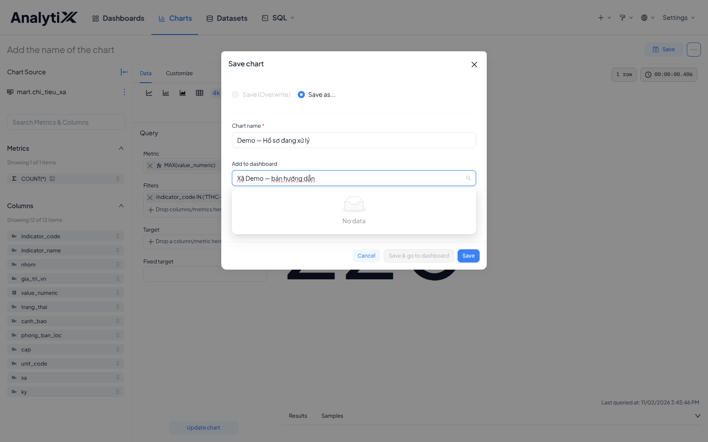
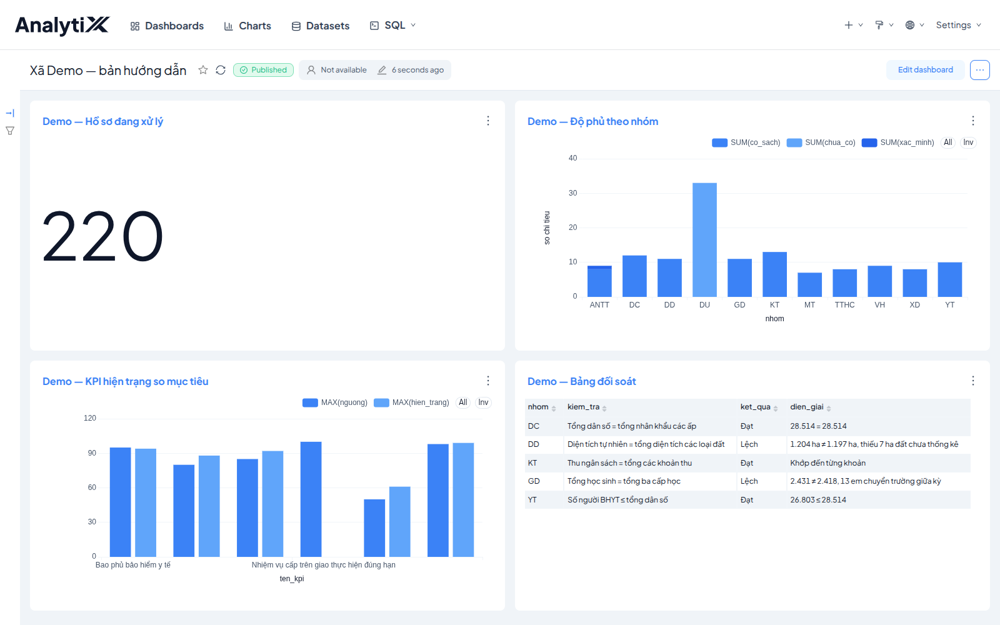

# Xếp biểu đồ thành dashboard

Trang này đưa nhiều biểu đồ đã lưu lên cùng một trang và sắp bố cục cho chúng.
Không dùng trang này khi bạn chỉ cần một biểu đồ đứng riêng — biểu đồ lưu xong
là đã xem được, không cần dashboard — hoặc khi cần nhúng trang ra ngoài, việc đó
ở [Nhúng dashboard bằng iframe đơn giản](../nhung-bao-cao/nhung-iframe-don-gian.md).

Dành cho người dựng báo cáo. Cần có trước: ít nhất hai biểu đồ đã lưu, và quyền
đọc dataset mà chúng dùng.

**Đọc chỗ này trước khi làm.** Ô `Add to dashboard` trong hộp `Save` của biểu đồ
ở bản 6.1.0 **chỉ chọn được dashboard đã tồn tại**. Gõ một tên chưa có thì danh
sách trả về `No data` — nó không tạo dashboard mới từ tên bạn gõ nữa. Đây là chỗ
kẹt thường gặp nhất của cả việc này.

## Hai đường gắn biểu đồ vào dashboard

**Đường A — gắn lúc lưu biểu đồ.** Ở màn biểu đồ, bấm **Save** góc trên phải.

1. Đặt tên biểu đồ ở ô `Chart name`.
2. Chọn dashboard đích ở ô `Add to dashboard`. Chỉ chọn trong danh sách đã có;
   dashboard chưa tồn tại thì danh sách trả `No data`.
3. Bấm **Save**.

Lặp lại cho từng biểu đồ còn lại, chọn cùng một dashboard. Đây là đường chắc
chắn nhất: biểu đồ nào lưu xong là nằm luôn trên trang.

**Đường B — gắn từ trong dashboard.** Mở dashboard, bấm **Edit dashboard** ở góc
trên phải, rồi kéo biểu đồ từ panel bên phải vào trang. Bấm **Save** để chốt.

Đường B hữu ích khi dashboard đã có sẵn và bạn không muốn mở lại từng biểu đồ.
Chưa có dashboard nào thì phải tạo trang trước ở **Dashboards** trên thanh trên,
vì Đường A không tạo được trang mới.

## Sắp bố cục

AnalytiX tự xếp mỗi biểu đồ một ô theo thứ tự thêm vào.

Muốn đổi bố cục thì bấm **Edit dashboard** ở góc trên phải rồi kéo thả:

- kéo **cạnh ô** để đổi kích thước;
- kéo **giữa ô** để đổi chỗ.

**Kích thước ô là cố định, nội dung không đẩy nó to ra.** Bảng dài hơn ô sẽ sinh
thanh cuộn bên trong, và trang vẫn trông bình thường cho tới lúc có người cần
đọc dòng cuối. Đặt ô cho bảng cao hơn mức bạn nghĩ là cần.

## Kiểm tra là đã đúng

Mở **Dashboards** trên thanh trên rồi vào trang vừa dựng. Đúng là:

- trang hiện đủ số biểu đồ bạn đã gắn — thiếu một cái là cái đó chưa gắn vào;
- biểu đồ nào cũng vẽ ra số liệu, không có ô nào báo lỗi.

## Lỗi hay gặp

| Hiện tượng | Nguyên nhân | Cách sửa |
|---|---|---|
| Ô `Add to dashboard` trả `No data` khi gõ tên | Dashboard đó chưa tồn tại; ô này không tạo trang mới | Tạo dashboard ở **Dashboards** trước, rồi quay lại chọn nó trong danh sách |
| Bảng bị cắt mất dòng cuối | Ô quá thấp | Vào **Edit dashboard**, kéo cạnh dưới ô xuống |
| Người khác không thấy trang | Trang vẫn ở trạng thái *Draft* | Bấm chữ *Draft* để chuyển sang *Published* — xem [Đặt quyền và chia sẻ dashboard](./dat-quyen-va-chia-se-dashboard.md) |
| Người khác mở được trang nhưng biểu đồ lỗi | Họ không có quyền trên dataset | Nhờ quản trị cấp quyền đọc dataset |

## Liên quan

- [Tạo biểu đồ](./tao-bieu-do.md) — việc phải làm trước trang này
- [Thêm bộ lọc dùng chung](./them-bo-loc-dung-chung.md) — cho người đọc lọc cả trang cùng lúc
- [Đặt quyền và chia sẻ dashboard](./dat-quyen-va-chia-se-dashboard.md) — chuyển *Draft* sang *Published* và cấp quyền
- [Dùng dashboard HTML trong SQL](./dung-dashboard-html-trong-sql.md)
- [Lỗi theo bước](../../reference/loi-theo-buoc.md) — bảng lỗi đầy đủ cho lớp Dashboard
