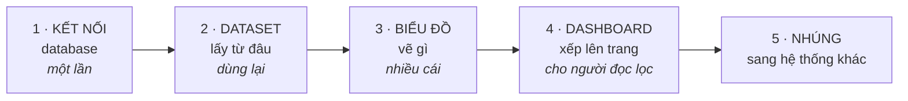

# Làm một việc cụ thể

Bạn đã cài xong và đang cần làm xong **một** việc. Trang này là bảng tra: tìm
dòng mô tả đúng việc bạn đang làm, rồi đi theo link.

Chưa cài gì thì bắt đầu ở [Bắt đầu nhanh](../tutorials/cai-dat-analytix.md). Muốn
đi hết một lượt từ database tới trang báo cáo thì đọc
[Từ database tới biểu đồ](../tutorials/tu-database-toi-bieu-do.md) — bài đó dạy,
các trang dưới đây chỉ làm.

## Bảy ngăn, mỗi ngăn một module

Năm ngăn đầu xếp đúng thứ tự bạn thực hiện: dữ liệu đi từ **kết nối** vào
**dataset**, dataset dựng ra **biểu đồ**, biểu đồ xếp lên **dashboard**, dashboard
**nhúng** sang hệ thống khác. Hai ngăn cuối là việc của quản trị, làm một lần.

## 1 · Kết nối database

| Tôi muốn… | Trang |
|:---|:---|
| cho AnalytiX đọc được database của tôi | [Nối vào một database](./ket-noi/noi-vao-mot-database.md) |
| nối vào PostgreSQL, MySQL, Trino… mà báo thiếu driver | [Thêm driver cho nguồn dữ liệu](./cai-dat/them-driver-du-lieu.md) |

## 2 · Dataset

| Tôi muốn… | Trang |
|:---|:---|
| khai "lấy dữ liệu từ đâu" để biểu đồ dùng | [Tạo dataset](./dataset/tao-dataset.md) |
| tính toán trên cột lưu dạng chữ mà không ra số `0` | [Viết SQL an toàn với cột dạng chữ](./dataset/viet-sql-an-toan.md) |
| biết nên lưu câu SQL hay trỏ thẳng vào view | [Hai cách tạo dataset](../explanation/hai-cach-tao-dataset.md) |

## 3 · Biểu đồ

| Tôi muốn… | Trang |
|:---|:---|
| **vẽ một biểu đồ** | [Tạo biểu đồ](./bieu-do/tao-bieu-do.md) |
| hiện một con số to thay vì biểu đồ | [Tạo biểu đồ](./bieu-do/tao-bieu-do.md) — phần Big Number |
| hiện bảng số liệu thô, không tính toán | [Tạo biểu đồ](./bieu-do/tao-bieu-do.md) — phần Table |
| một bố cục riêng, không theo biểu đồ có sẵn | [Dựng biểu đồ tuỳ chỉnh bằng HTML trong SQL](./bieu-do/bieu-do-tuy-chinh-html.md) |

## 4 · Dashboard

| Tôi muốn… | Trang |
|:---|:---|
| xếp nhiều biểu đồ lên một trang | [Xếp biểu đồ thành dashboard](./dashboard/xep-bieu-do-thanh-dashboard.md) |
| một ô lọc tác động lên cả trang | [Thêm bộ lọc dùng chung](./dashboard/them-bo-loc-dung-chung.md) |
| cho đồng nghiệp xem trang của tôi | [Đặt quyền và chia sẻ dashboard](./dashboard/dat-quyen-va-chia-se-dashboard.md) |

## 5 · Nhúng

| Tôi muốn… | Trang |
|:---|:---|
| **đưa dashboard lên một trang web khác** | [Nhúng bằng iframe đơn giản](./nhung/nhung-iframe-don-gian.md) |
| nhúng cho người xem **không có tài khoản**, phân quyền từng người | [Nhúng qua SDK cho đối tác ngoài](./nhung/nhung-qua-sdk.md) |
| tra tham số của thẻ `iframe` | [Tham số iframe](../reference/tham-so-iframe.md) |

## 6 · Trợ lý AI (MCP)

| Tôi muốn… | Trang |
|:---|:---|
| mô tả bằng lời thay vì bấm chuột | [Bật dịch vụ MCP](./mcp/bat-mcp.md) |
| mở dịch vụ MCP ra ngoài máy của tôi | [Đổi xác thực MCP sang JWT](./mcp/mcp-doi-sang-jwt.md) |
| xem trợ lý gọi được những gì | [Công cụ MCP](../reference/mcp-cong-cu.md) |

## 7 · Cài đặt

| Tôi muốn… | Trang |
|:---|:---|
| cài lên một máy có Docker | [Cài bằng Docker](./cai-dat/cai-dat-bang-docker.md) |
| cài mà không dùng Docker | [Cài thực trên máy](./cai-dat/cai-dat-tren-may.md) |
| cài lên máy **không có internet** | [Cài trên máy không có internet](./cai-dat/cai-tren-may-khong-co-mang.md) |
| thêm driver cho nguồn dữ liệu | [Thêm driver cho nguồn dữ liệu](./cai-dat/them-driver-du-lieu.md) |
| tạo bản đóng gói để giao cho người khác | [Đóng gói bản phát hành](./cai-dat/dong-goi-ban-phat-hanh.md) |

## Đang gặp lỗi

Có thông báo lỗi cụ thể thì tra thẳng, đừng đọc lại trang hướng dẫn:

| Lỗi ở đâu | Tra ở |
|:---|:---|
| lúc dựng báo cáo trên giao diện | [Lỗi theo bước](../reference/loi-theo-buoc.md) |
| lúc nhúng bằng SDK | [Mã lỗi khi nhúng qua SDK](../reference/ma-loi-sdk.md) |
| lúc cài — dòng bắt đầu bằng `[analytix] LỖI:` | mục *Lỗi hay gặp* của trang cài tương ứng |
