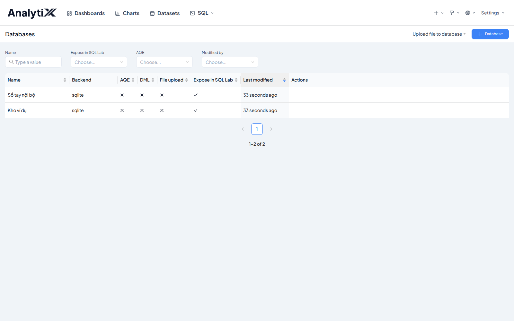
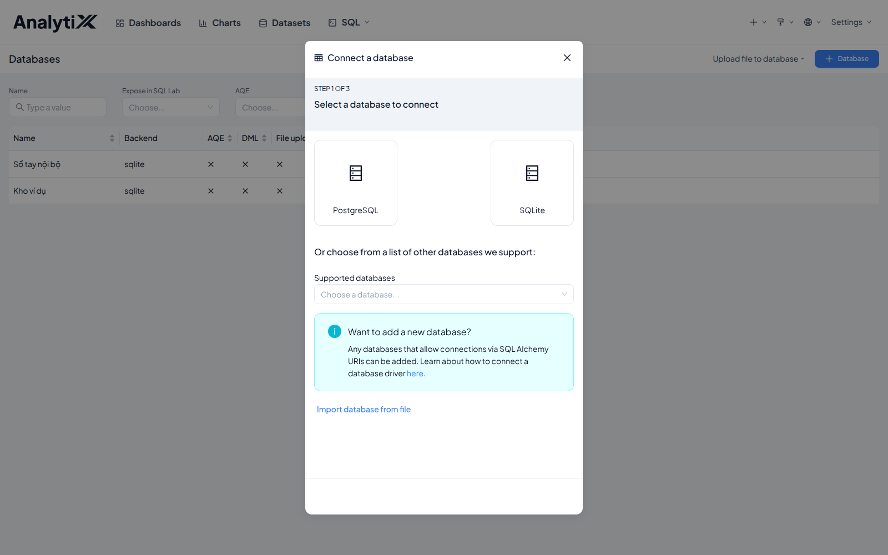
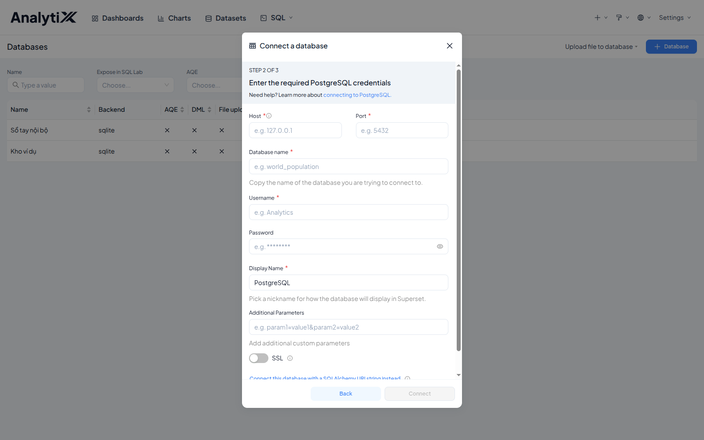
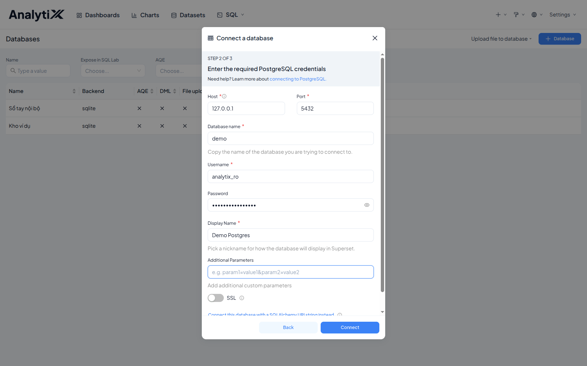
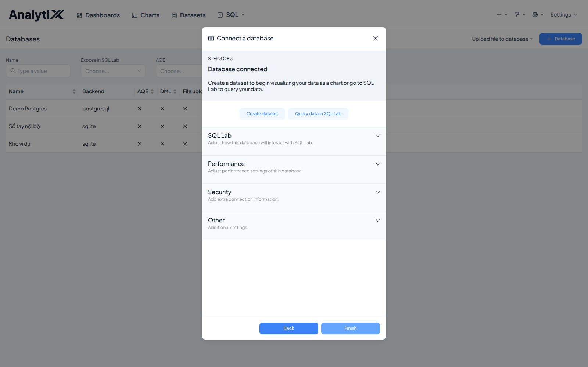
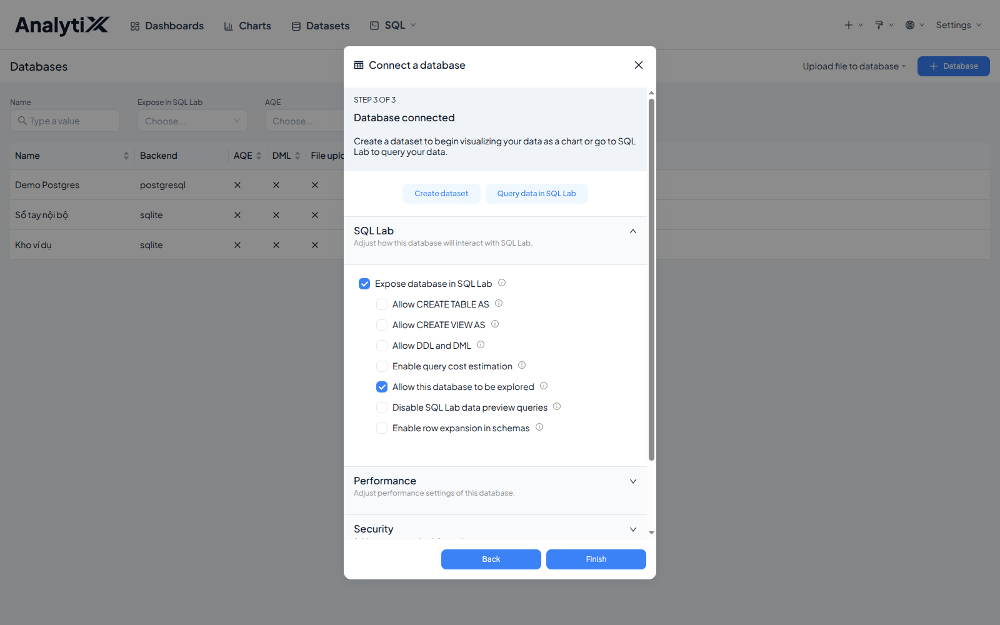
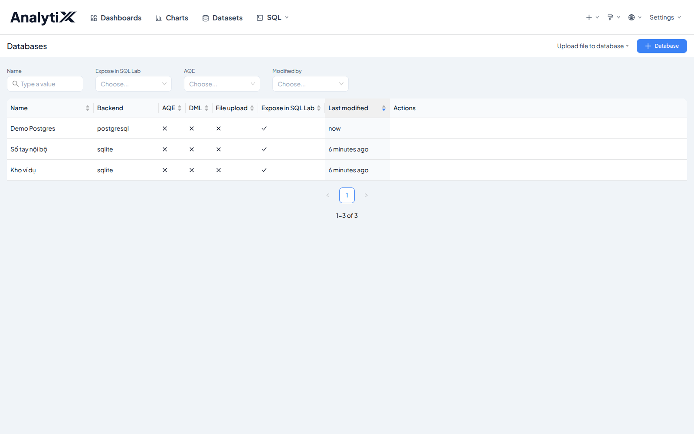

# Nối vào một database

Trang này khai một kết nối database mới trên giao diện AnalytiX, làm một lần rồi
cả hệ thống dùng chung. Chưa cài driver cho loại database đó thì đừng bắt đầu từ
đây — cài driver trước, xem [Thêm driver cho nguồn dữ liệu](../cai-dat/them-driver-du-lieu.md).

Dành cho người quản trị hoặc người dựng báo cáo. Cần có trước: AnalytiX đang
chạy, một database có dữ liệu, một tài khoản chỉ đọc, và driver tương ứng đã cài.
Giá trị demo dưới đây khớp với ảnh chụp; thay bằng giá trị của bạn, bước không đổi.

:::danger[Thiếu driver thì lỗi báo sai hướng]
Bản cài mặc định **không mang driver Postgres**. Chưa cài thì nút **Connect**
quay một lúc rồi báo `Please re-enter the password`, trong khi nguyên nhân thật
là `ModuleNotFoundError: No module named 'psycopg2'`. Cài `psycopg2-binary` rồi
khởi động lại tiến trình.
:::

## Các bước

### 1. Mở trang Databases

Menu **Settings** ở góc trên bên phải → **Database Connections**.



Bấm **+ Database**.

### 2. Chọn loại database



Chọn **PostgreSQL**. Không thấy loại của bạn trong các ô lớn thì mở ô
**Supported databases** bên dưới.

### 3. Điền năm ô thông tin kết nối

Hộp thoại chuyển sang bước 2 trên 3. Ô nào có dấu sao đỏ là bắt buộc.



```
Host            127.0.0.1
Port            5432
Database name   demo
Username        analytix_ro
Password        (xem từ điển dữ liệu)
Display Name    Demo Postgres
```



Ba chỗ dễ mất thời gian ở màn này:

**`Host` là `127.0.0.1`, không phải địa chỉ LAN của máy chủ.** Đúng khi AnalytiX
và database cùng một máy và database chỉ nghe trên địa chỉ nội bộ; điền địa chỉ
LAN sẽ báo không nối được. AnalytiX trong container thì ngược lại — xem Ghi chú
của [Lỗi theo bước](../../reference/loi-theo-buoc.md).

**`Display Name` chỉ là tên hiển thị.** Đặt gì cũng được; đặt rõ ràng thì sau
này trong danh sách dataset bạn biết ngay cái nào đọc từ đâu.

**Nút `Connect` chỉ sáng sau khi bạn rời ô cuối cùng.** Điền xong `Display Name`
mà con trỏ vẫn nằm trong đó thì nút còn mờ. Bấm `Tab`, hoặc click ra chỗ trống.

Bấm **Connect** một lần rồi chờ — bấm lần hai lúc nó còn kiểm thì cú bấm đầu bị bỏ.

### 4. Kiểm ba ô của nhóm SQL Lab

Kết nối thành công thì hộp thoại sang bước 3 trên 3. Chưa bấm **Finish** — mở
nhóm **SQL Lab** trước.





| Ô | Nên để | Vì sao |
|---|---|---|
| Expose database in SQL Lab | **bật** | Không bật thì SQL Lab không thấy database này, và không dựng được dataset từ SQL |
| Allow this database to be explored | **bật** | Cho phép dựng dataset từ một câu SQL thay vì từ bảng có sẵn |
| Allow DDL and DML | **tắt** | Cho phép ghi. Tài khoản chỉ đọc vốn không ghi được, nhưng tắt ở đây là lớp chặn thứ hai |

AnalytiX bật sẵn hai ô đầu. Ai đó tắt đi thì việc dựng dataset hỏng mà không báo lỗi rõ.

Bấm **Finish**.

## Kiểm tra là đã đúng



Dòng kết nối mới xuất hiện đầu danh sách, `Backend` đúng loại database (ở đây là
`postgresql`), cột **Expose in SQL Lab** có dấu tích, `Last modified` ghi `now`.

Rồi mở **SQL** → **SQL Lab**, chọn kết nối vừa tạo, chạy `SELECT 1` — ra một dòng.

## Lỗi hay gặp

| Hiện tượng | Nguyên nhân | Cách sửa |
|:---|:---|:---|
| `Please re-enter the password` mà mật khẩu đúng | Thiếu driver Postgres — thông báo sai hướng hoàn toàn | Cài `psycopg2-binary` rồi khởi động lại, xem [Thêm driver](../cai-dat/them-driver-du-lieu.md) |
| `Could not connect to database` | Sai `Host`. Bản cài thực trên máy: điền địa chỉ LAN thay vì `127.0.0.1` | Sửa `Host` thành `127.0.0.1` |
| `Could not connect to database` mà `Host` đã là `127.0.0.1` | AnalytiX chạy trong container — ở đó `127.0.0.1` là chính container | Xem Ghi chú *`Host` khi AnalytiX chạy trong container* ở [Lỗi theo bước](../../reference/loi-theo-buoc.md) |
| `password authentication failed` | Sai mật khẩu, hoặc sai tên tài khoản | Đối chiếu lại với từ điển dữ liệu |
| `database "demo" does not exist` | Gõ nhầm tên database | Kiểm lại tên, phân biệt chữ hoa chữ thường |
| Nút `Connect` không sáng | Con trỏ còn nằm trong ô cuối | Bấm `Tab` hoặc click ra chỗ trống |
| Kết nối xong nhưng SQL Lab không thấy | Ô *Expose database in SQL Lab* bị tắt | Mở lại kết nối, vào tab Advanced, bật nó lên |

## Liên quan

- [Thêm driver cho nguồn dữ liệu](../cai-dat/them-driver-du-lieu.md) — làm trước trang này
- [Tạo dataset](../dataset/tao-dataset.md) — bước kế tiếp
- [Lỗi theo bước](../../reference/loi-theo-buoc.md)
- [Từ database tới biểu đồ](../../tutorials/tu-database-toi-bieu-do.md)
