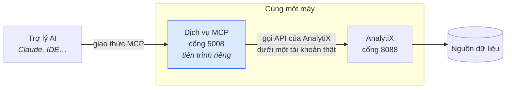
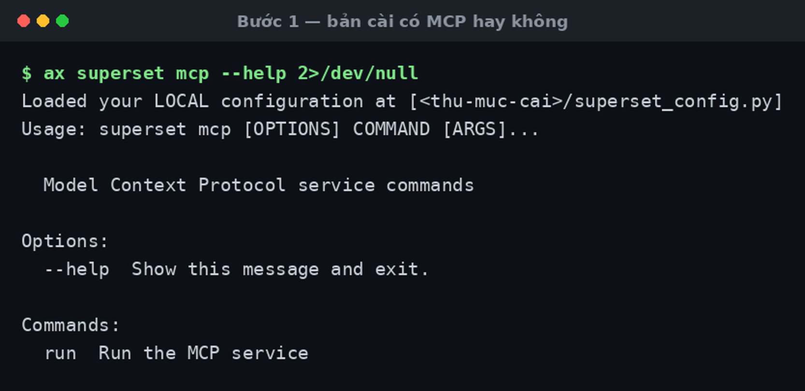
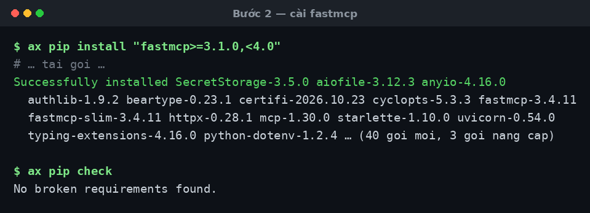
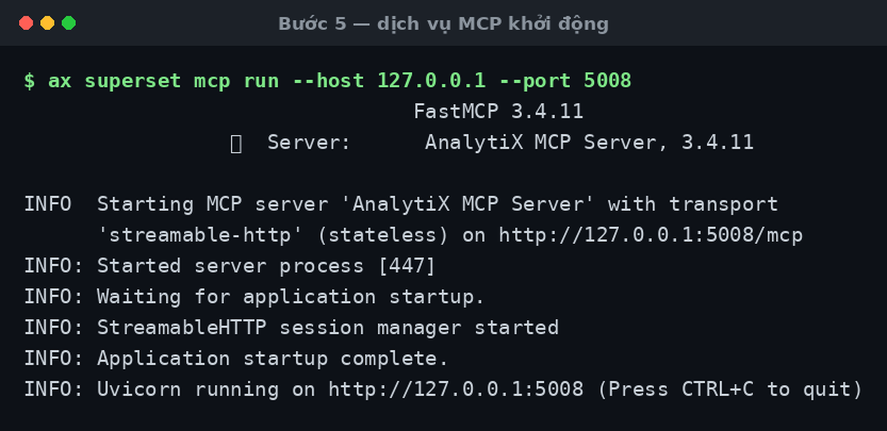
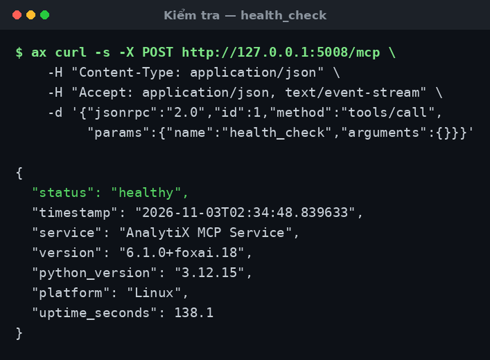
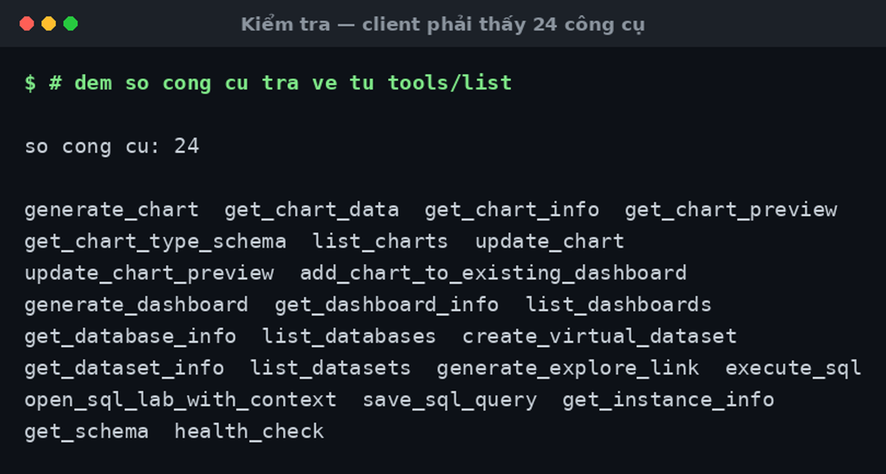
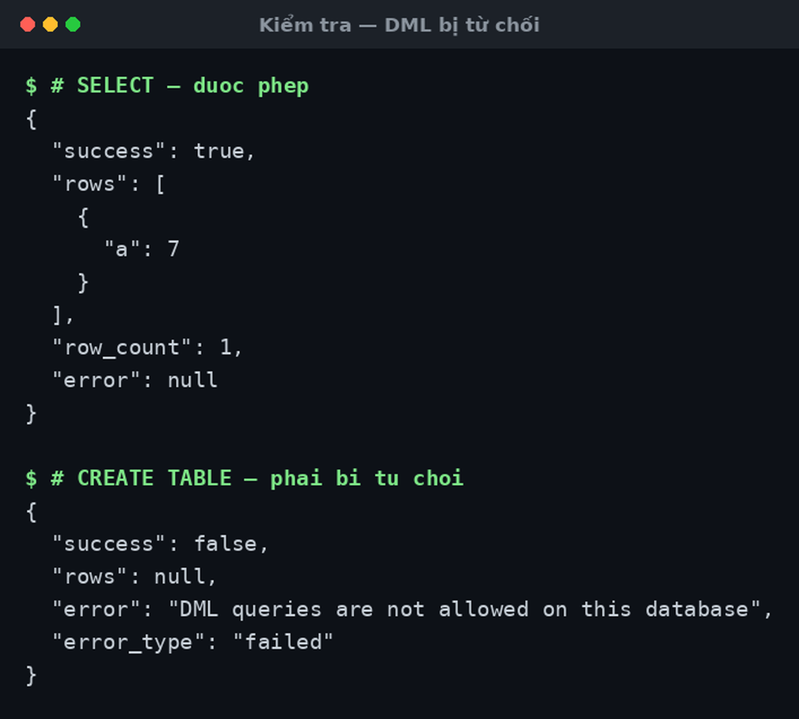

# Bật dịch vụ MCP

Bật dịch vụ cho phép trợ lý AI đọc dữ liệu và dựng biểu đồ trong công cụ trực
quan bằng lời. Dịch vụ chạy như **một tiến trình riêng** — xem
[Vì sao MCP là một dịch vụ riêng](../../explanation/vi-sao-mcp-la-service-rieng.md).

Dành cho người quản trị. Cần có trước: quyền ghi vào thư mục cài của công cụ
trực quan, và quyền khởi động tiến trình trên máy đó.

Mất khoảng 15 phút. Toàn bộ các bước dưới đây đã được chạy thật trên bản
`6.1.0+foxai.18` — ảnh trong trang là output thật của lần chạy đó.

Trước khi bắt đầu, cần biết **đây là tính năng tự thêm vào, không phải tính năng
có bảo hành**. Mã nguồn dịch vụ MCP có trong bản cài — nó đi theo nền Superset
6.1.0. Nhưng không có gì trong bộ cài bật nó lên: `cai-tren-may.sh`, `Dockerfile` và
`entrypoint.sh` đều không cài `fastmcp`, không mở cổng 5008, không khởi động
dịch vụ. Không bản vá nào của AnalytiX chạm vào nó. Bạn tự cài gói, tự viết cấu
hình, tự trông tiến trình.

## Sau khi bật, hệ thống trông thế này



MCP **không** đi vòng qua phân quyền: nó gọi đúng API mà giao diện web gọi,
dưới một tài khoản có vai trò cụ thể. Tài khoản đó thấy gì thì trợ lý thấy nấy.

## Chuẩn bị: một lối tắt tên `ax`

Hai đường cài đặt ra lệnh theo hai kiểu khác nhau. Thay vì viết đi viết lại
đường dẫn dài trong từng bước, **đặt một hàm shell tên `ax`** nghĩa là *"chạy
lệnh này bên trong bản cài AnalytiX"*. Chọn đúng một khối dưới đây, dán vào
terminal, rồi mọi bước sau đó dán được nguyên văn.

**Nếu cài thực trên máy** — thay `~/analytix` bằng `ANALYTIX_HOME` nếu lúc cài
bạn đặt khác mặc định:

```bash
ax() { ( . ~/analytix/venv/bin/activate; "$@" ); }
CFG=~/analytix/superset_config.py
```

**Nếu chạy bằng Docker** — thay `analytix` bằng tên container của bạn:

```bash
ax() { docker exec analytix "$@"; }
```

Thử ngay để biết lối tắt đã đúng:

```bash
ax python -V
```

In ra `Python 3.12.x` (hoặc 3.10/3.11) là được. Báo `command not found` thì
đường dẫn hoặc tên container sai — sửa trước khi đi tiếp.

## 1. Kiểm bản cài có MCP không

```bash
ax superset mcp --help 2>/dev/null
```



Thấy dòng `run  Run the MCP service` là bản cài có sẵn mã MCP. Báo
`No such command 'mcp'` là bản quá cũ — không có cách bật nào khác ngoài nâng cấp.

Lệnh này nạp cả ứng dụng lên trước khi in trợ giúp, nên nó đổ ra khoảng 30 dòng
log `INFO` — vô hại, nhưng che mất phần cần đọc. Đó là việc của `2>/dev/null`.

Kiểm tại chỗ như trên đáng tin hơn đọc tài liệu thượng nguồn: tài liệu đó ghi
yêu cầu *"Superset 5.0+"* là sai, mã nguồn `mcp_service/` không tồn tại trước
6.1.0.

## 2. Cài gói `fastmcp`

Đây thường là thứ duy nhất còn thiếu.

```bash
ax pip install "fastmcp>=3.1.0,<4.0"
ax pip check
```



Dòng cuối phải là `No broken requirements found.`

| Lần cài thật đã làm gì | Số lượng |
|:---|:---|
| Gói cài mới | 40 (`fastmcp 3.4.11`, `mcp`, `uvicorn`, `starlette`, `httpx`…) |
| Gói đã có bị nâng cấp | 3 — `certifi`, `python-dotenv`, `typing_extensions`, đều là bump nhỏ |
| `pip check` sau khi cài | sạch |

Muốn xem trước ảnh hưởng mà chưa cài thì thêm `--dry-run`, và muốn lùi lại được
thì lưu bản gói hiện tại trước:

```bash
ax pip freeze > /tmp/goi-truoc-khi-cai-mcp.txt
ax pip install --dry-run "fastmcp>=3.1.0,<4.0"
```

Giữ nguyên cận trên `<4.0`. Kho gói công khai đã có bản 4.x, và `fastmcp` tự
nhắc nâng cấp mỗi lần khởi động — đừng nghe, cài bản 4 là ra ngoài khoảng
AnalytiX hỗ trợ. Bản 3 cao nhất hiện là `3.4.11`.

## 3. Thêm khối cấu hình

Nối khối sau vào **cuối** `superset_config.py`. Thay
`http://127.0.0.1:8088` bằng địa chỉ người dùng thật sự gõ vào trình duyệt để
mở AnalytiX.

```python
MCP_SERVICE_HOST = "127.0.0.1"
MCP_SERVICE_PORT = 5008

# Chế độ dev: không kiểm token, chạy dưới một tài khoản cố định.
# An toàn CHỈ VÌ chỉ nghe trên 127.0.0.1. Mở ra ngoài thì phải đổi sang JWT.
MCP_AUTH_ENABLED = False
MCP_DEV_USERNAME = "admin"

# Phân quyền của AnalytiX vẫn áp dụng cho mọi công cụ MCP, kể cả RLS.
MCP_RBAC_ENABLED = True

# Tắt tìm-kiếm-công-cụ: khi bật, nó thay 24 công cụ bằng cặp proxy để tiết kiệm
# ngữ cảnh. 24 công cụ thì để client thấy trực tiếp đáng tin hơn.
MCP_TOOL_SEARCH_CONFIG = {"enabled": False}

SUPERSET_WEBSERVER_ADDRESS = "http://127.0.0.1:8088"
WEBDRIVER_BASEURL = "http://127.0.0.1:8088/"

# BẮT BUỘC — đây mới là biến sinh link trả về cho người dùng.
WEBDRIVER_BASEURL_USER_FRIENDLY = "http://127.0.0.1:8088/"
```

Tệp nằm ở đâu, và sửa bằng cách nào:

| | Đường dẫn | Sửa thế nào |
|:---|:---|:---|
| Cài thực trên máy | `$CFG` (tức `~/analytix/superset_config.py`) | mở bằng trình soạn thảo bình thường |
| Docker | `/app/analytix/superset_config.py` **bên trong** container | `docker cp` ra, sửa, `docker cp` vào — hoặc gắn sẵn một volume cho tệp này |

:::danger[Thiếu dòng cuối là link không bấm được]
AnalytiX gán `WEBDRIVER_BASEURL_USER_FRIENDLY` từ mặc định riêng của nó
**trước khi** `superset_config.py` chạy, nên đặt `WEBDRIVER_BASEURL` là **không
đủ**. Thiếu dòng cuối thì mọi link biểu đồ MCP trả về đều trỏ về một địa chỉ mặc
định sai và không mở được.
:::

Sửa tệp bên trong container là sửa trên lớp ghi tạm: `docker rm` rồi `docker
run` lại là mất sạch, kể cả gói `fastmcp` ở bước 2. Dùng lâu dài thì đưa cả hai
vào `Dockerfile` riêng của bạn, hoặc gắn volume.

## 4. Tắt quyền ghi trên kết nối dữ liệu

Trong giao diện web, mở khai báo kết nối mà MCP sẽ truy vấn, bỏ chọn cả bốn ô:
**Allow DML**, **Allow CTAS**, **Allow CVAS**, **Allow file upload**.

Đây là chốt an toàn thật — nó chặn ở tầng kết nối, không dựa vào việc MCP tự giữ
mình. Phần *Kiểm tra* ở dưới sẽ chứng minh chốt này có tác dụng.

## 5. Khởi động dịch vụ

```bash
ax superset mcp run --host 127.0.0.1 --port 5008
```



Hai dòng cần thấy: tên máy chủ là **`AnalytiX MCP Server`**, và dòng cuối
`Uvicorn running on http://127.0.0.1:5008`. Tiến trình chiếm luôn terminal và in
log mỗi lần trợ lý gọi một công cụ — mở terminal thứ hai để làm phần kiểm tra.

Chạy thường trực thì bọc thành một đơn vị dịch vụ `systemd`. Thượng nguồn
**không** cung cấp sẵn đơn vị `systemd` lẫn khối Helm cho MCP — phải tự viết.

## 6. Nối trợ lý AI vào

Khai báo endpoint cho client MCP:

```json
{
  "mcpServers": {
    "analytix": {
      "type": "http",
      "url": "http://127.0.0.1:5008/mcp"
    }
  }
}
```

Nối từ máy khác thì mở đường hầm SSH trước, đừng mở cổng ra mạng:

```bash
ssh -N -L 5008:127.0.0.1:5008 <may-chu>
```

## Kiểm tra là đã đúng

Ba phép kiểm, làm theo đúng thứ tự. Cả ba đều gọi thẳng bằng `curl` nên chạy
được ngay, không cần client MCP.

Dịch vụ nói chuyện bằng JSON-RPC trên một endpoint duy nhất, nên lệnh nào cũng
cùng một khung — chỉ đổi phần `"name"`. Đặt thêm một lối tắt cho gọn:

```bash
goi() {
  ax curl -s -X POST http://127.0.0.1:5008/mcp \
    -H 'Content-Type: application/json' \
    -H 'Accept: application/json, text/event-stream' \
    -d "$1" | grep '^data: ' | sed 's/^data: //'
}
```

### a. Dịch vụ còn sống

```bash
goi '{"jsonrpc":"2.0","id":1,"method":"tools/call",
      "params":{"name":"health_check","arguments":{}}}'
```



`"status": "healthy"` và `"service": "AnalytiX MCP Service"`. Sai tên dịch vụ
nghĩa là đang nối nhầm tiến trình.

### b. Client thấy đủ 24 công cụ

```bash
goi '{"jsonrpc":"2.0","id":2,"method":"tools/list","params":{}}'
```



Phải ra **24**. Chỉ thấy 2 công cụ tên `search_tools` và `call_tool` là
tìm-kiếm-công-cụ còn bật — quay lại bước 3.

### c. Chốt an toàn ở bước 4 có tác dụng

Đây là phép kiểm quan trọng nhất. Thay `1` bằng id kết nối của bạn.

```bash
# phải chạy được
goi '{"jsonrpc":"2.0","id":3,"method":"tools/call","params":{"name":"execute_sql",
      "arguments":{"request":{"database_id":1,"sql":"SELECT 1 AS a"}}}}'

# phải BỊ TỪ CHỐI
goi '{"jsonrpc":"2.0","id":4,"method":"tools/call","params":{"name":"execute_sql",
      "arguments":{"request":{"database_id":1,"sql":"CREATE TABLE x(b int)"}}}}'
```



Câu `CREATE TABLE` phải trả về đúng lỗi
`DML queries are not allowed on this database`.

:::danger[Nếu `CREATE TABLE` chạy được]
Bước 4 chưa có tác dụng. **Dừng lại, sửa xong rồi mới cho ai dùng** — lúc đó trợ
lý AI đang có quyền ghi vào nguồn dữ liệu thật.
:::

## Lỗi hay gặp

| Hiện tượng | Nguyên nhân | Cách sửa |
|:---|:---|:---|
| `ax: command not found` | Hàm `ax` chỉ sống trong một phiên terminal | Dán lại khối ở mục Chuẩn bị vào terminal mới |
| `superset mcp` báo `No such command` | Bản cài thấp hơn 6.1.0 | Nâng cấp. Không có cách bật nào khác |
| `superset mcp` báo thiếu module | Chưa cài `fastmcp` | Làm lại bước 2 |
| `ss -ltnp` không có lệnh | Ảnh container không kèm `iproute2` | Kiểm bằng `health_check` ở mục a, đừng kiểm bằng `ss` |
| Link biểu đồ trả về trỏ về địa chỉ lạ, không mở được | Thiếu `WEBDRIVER_BASEURL_USER_FRIENDLY` | Thêm dòng đó rồi khởi động lại dịch vụ MCP |
| Client chỉ thấy 2 công cụ `search_tools`/`call_tool` | Tìm-kiếm-công-cụ đang bật | Đặt `MCP_TOOL_SEARCH_CONFIG = {"enabled": False}` |
| Gọi công cụ báo `Missing required argument [request]` | Hầu hết công cụ bọc tham số trong một object tên `request` | Gọi `{"request": {...}}`, không gọi `{}` |
| `get_chart_info` báo thiếu `identifier` | Tham số tên là `identifier`, không phải `chart_id` | Đổi tên tham số |
| `CREATE TABLE`/`DELETE` bị từ chối | **Không phải lỗi** — đúng thiết kế | Không sửa gì |
| Khởi động lại container là mất MCP | Gói và cấu hình nằm trên lớp ghi tạm | Đưa vào `Dockerfile` riêng, hoặc gắn volume |
| Dịch vụ chết lúc chạy truy vấn dài | Quá hạn thời gian của công cụ | Tăng `timeout` trong lời gọi (tối đa 300 giây) |
| Xem trước biểu đồ dạng ảnh PNG không ra | Thiếu Chromium — bản gốc bỏ Chromium khỏi ảnh mặc định từ 6.0 | Cài Chromium, hoặc bỏ dùng xem-trước-ảnh |

## Liên quan

- [Vì sao MCP là một dịch vụ riêng](../../explanation/vi-sao-mcp-la-service-rieng.md)
- [Đổi xác thực MCP sang JWT](./mcp-doi-sang-jwt.md) — **bắt buộc** trước khi mở ra ngoài localhost
- [Cấu hình MCP](../../reference/mcp-cau-hinh.md) — bảng đầy đủ các biến
- [Công cụ MCP](../../reference/mcp-cong-cu.md) — 24 công cụ và cách gọi
- [Tạo biểu đồ bằng lời](../../tutorials/tao-bieu-do-bang-loi.md)
