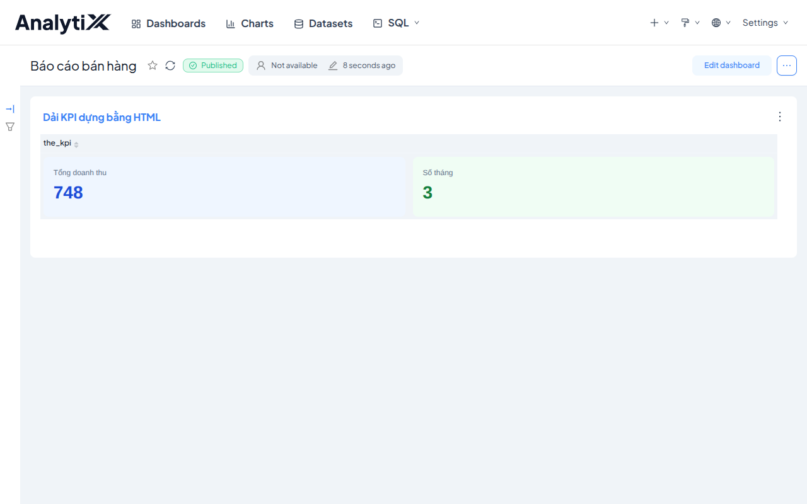
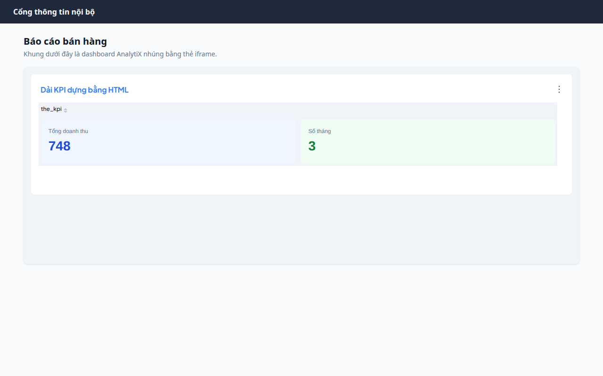

# Nhúng dashboard bằng iframe đơn giản

Dùng cho **trang nội bộ** — không cần đăng ký UUID, không cần dịch vụ cấp
vé. Nếu cần nhúng cho đối tác bên ngoài có phân quyền theo người xem, xem
**Nhúng dashboard qua SDK cho đối tác ngoài** thay vì cách này.

## Các bước

1. Mở dashboard cần nhúng, xác nhận trạng thái đã là **Published** (dashboard
   `Draft` sẽ không nhúng được cho người khác xem).

   
2. Lấy **mã trang (slug)** của dashboard ở thanh địa chỉ trình duyệt.
3. Dán thẻ `iframe` vào trang web đích — xem đầy đủ tham số ở
   [Tham số iframe khi nhúng dashboard](../../reference/tham-so-iframe.md):

```html
<iframe
  src="<địa-chỉ-trực-quan-của-bạn>/dashboard/<mã-trang>/?standalone=2&show_filters=0"
  width="100%"
  height="<chiều-cao-đã-đo>"
  style="border:0; min-width:1200px"
></iframe>
```

4. Đo chiều cao thật của trang (ví dụ mở DevTools, xem chiều cao nội dung
   thật) rồi ghi cố định vào `height` — khung không tự co giãn theo nội
   dung.

Kết quả đúng trông thế này — dashboard nằm gọn trong trang của bạn, không còn
thanh điều hướng AnalytiX nhờ `standalone=2`:



## Bốn điều kiện bắt buộc, sai một là nhúng thất bại

0. **Phải khai origin được phép nhúng.** Mặc định AnalytiX gửi
   `X-Frame-Options: SAMEORIGIN` và không khai `frame-ancestors`, nên **mọi**
   trang khác origin đều nhận `refused to connect` — trước cả khi xét quyền.

   Khai biến môi trường rồi khởi động lại:

   ```bash
   ANALYTIX_FRAME_ANCESTORS="https://cong-thong-tin.noi-bo"
   ```

   Nhiều origin thì cách nhau bằng dấu cách. Kiểm bằng header:

   ```bash
   curl -sD - -o /dev/null http://127.0.0.1:8088/login/ | grep -i frame
   ```

   Đúng là `X-Frame-Options` biến mất và `frame-ancestors` liệt kê origin bạn khai.

   :::danger[Đừng khai `*`]
   `frame-ancestors *` cho **bất kỳ trang nào** nhúng AnalytiX vào khung ẩn và
   lừa người dùng bấm — đó là clickjacking. Liệt kê đúng origin bạn kiểm soát.
   :::

1. **Trang HTTPS không nhúng được địa chỉ HTTP.** Nếu trang đích chạy
   `https://`, địa chỉ trong `iframe` cũng **bắt buộc** phải là `https://`.
   Trình duyệt chặn thẳng, không có tuỳ chọn nào bỏ qua được.
2. **Địa chỉ nội bộ chỉ dùng được trong mạng nội bộ.** Nếu công cụ trực
   quan chỉ nghe ở một địa chỉ IP nội bộ, máy ngoài mạng đó sẽ không truy
   cập được — cần một tên miền công khai trỏ về đúng dịch vụ nếu muốn nhúng
   từ ngoài mạng nội bộ.
3. **Người xem phải có quyền đọc.** Mặc định, mở dashboard mà chưa đăng
   nhập sẽ bị đẩy về trang đăng nhập, và khung `iframe` hiện ra trắng trơn.
   Hai cách xử lý:
   - *Cách đơn giản* — cấp quyền đọc cho vai trò công khai (Public). Ai vào
     được địa chỉ AnalytiX đều xem được, không cần đăng nhập. Phù
     hợp mạng nội bộ, **không phù hợp** khi cần phân quyền theo người dùng.
   - *Cách đúng chuẩn khi cần phân quyền* — dùng SDK + vé khách, xem
     **Nhúng dashboard qua SDK cho đối tác ngoài**.

## Lỗi thường gặp

| Hiện tượng | Nguyên nhân | Cách xử lý |
|---|---|---|
| `refused to connect` trong khung | Chưa khai `ANALYTIX_FRAME_ANCESTORS` cho origin của trang đích | Xem điều kiện 0 |
| Khung trắng trơn | Chưa đăng nhập, hoặc chưa cấp quyền đọc công khai | Xem mục "Bốn điều kiện bắt buộc" ở trên |
| Khung bị cắt mất phần dưới | `height` khai báo nhỏ hơn chiều cao thật | Đo lại và tăng `height` |
| Nội dung có thanh cuộn riêng bên trong khung | Khung hẹp hơn `min-width` khai trong trang | Tăng chiều rộng khung chứa, hoặc chấp nhận bố cục 2 cột |
| Còn thấy thanh tiêu đề của AnalytiX, chồng lên tiêu đề trang đích | Thiếu `standalone=2`, hoặc dùng nhầm `standalone=1` | Sửa lại tham số |
