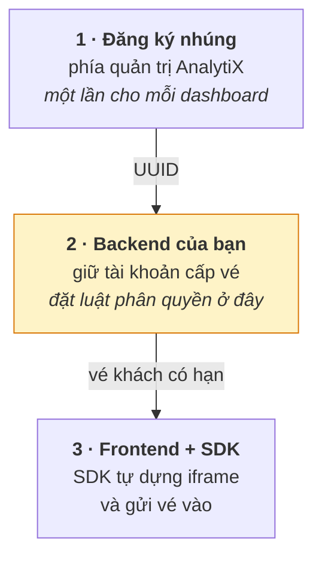

# Nhúng dashboard qua SDK cho đối tác ngoài

Dùng khi cần nhúng dashboard cho một ứng dụng/portal bên ngoài, có phân
quyền theo từng người xem. Nếu chỉ cần nhúng đơn giản cho trang nội bộ
không cần phân quyền, xem **Nhúng dashboard bằng iframe đơn giản** thay vì
cách này. Lý do kỹ thuật đứng sau cách làm này được giải thích ở
[Vì sao nhúng dashboard cần vé khách](../../explanation/vi-sao-nhung-can-ve-khach.md).

Có ba việc, ba bên khác nhau làm:



## [1] Đăng ký nhúng, lấy UUID

Từ menu **⋯** của dashboard đã `Published`, chọn **Embed dashboard**, khai
danh sách tên miền được phép nhúng (`allowed_domains`), bấm **Enable
embedding**. Hệ thống trả về một **UUID nhúng** — đưa mã này cho đội phát
triển ứng dụng nhúng.

## [2] Backend — endpoint cấp vé

**Ba lệnh, đúng thứ tự, dùng chung một session:**

```
POST /api/v1/security/login        →  access_token
GET  /api/v1/security/csrf_token/  →  csrf       ← CÙNG session với lệnh dưới
POST /api/v1/security/guest_token/ →  vé khách
```

Bỏ lệnh giữa sẽ trả lỗi `400 The CSRF token is missing.` Lấy CSRF bằng một
session khác với lúc gọi xin vé sẽ trả `400 The CSRF session token is
missing.`

Mã nguồn tham chiếu (Python/Flask — chuyển sang Node, Java hay .NET vẫn giữ
nguyên ba lệnh trên):

```python
import os, requests
from flask import Flask, jsonify, request

VISUALIZATION_URL = os.environ['VISUALIZATION_URL']   # địa chỉ AnalytiX của bạn
TOKEN_USER        = os.environ['TOKEN_USER']          # tài khoản CHỈ dùng để cấp vé
TOKEN_PASSWORD    = os.environ['TOKEN_PASSWORD']

app = Flask(__name__)

def mint(dashboard_uuid, nguoi_xem, rls=None):
    s = requests.Session()  # MỘT session cho cả ba lệnh

    r = s.post(f'{VISUALIZATION_URL}/api/v1/security/login', timeout=30, json={
        'username': TOKEN_USER, 'password': TOKEN_PASSWORD,
        'provider': 'db', 'refresh': True})
    r.raise_for_status()
    h = {'Authorization': f"Bearer {r.json()['access_token']}"}

    r = s.get(f'{VISUALIZATION_URL}/api/v1/security/csrf_token/', headers=h, timeout=30)
    r.raise_for_status()
    h |= {'X-CSRFToken': r.json()['result'], 'Referer': VISUALIZATION_URL}

    r = s.post(f'{VISUALIZATION_URL}/api/v1/security/guest_token/', headers=h, timeout=30,
               json={'user': nguoi_xem,
                     'resources': [{'type': 'dashboard', 'id': dashboard_uuid}],
                     'rls': rls or []})
    r.raise_for_status()
    return r.json()['token']


@app.post('/api/guest-token')
def guest_token():
    uuid = (request.json or {}).get('dashboard_uuid')
    if not uuid:
        return jsonify(error='thiếu dashboard_uuid'), 400

    # ĐẶT PHÂN QUYỀN CỦA ỨNG DỤNG Ở ĐÂY.
    # Không kiểm tra ở đây thì ai gọi được endpoint cũng xem được dashboard.
    # if not duoc_phep(current_user, uuid):
    #     return jsonify(error='không có quyền'), 403

    token = mint(uuid, nguoi_xem={'username': current_user.username,
                                  'first_name': current_user.first_name,
                                  'last_name': current_user.last_name},
                 # rls=[{'clause': "mien = 'khu-vuc-cua-nguoi-dung'"}],  # lọc theo hàng nếu cần
                 )
    return jsonify(token=token)
```

**Ba điều không được bỏ qua:**

- Dùng một tài khoản **riêng chỉ để cấp vé**, không dùng tài khoản quản
  trị. Tài khoản này nên chỉ giữ đúng một quyền (cấp vé khách) — lộ ra thì
  kẻ lấy được cũng chỉ cấp được vé, không đọc được dữ liệu nào.
- **Phân quyền đặt ở chính endpoint này.** AnalytiX không biết ai
  đang xem; nó chỉ cấp vé khi được hỏi, và tin đúng những gì endpoint khai
  trong `resources`/`user`.
- Vé có hạn ngắn. SDK tự gọi lại hàm xin vé trước khi hết hạn, nên endpoint
  phải gọi được nhiều lần, không phải một lần dùng mãi.

## [3] Frontend — gọi SDK

```bash
npm install @superset-ui/embedded-sdk
```

```js
import { embedDashboard } from '@superset-ui/embedded-sdk';

embedDashboard({
  id: DASHBOARD_UUID, // UUID lấy ở bước [1]
  supersetDomain: VISUALIZATION_PUBLIC_URL, // PHẢI https nếu trang nhúng là https
  mountPoint: document.getElementById('khung'),

  // SDK gọi hàm này mỗi lần cần vé mới.
  // Gọi sang BACKEND CỦA MÌNH — không gọi thẳng AnalytiX.
  fetchGuestToken: async () => {
    const r = await fetch('/api/guest-token', {
      method: 'POST',
      headers: { 'Content-Type': 'application/json' },
      credentials: 'same-origin', // gửi kèm phiên đăng nhập của ứng dụng
      body: JSON.stringify({ dashboard_uuid: DASHBOARD_UUID }),
    });
    if (!r.ok) throw new Error('không xin được vé: ' + r.status);
    return (await r.json()).token;
  },

  dashboardUiConfig: {
    hideTitle: true,
    hideChartControls: true,
    filters: { expanded: false },
  },
});
```

### Chiều cao khung

Khung khác tên miền **không tự co giãn theo nội dung**. Giữ cố định như
đường iframe đơn giản:

```css
#khung { height: <chiều-cao-đã-đo>; min-width: 1200px; }
```

## `allowed_domains` — quy tắc so khớp

Mỗi UUID mang một danh sách tên miền được phép nhúng. AnalytiX so
khớp **nguyên văn chuỗi origin**.

Nghĩa là **`localhost` KHÁC `127.0.0.1`**: khai `http://localhost:5173` rồi mở
trang bằng `http://127.0.0.1:5173` sẽ cho khung hiện JSON `403 Forbidden` —
trình duyệt coi hai origin này hoàn toàn khác nhau. Khai đủ mọi địa chỉ mà đội
phát triển thực sự dùng để mở trang, kể cả khi chỉ khác nhau ở `localhost` so
với `127.0.0.1`.

Sửa `allowed_domains` **không làm đổi UUID** — cấu hình phía nhúng không
cần sửa theo khi danh sách tên miền thay đổi.

## Nghiệm thu

Làm theo thứ tự; mỗi bước hỏng thì dừng ở đó trước khi đi tiếp:

| # | Kiểm tra | Đạt khi |
|:--|:--------------------------------------------------|:-------------------------|
| 1 | Gọi `POST /api/guest-token` từ máy chủ backend | `200`, trả về chuỗi vé |
| 2 | Giải mã vé, xem phần `resources` | đúng UUID đang xin |
| 3 | Mở trang bằng **đúng origin** đã khai trong `allowed_domains` | dashboard hiện đầy đủ |
| 4 | Chờ vé hết hạn rồi thao tác tiếp | SDK tự xin vé mới, trang không trắng |
| 5 | Thu hẹp cửa sổ dưới 1200px | khung sinh thanh cuộn — đúng như mong đợi |

Gặp lỗi, tra [Mã lỗi khi nhúng qua SDK](../../reference/ma-loi-sdk.md).
