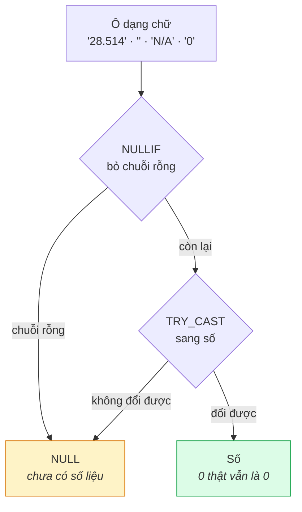

# Viết SQL an toàn với cột dạng chữ

Bộ nạp liệu **không tự suy ra kiểu dữ liệu** — mọi cột ở lớp `raw` đều là
chữ (VARCHAR), kể cả cột chứa số hay ngày tháng (xem
[Kiến trúc dữ liệu](../explanation/analytix-la-gi.md) để biết vì sao).
Muốn tính toán, phải ép kiểu tường minh — và phải ép kiểu **đúng cách**, nếu
không ô trống sẽ âm thầm biến thành số `0`.

Ví dụ dưới đây dùng bảng `doanh_thu` (cột `so_luong`, `doanh_thu`,
`chiet_khau`, `so_don` đều là số nhưng lưu dưới dạng chữ).

## Đường đi của một ô dữ liệu dạng chữ



Bỏ `NULLIF`, chuỗi rỗng thành `0` — và "chưa có số liệu" bị đếm lẫn vào
"bằng 0 thật".

## Quy tắc: luôn `NULLIF` trước khi `TRY_CAST`

```sql
TRY_CAST(NULLIF(so_luong, '') AS BIGINT)
```

- **`NULLIF(cột, '')`** đổi chuỗi rỗng `''` thành `NULL` trước.
- **`TRY_CAST(... AS BIGINT)`** ép kiểu an toàn — một ô sai định dạng cho ra
  `NULL` thay vì làm hỏng cả câu truy vấn (khác với `CAST` thường, sẽ ném
  lỗi và dừng toàn bộ truy vấn).

**Vì sao thứ tự này bắt buộc:** nếu ép kiểu trực tiếp mà không qua
`NULLIF`, chuỗi rỗng `''` sẽ bị hiểu thành `0` ở một số công cụ, và "chưa có
số liệu" sẽ biến thành "bằng 0" — hai điều hoàn toàn khác nhau khi báo cáo.

## Ví dụ: phân biệt "chưa có số liệu" với "bằng 0 thật"

```sql
SELECT
  ma_san_pham,
  so_luong AS gia_tri_tho,
  TRY_CAST(NULLIF(so_luong, '') AS BIGINT) AS da_ep_kieu,
  CASE WHEN NULLIF(so_luong, '') IS NULL THEN 'Chưa có số liệu'
       WHEN TRY_CAST(so_luong AS DOUBLE) = 0 THEN 'Bán được 0'
       ELSE 'Có số liệu' END AS trang_thai
FROM raw.uploads.doanh_thu
WHERE ma_san_pham = 'SP-007' AND thang = '2026-06'
```

Nếu hai dòng kiểu này hiện ra **giống nhau**, dataset phía sau đang thiếu
`NULLIF` — đây là lỗi hay gặp nhất khi mới làm việc với dữ liệu nạp từ
Excel.

## Ví dụ: tổng hợp nhiều cột cùng lúc

```sql
SELECT
  count(*) AS so_dong,
  sum(TRY_CAST(NULLIF(so_luong,  '') AS BIGINT)) AS tong_so_luong,
  sum(TRY_CAST(NULLIF(doanh_thu, '') AS DOUBLE)) AS tong_doanh_thu,
  sum(TRY_CAST(NULLIF(so_don,    '') AS BIGINT)) AS tong_so_don
FROM raw.uploads.doanh_thu
```

## Cột tỷ lệ/phần trăm: kiểm tra đơn vị trước khi dùng

Cột có định dạng phần trăm trong Excel (ví dụ `ty_le_loi_nhuan`,
`chiet_khau`) thường lưu giá trị **thập phân** (`0.05` cho 5%), không phải
số nguyên phần trăm. Trước khi dùng trong báo cáo, chạy thử một dòng biết
trước đáp án để xác nhận:

```sql
SELECT ma_san_pham, ty_le_loi_nhuan
FROM raw.uploads.san_pham
WHERE ma_san_pham = 'SP-001'
```

So kết quả với giá trị gốc trong tệp Excel — nếu lệch 100 lần (ví dụ ra
`31.25` thay vì `0.3125`), đang nhân nhầm 100 hai lần ở đâu đó trong chuỗi
xử lý.

## Liên quan

Đây là bước chuẩn bị dữ liệu trước khi **Dựng dashboard & biểu đồ** — dataset
dùng cho dashboard nên áp sẵn mẫu `TRY_CAST(NULLIF(...))` cho mọi cột số,
không để biểu đồ tự ép kiểu ngầm.
