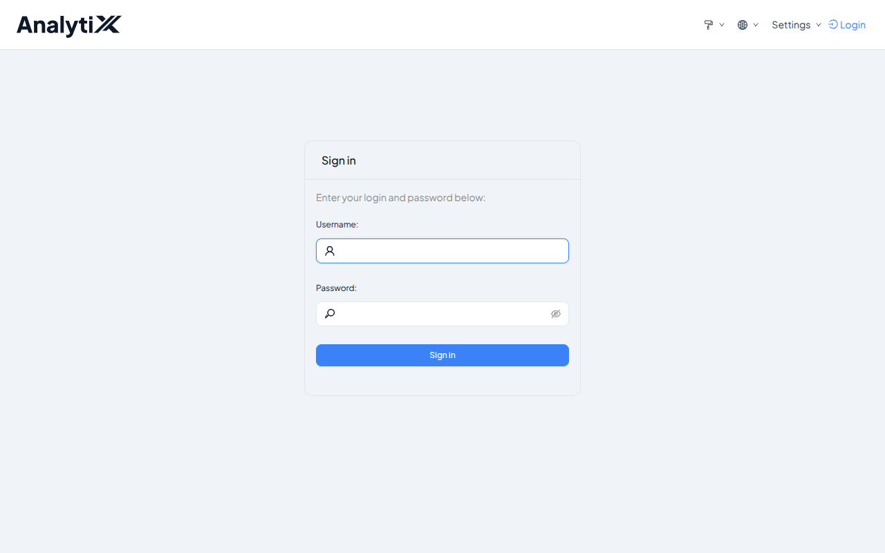
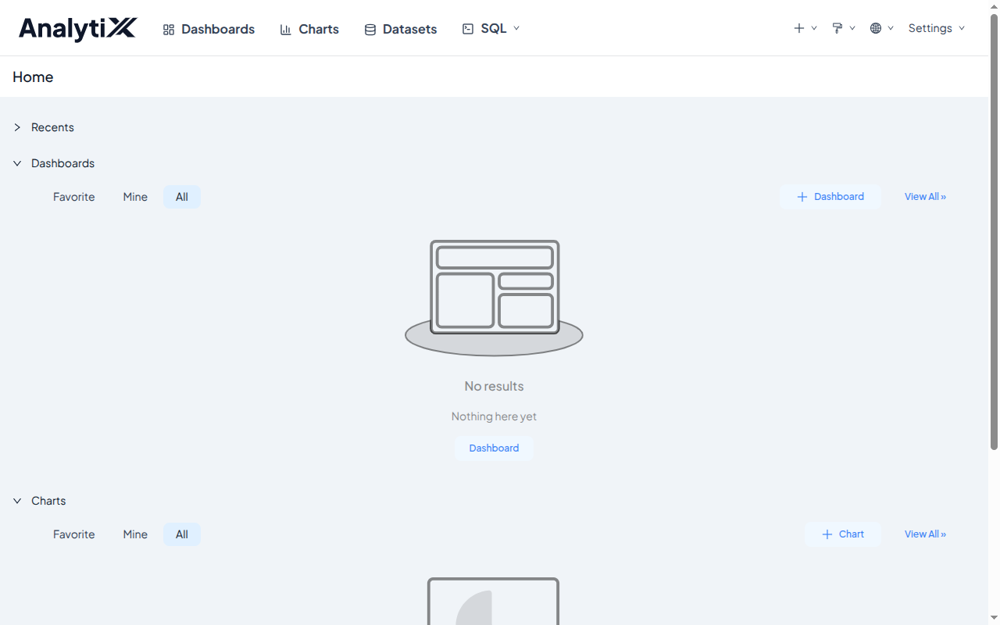
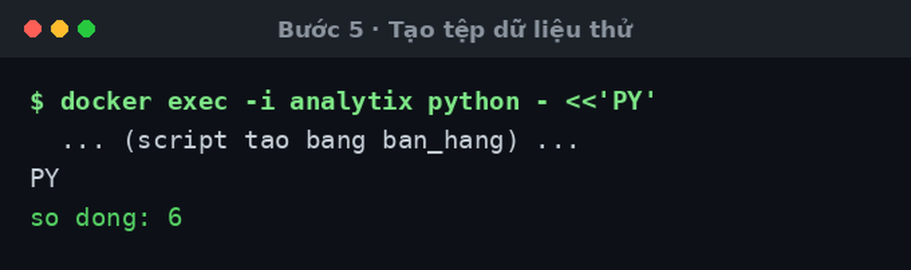
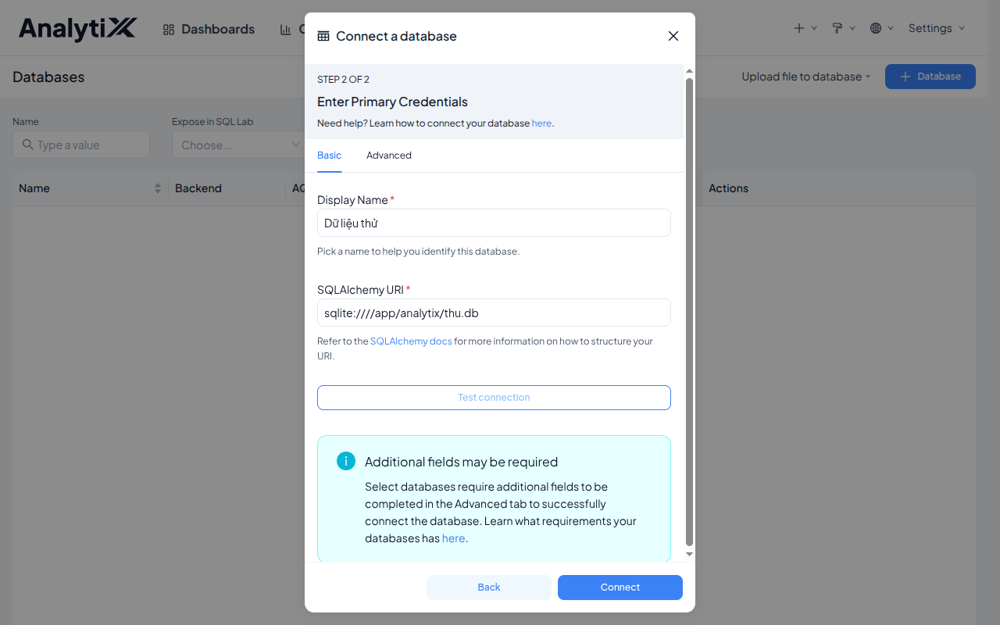
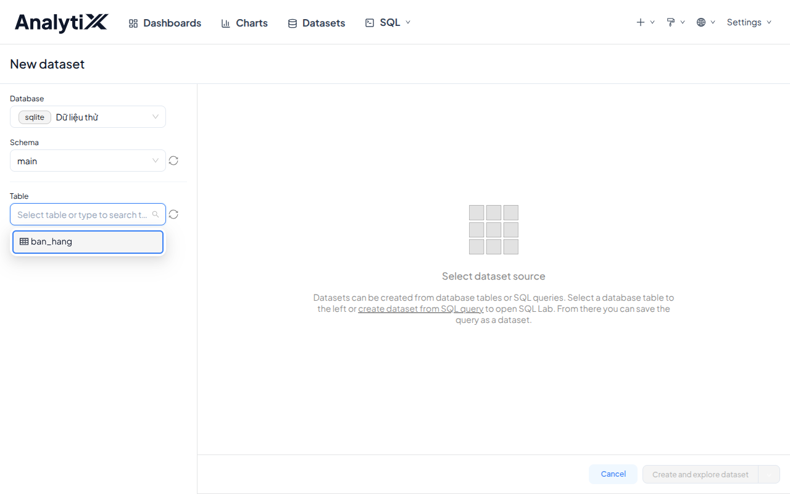
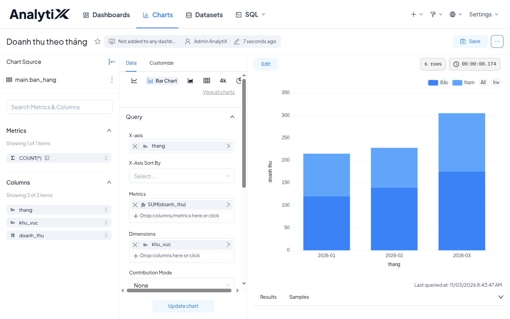

# Bắt đầu nhanh

Cài AnalytiX trên máy của bạn, nối vào một nguồn dữ liệu, và dựng biểu đồ đầu
tiên. Khoảng 20 phút, phần lớn là chờ tải.

LƯU Ý: Máy cần **một** trong hai thứ — Docker gọi được không cần `sudo`, hoặc
Python 3.10, 3.11 hoặc 3.12. Không cần cả hai.

## Bước 1: Lấy bộ cài

Giải nén bản đóng gói rồi vào thư mục vừa bung ra.

```
tar -xzf analytix-1.0.tar.gz
cd analytix-1.0
ls
```

Kết quả mẫu:

```
apache_superset-6.1.0+foxai.18-py3-none-any.whl  PHIEN-BAN
cai.sh                                           README.md
cai-tren-may.sh                                  requirements
Dockerfile                                       superset-core
entrypoint.sh                                    workspace_x_theme.py
go-cai.sh
```

Đủ 11 mục là bộ cài lành. Thiếu mục nào thì bước sau sẽ dừng và nói rõ thiếu gì.

## Bước 2: Cài

Một lệnh. Script tự dò máy bạn có Docker hay có Python rồi chọn đường.

```
./cai.sh
```

Kết quả mẫu:

```
[analytix] chọn đường: docker (máy có Docker)
[analytix] ép đường khác bằng ./cai.sh --docker, --may hoặc --offline
[analytix] dựng ảnh analytix:1.0 — bước này lâu nhất, cần mạng ra PyPI
[analytix] tạo container analytix trên cổng 8088
[analytix] chờ dịch vụ sẵn sàng (lần đầu khoảng 40 giây)

[analytix] AnalytiX 1.0 đang chạy tại  http://127.0.0.1:8088
[analytix] tài khoản quản trị:          admin
[analytix] mật khẩu:                    kJ8vQ2mNxR4t
```

Máy không có Docker thì script đi đường `--may` và **chiếm luôn cửa sổ
terminal** — dòng cuối nó in bắt đầu bằng `[analytix] đang khởi động. Ctrl-C để
dừng;` rồi chỉ ra `khoi-dong.sh` để chạy lại (mặc định
`~/analytix/khoi-dong.sh`). Để nguyên cửa sổ đó và mở cửa sổ thứ hai cho các
bước sau. Mật khẩu của đường này nằm ở dòng `[analytix] administrator admin
password: ...` phía trên trong cùng một output.

:::danger[Mật khẩu chỉ in MỘT LẦN]
Lưu nó ngay. Nó không được ghi vào tệp nào, và lần chạy sau sẽ không in lại vì
tài khoản đã tồn tại. Không có tài khoản mặc định — đây là chủ ý.

Muốn tự chọn mật khẩu: `ANALYTIX_ADMIN_PASSWORD=... ./cai.sh`. Nhưng khi đó nó
nằm trong lịch sử shell của bạn.
:::

Cổng 8088 đã có thứ khác dùng thì đổi cổng:

```
ANALYTIX_PORT=9000 ./cai.sh
```

## Bước 3: Kiểm nó đang chạy

```
curl -s http://127.0.0.1:8088/health
```

Kết quả mẫu:

```
OK
```

Xem bản vừa cài là bản nào — tệp `PHIEN-BAN` trong thư mục bộ cài giữ cả hai số:

```
cat PHIEN-BAN
```

Kết quả mẫu:

```
ANALYTIX_VERSION=1.0
FOXAI_VERSION=6.1.0+foxai.18
WHEEL=apache_superset-6.1.0+foxai.18-py3-none-any.whl
```

`ANALYTIX_VERSION` là phiên bản sản phẩm — cái in trên tên bản đóng gói.
`FOXAI_VERSION` là phiên bản kỹ thuật của wheel. Hai số luôn đi cùng nhau, nên
báo lỗi thì gửi cả tệp này. `cai.sh` cũng đọc chính tệp này để đặt thẻ tag cho
ảnh Docker (`analytix:1.0`).

## Bước 4: Đăng nhập

Mở `http://127.0.0.1:8088`, đăng nhập bằng `admin` và mật khẩu ở Bước 2.



Góc trên trái phải là logo và chữ **AnalytiX** — không phải "Superset".



Kiểm bằng dòng lệnh thay vì mắt:

```
curl -s -X POST http://127.0.0.1:8088/api/v1/security/login \
  -H 'Content-Type: application/json' \
  -d '{"username":"admin","password":"<mật-khẩu>","provider":"db","refresh":true}'
```

Kết quả mẫu:

```
{"access_token":"eyJhbGciOiJIUzI1NiIs...","refresh_token":"eyJhbGciOiJIUzI1..."}
```

## Bước 5: Tạo một nguồn dữ liệu

AnalytiX cài xong **chỉ query được SQLite**. Tạo một tệp nhỏ để thử.

Cài bằng Docker:

```
docker exec -i analytix python - <<'PY'
import sqlite3
c = sqlite3.connect('/app/analytix/thu.db')
c.execute("create table if not exists ban_hang (thang text, khu_vuc text, doanh_thu integer)")
c.execute("delete from ban_hang")
c.executemany("insert into ban_hang values (?,?,?)", [
    ('2026-01','Bắc',120),('2026-01','Nam',95),
    ('2026-02','Bắc',140),('2026-02','Nam',88),
    ('2026-03','Bắc',175),('2026-03','Nam',130),
])
c.commit()
print('so dong:', c.execute('select count(*) from ban_hang').fetchone()[0])
PY
```

Cài thực trên máy — cùng script, đổi đường dẫn tệp thành `~/analytix/thu.db` và
chạy bằng `~/analytix/venv/bin/python`.

Kết quả mẫu:

```
so dong: 6
```



Trong AnalytiX: **Settings → Database Connections → + Database**, chọn
**SQLite**, điền chuỗi kết nối:

```
sqlite:////app/analytix/thu.db
```

Để ý **bốn dấu gạch chéo** — ba của giao thức cộng một mở đầu đường dẫn tuyệt
đối. Ba dấu là đường dẫn tương đối và sẽ không tìm thấy tệp.

Cài thực trên máy thì tệp nằm chỗ khác, nên chuỗi kết nối cũng khác — vẫn bốn
dấu gạch chéo:

```
sqlite:////home/<tên-tài-khoản>/analytix/thu.db
```



Hai ô còn lại nằm ở tab **Advanced**, nhóm *SQL Lab*: **Expose database in SQL
Lab** bản này bật sẵn, để nguyên; **Allow DDL and DML** để **tắt**. Rồi bấm
**Test connection**. Không ra lỗi đỏ là đạt.

## Bước 6: Tạo dataset

**Datasets → + Dataset**, chọn kết nối vừa tạo, schema `main`, bảng `ban_hang`.
Bấm **Create and explore dataset**.



## Bước 7: Dựng biểu đồ đầu tiên

**Charts → + Chart**, chọn dataset `ban_hang`, kiểu **Bar Chart**:

```
Trục X        thang
Phép đo       SUM(doanh_thu)
Tách chuỗi    khu_vuc
```

Bấm **Create chart**, rồi **Save** với tên `Doanh thu theo tháng`.



Ba cột tháng, mỗi cột tách hai màu theo khu vực. Tháng 3 cao nhất, tổng **305**
— tức 175 cộng 130.

## Bước 8: Dọn dẹp

Còn muốn làm tiếp các bài ở mục **Xong!** bên dưới thì để nguyên bản cài — chạy
bước này khi nào bạn thật sự muốn dọn.

Một lệnh cho cả ba đường cài. Nó tự ngó container, ảnh, volume và thư mục
`~/analytix`, rồi dọn đúng những thứ tìm thấy.

```
./go-cai.sh
```

Mặc định nó xoá container, ảnh `analytix:*` (chỉ ảnh không còn container nào khác
dùng), `~/analytix/venv` và `~/analytix/khoi-dong.sh`. Nó **giữ** volume
`analytix-data`, `~/analytix/superset.db` và `~/analytix/superset_config.py` —
nên cài lại thì tài khoản, dataset và biểu đồ của bạn vẫn còn. Hai tệp đó luôn
giữ cùng nhau, vì `SECRET_KEY` trong config là thứ mã hoá mật khẩu các kết nối
đã lưu trong db.

Muốn xoá sạch, kể cả dữ liệu:

```
./go-cai.sh --ca-du-lieu
```

`--ca-du-lieu` xoá thêm volume và cả thư mục `~/analytix` — tức xoá **cả** cơ sở
dữ liệu metadata: khoá bí mật, tài khoản, dataset và biểu đồ của bạn nằm trong
đó. Còn muốn làm tiếp thì dùng lệnh không có flag này.

Cả hai lệnh in danh sách sắp xoá rồi hỏi lại `[y/N]`. Thêm `-y` để không hỏi.

## Ba đường cài, và cách kiểm từng đường

`./cai.sh` chọn hộ bạn. Muốn tự chọn, hoặc muốn kiểm cả ba, thì đây là từng
đường kèm lệnh kiểm riêng.

### Đường 1 — Docker

Không đụng vào Python của máy. Gỡ đi chỉ là xoá một container.

```
./cai.sh --docker
```

Kiểm:

```
docker inspect -f '{{.State.Health.Status}}' analytix
curl -s http://127.0.0.1:8088/health
```

Đạt khi hai lệnh trả về `healthy` và `OK`.

### Đường 2 — cài thực trên máy

Không cần Docker. Cài vào một môi trường ảo Python, chạy ở tiền cảnh.

```
./cai.sh --may
```

Kiểm, ở cửa sổ terminal thứ hai:

```
~/analytix/venv/bin/python -c "import superset; print(superset.__file__)"
curl -s http://127.0.0.1:8088/health
```

Đạt khi đường dẫn nằm trong `~/analytix/venv/`, không nằm trong thư mục bộ cài,
và `/health` trả `OK`.

### Đường 3 — máy không có internet

Hai đường trên đều cần mạng ra PyPI. Máy cách ly thì dùng bản phát hành riêng —
nó chở theo ảnh đã dựng sẵn thay vì chở công thức.

```
cd analytix-1.0-khong-can-mang
sha256sum -c SHA256SUMS
./cai.sh
```

Vẫn là `cai.sh` như hai đường trên. Trong thư mục này nó thấy tệp ảnh
`analytix-1.0-anh.tar.gz` bên cạnh nên tự chọn đường `--offline` — nạp ảnh đã
lưu sẵn thay vì dựng. Gõ rõ `./cai.sh --offline` cũng ra đúng đường đó.

Kiểm rằng nó thật sự không cần mạng. Container `analytix` do `cai.sh` tạo nằm
trên mạng bridge mặc định, nên nhìn vào nó không kết luận được gì — phải dựng
một container thứ hai, cắt hẳn mạng:

```
docker run -d --network none --name thu-cach-ly analytix:1.0
sleep 60
docker exec thu-cach-ly curl -s -o /dev/null -w '%{http_code}\n' http://127.0.0.1:8088/health
docker rm -f thu-cach-ly
```

Phải ra `200`.

Dựng bản đó: [Đóng gói bản phát hành](../how-to/dong-goi-ban-phat-hanh.md).

## Xong!

Bạn đã đi qua ba lớp đầu của AnalytiX: kết nối → dataset → biểu đồ. Lớp thứ tư,
trang báo cáo, nằm ở bài dài hơn bên dưới. Tiếp theo:

- [Thêm driver cho nguồn dữ liệu](../how-to/them-driver-du-lieu.md) — **gần như
  chắc chắn bạn cần việc này**, vì dữ liệu thật không nằm trong SQLite
- [Từ database tới biểu đồ](./tu-database-toi-bieu-do.md) — bài dài hơn, dựng
  một trang báo cáo bốn biểu đồ có bộ lọc dùng chung
- [Vì sao bản cài chưa sẵn sàng cho môi trường thật](../explanation/chua-san-sang-cho-production.md) — đọc trước khi cho người khác dùng
- [Bật dịch vụ MCP](../how-to/bat-mcp.md) — hỏi bằng lời, nó tự dựng biểu đồ
