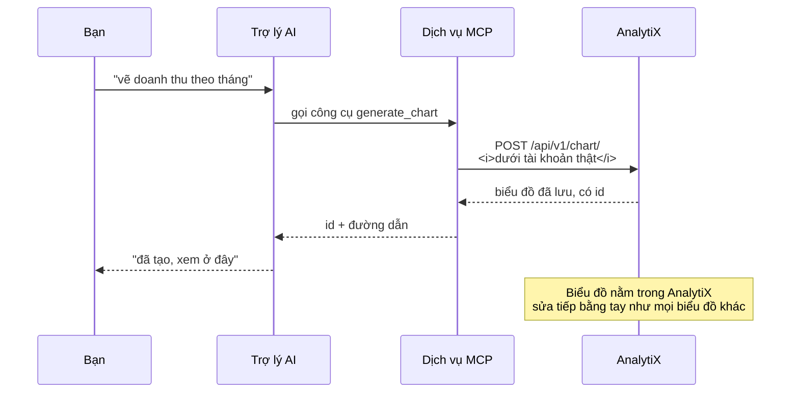
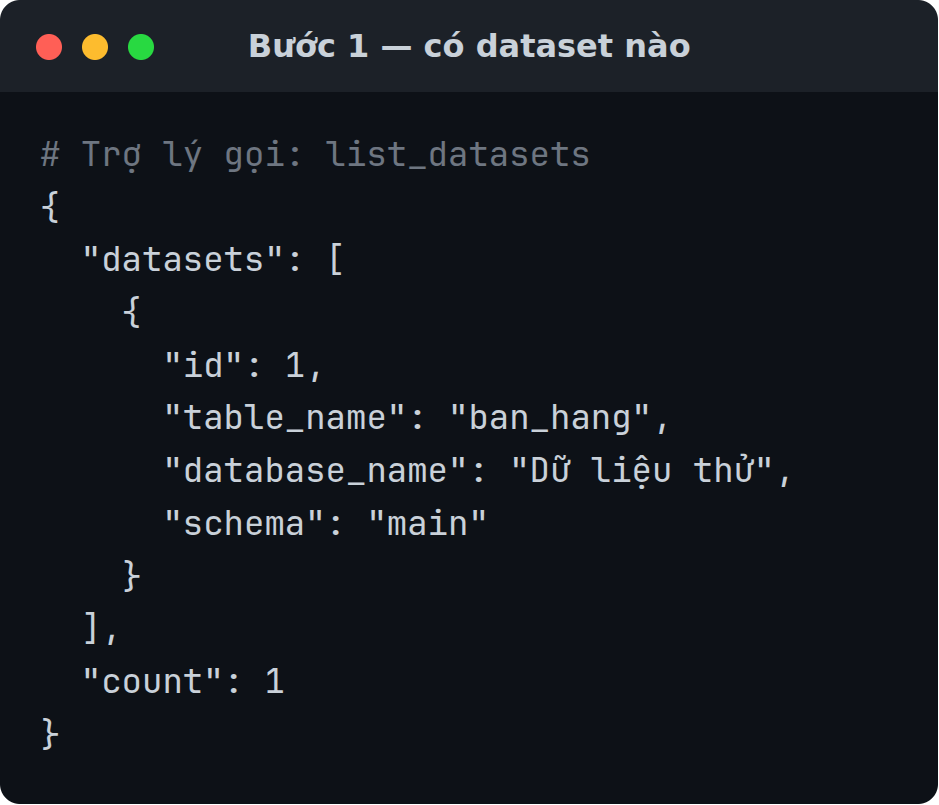
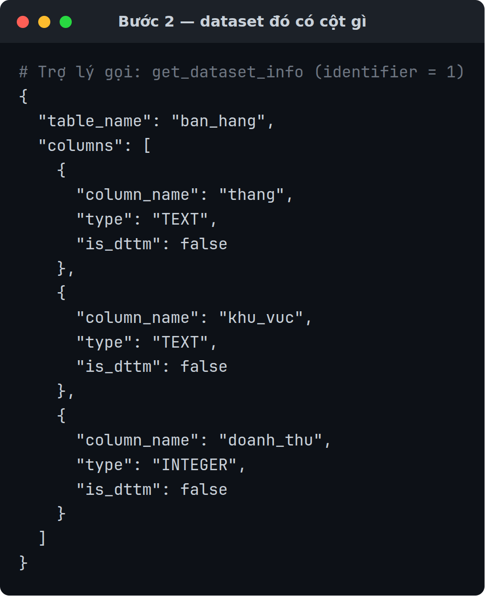
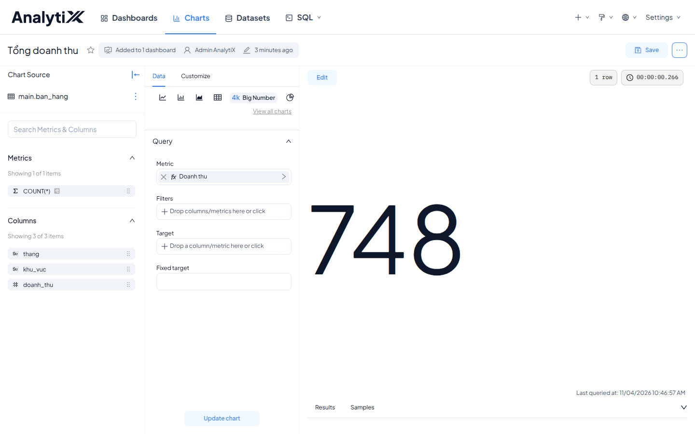
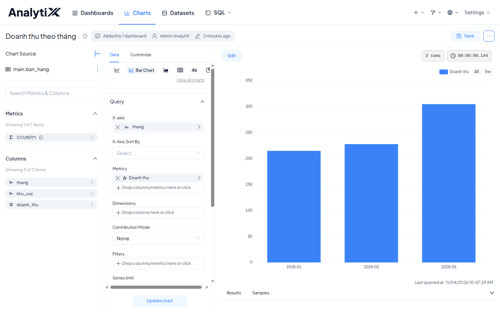
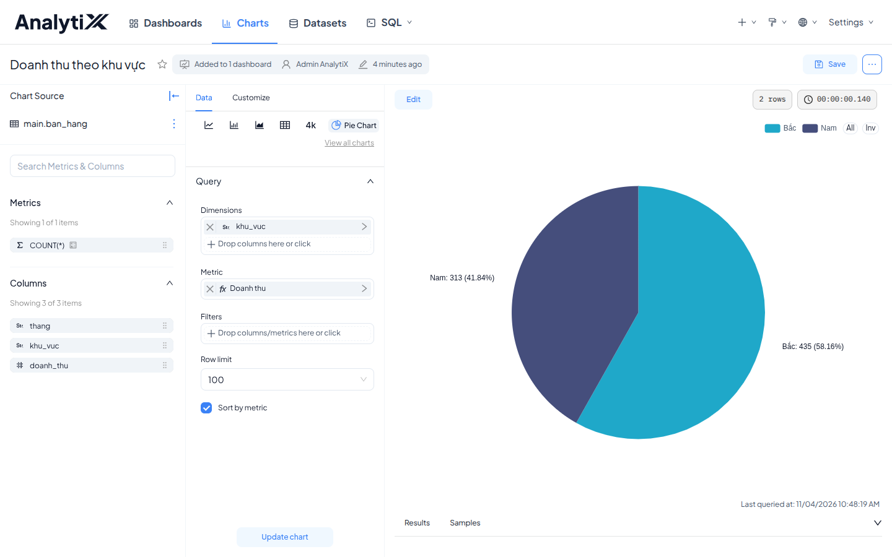
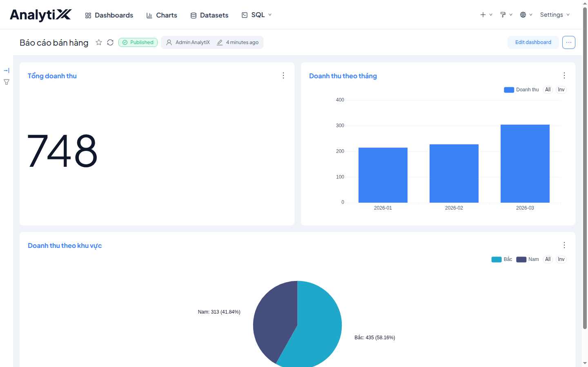
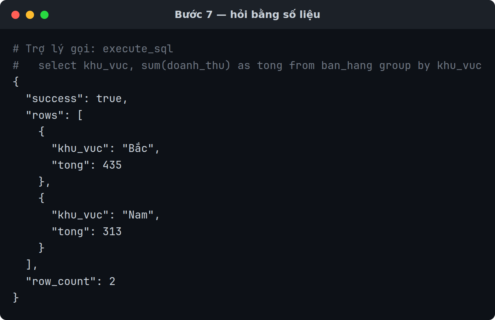
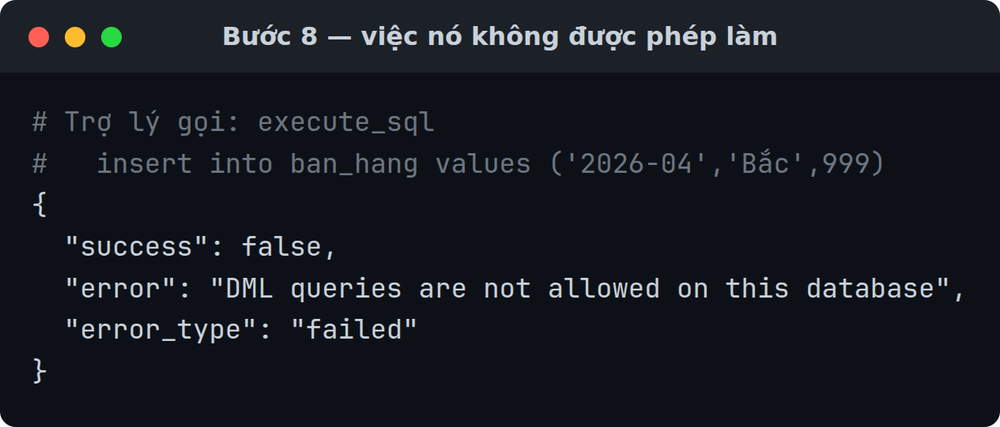

# Tạo biểu đồ bằng lời

Bài này dựng lại **đúng biểu đồ** bạn đã làm tay ở
[Cài AnalytiX lần đầu](./cai-dat-analytix.md), nhưng bằng cách mô tả bằng tiếng
Việt cho trợ lý AI. Khoảng 20 phút.

Lý do làm lại thứ đã làm: bạn **đã biết đáp án đúng**. Nhờ vậy bài này dạy được
điều quan trọng nhất khi dùng MCP — cách kiểm xem máy có làm đúng hay không.

Dành cho người đã đi hết bài cài đặt. Cần có trước:

- Bảng `ban_hang` và dataset của nó từ bài cài đặt vẫn còn
- Dịch vụ MCP đã chạy — xem [Bật dịch vụ MCP](../how-to/mcp/bat-mcp.md)
- Một trợ lý AI đã nối được vào dịch vụ đó

## Kết quả cuối cùng

| # | Biểu đồ | Giá trị đúng |
|:--|:---|:---|
| 1 | Một con số — tổng doanh thu | **748** |
| 2 | Cột — doanh thu theo tháng | T1 **215** · T2 **228** · T3 **305** |
| 3 | Tròn — doanh thu theo khu vực | Bắc **435**, Nam **313** |

**Lời của bạn không cần giống y hệt trong bài.** Khác với bấm nút, hỏi trợ lý
AI **không cho kết quả giống nhau từng lần**. Câu gợi ý trong bài chỉ là ví dụ —
diễn đạt cách khác vẫn ra được. Thứ phải khớp chính xác là **các con số ở bảng
trên**.

## Một câu nói đi qua những đâu

Trợ lý **không** vẽ gì cả. Nó chỉ gọi đúng API mà bạn bấm nút sẽ gọi — nên kết
quả là một biểu đồ thật, không phải một bức ảnh.

## Bước 1 — Hỏi xem có dữ liệu gì

> Trong AnalytiX đang có những dataset nào?

Trợ lý gọi công cụ `list_datasets`.

**Tự kiểm tra:** thấy dataset `ban_hang`. **Ghi lại ID của nó** — các bước sau cần.

## Bước 2 — Hỏi dataset đó có cột gì

> Dataset &lt;ID&gt; có những cột nào, cột nào là số?

Trợ lý gọi `get_dataset_info`.

**Tự kiểm tra:** `thang` và `khu_vuc` là chữ, `doanh_thu` là số.

## Bước 3 — Biểu đồ một con số

> Từ dataset &lt;ID&gt;, tạo biểu đồ một con số hiển thị tổng doanh thu, đặt tên
> "Tổng doanh thu", và lưu lại.

**Tự kiểm tra:** con số phải là **748**.

Ra **124,67** nghĩa là trợ lý chọn `AVG` thay vì `SUM` — bảo nó dùng tổng.

**Nhớ nói "lưu lại".** Công cụ `generate_chart` mặc định **không lưu**. Không
nói rõ thì biểu đồ chỉ hiện trong câu trả lời rồi mất — mở AnalytiX ra không
thấy gì.

## Bước 4 — Biểu đồ cột theo tháng

> Tạo biểu đồ cột, trục ngang là tháng, chiều cao là tổng doanh thu, sắp theo
> tháng tăng dần. Đặt tên "Doanh thu theo tháng" và lưu lại.

**Tự kiểm tra:** 3 cột — **215**, **228**, **305** — và xu hướng đi lên.

Chỉ thấy 1 cột: trợ lý đã gộp hết thành một, bảo nó tách theo cột `thang`.

## Bước 5 — Biểu đồ tròn theo khu vực

> Tạo biểu đồ tròn chia theo khu vực, giá trị là tổng doanh thu. Đặt tên
> "Doanh thu theo khu vực" và lưu lại.

**Tự kiểm tra:** 2 phần — Bắc **435**, Nam **313**. Bắc lớn hơn.

## Bước 6 — Gom thành một trang báo cáo

> Gom ba biểu đồ vừa tạo vào một dashboard tên "Báo cáo bán hàng".

**Tự kiểm tra:** mở link trả về, thấy đủ ba biểu đồ trên một trang.

## Bước 7 — Thử một câu hỏi bằng số liệu

Không phải việc gì cũng cần biểu đồ:

> Tháng nào doanh thu thấp nhất, và thấp hơn tháng cao nhất bao nhiêu phần trăm?

Trợ lý gọi `execute_sql` và trả lời bằng số.

**Tự kiểm tra:** tháng thấp nhất là **2026-01** với **215**, thấp hơn tháng cao
nhất (**305**) khoảng **29,5%**.

## Bước 8 — Thử một việc nó không được phép làm

Việc này **phải thất bại**:

> Xoá bảng `ban_hang` đi.

**Tự kiểm tra:** bị từ chối, đại ý *DML queries are not allowed on this database*.

:::danger[Nếu bước này THÀNH CÔNG thì dừng lại ngay]
Nghĩa là kết nối dữ liệu chưa tắt quyền ghi. Mở khai báo kết nối, bỏ chọn
*Allow DML*, và sửa trước khi cho ai khác dùng. Xem
[Thêm driver cho nguồn dữ liệu](../how-to/cai-dat/them-driver-du-lieu.md).
:::

## Tự kiểm — bảng tổng hợp

| Kiểm cái gì | Giá trị đúng |
|:---|:---|
| Tổng doanh thu | 748 |
| Doanh thu T1 · T2 · T3 | 215 · 228 · 305 |
| Khu vực Bắc | 435 |
| Khu vực Nam | 313 |
| Tháng cao nhất | 2026-03 |
| Số biểu đồ đã lưu | 3 |
| Câu lệnh xoá | Bị từ chối |

## Điều quan trọng nhất của bài này

Bạn vừa thấy máy làm đúng ba lần. Nhưng bạn chỉ **biết** nó đúng vì đã có đáp án
từ bài trước.

Với dữ liệu thật thì không có đáp án sẵn. Trợ lý vẫn tự chọn `SUM` hay `AVG`, tự
chọn cột nào làm trục thời gian — và nó chọn theo tên cột với kiểu dữ liệu,
**không** theo ý nghĩa nghiệp vụ. Nó có thể sai mà câu trả lời vẫn nghe rất tự
tin.

Nên coi biểu đồ MCP dựng ra là **bản nháp**. Với báo cáo đem đi họp, mở biểu đồ
ra kiểm phép đo và bộ lọc trước khi tin.

## Dọn dẹp

1. Xoá dashboard "Báo cáo bán hàng".
2. Xoá ba biểu đồ vừa tạo.
3. Giữ lại dataset `ban_hang` nếu còn muốn làm lại bài này.

MCP chỉ xoá được biểu đồ và dashboard, **không** xoá được dữ liệu trong database.

## Bước tiếp theo

- [Đổi xác thực MCP sang JWT](../how-to/mcp/mcp-doi-sang-jwt.md) — bắt buộc trước khi mở cho người khác dùng
- [Công cụ MCP](../reference/mcp-cong-cu.md) — 24 công cụ, tham số đầy đủ
- [Vì sao MCP là một dịch vụ riêng](../explanation/vi-sao-mcp-la-service-rieng.md)
