# Từ database tới biểu đồ

Bài này dẫn bạn từ lúc AnalytiX chưa biết gì về dữ liệu của bạn, tới một trang
báo cáo bốn biểu đồ có bộ lọc dùng chung. Mười lăm bước, làm hết trên giao diện —
không bước nào cần gõ lệnh trên máy chủ.

Mọi ảnh trong bài là ảnh chụp chính AnalytiX, không phải ảnh dựng lại.

**Cần có trước:** một bản AnalytiX đang chạy ([Cài đặt AnalytiX](./cai-dat-analytix.md)),
một database PostgreSQL có dữ liệu, và tài khoản chỉ đọc vào database đó.

**Dữ liệu trong bài.** Mọi con số dưới đây chạy trên một bộ dữ liệu demo bạn
dựng lại được — xem `docs/du-lieu-demo/` trong mã nguồn. Dựng nó lên thì từng
con số trong bài khớp đúng: 131 dòng, Big Number ra 220, nhóm `DU` ở mức 33.

Đang dùng dữ liệu của chính bạn thì tên bảng và con số sẽ khác; các bước thì
không đổi.

:::danger[Cài driver Postgres trước khi bắt đầu]
Bản cài mặc định **không mang driver Postgres**. Chưa cài thì Bước 3 treo ở nút
**Connect** rồi báo `Please re-enter the password`, trong khi nguyên nhân thật là
`ModuleNotFoundError: psycopg2`.

```bash
# chay bang Docker
docker exec <ten-container> pip install psycopg2-binary && docker restart <ten-container>

# hoac cai bang cai-tren-may.sh
~/analytix/venv/bin/pip install psycopg2-binary
```

Chi tiết: [Thêm driver cho nguồn dữ liệu](../how-to/cai-dat/them-driver-du-lieu.md).
:::

## Kết quả cuối cùng

Xong bài, bạn có một dashboard như thế này — bốn biểu đồ và một ô lọc dùng chung
ở cột trái:

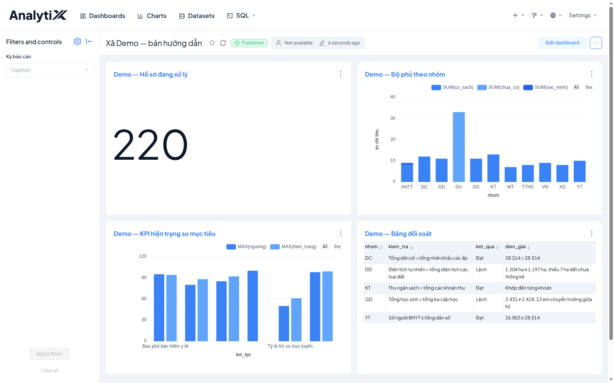

Và bốn lớp của AnalytiX, mỗi lớp một phần của bài:

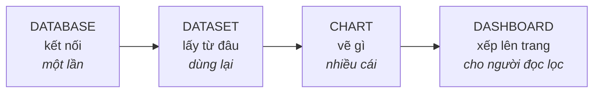

## Phần 1 · Database

Nối Superset vào database của bạn. Làm một lần, cả hệ thống dùng chung.

### Bước 1 — Mở trang Databases

Menu **Settings** ở góc trên bên phải → **Database Connections**.

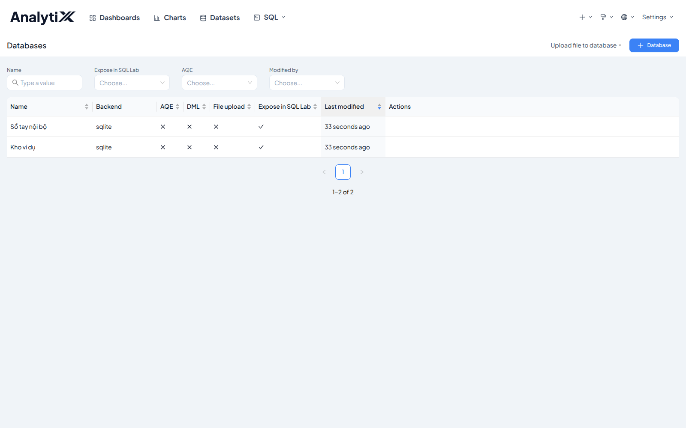

Trang này liệt kê mọi kết nối Superset đang giữ. Cột **Backend** cho biết loại database, cột
**Expose in SQL Lab** cho biết kết nối đó có cho phép viết SQL hay không.

Bấm **+ Database** ở góc trên bên phải.

> **Lưu ý khi đọc danh sách này.** Một dòng nằm đây không có nghĩa là nó còn chạy. Superset
> chỉ lưu thông tin kết nối, nó không kiểm tra database còn sống hay không cho tới lúc có
> người truy vấn.

### Bước 2 — Chọn loại database

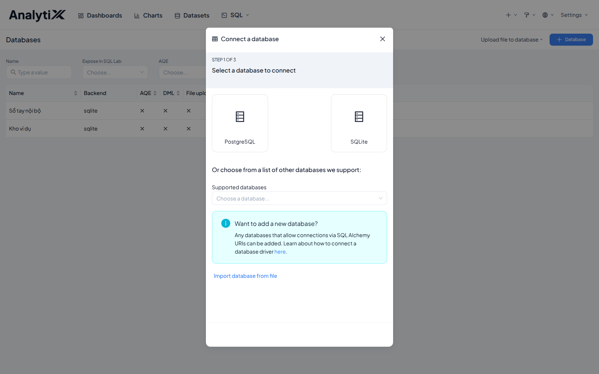

Chọn **PostgreSQL** ở ô ngoài cùng bên trái.

Nếu danh sách của bạn không có PostgreSQL trong hai ô lớn, mở ô **Supported databases** bên
dưới và tìm trong đó.

### Bước 3 — Điền thông tin kết nối

Hộp thoại chuyển sang bước 2 trên 3. Năm ô cần điền, ô nào có dấu sao đỏ là bắt buộc.

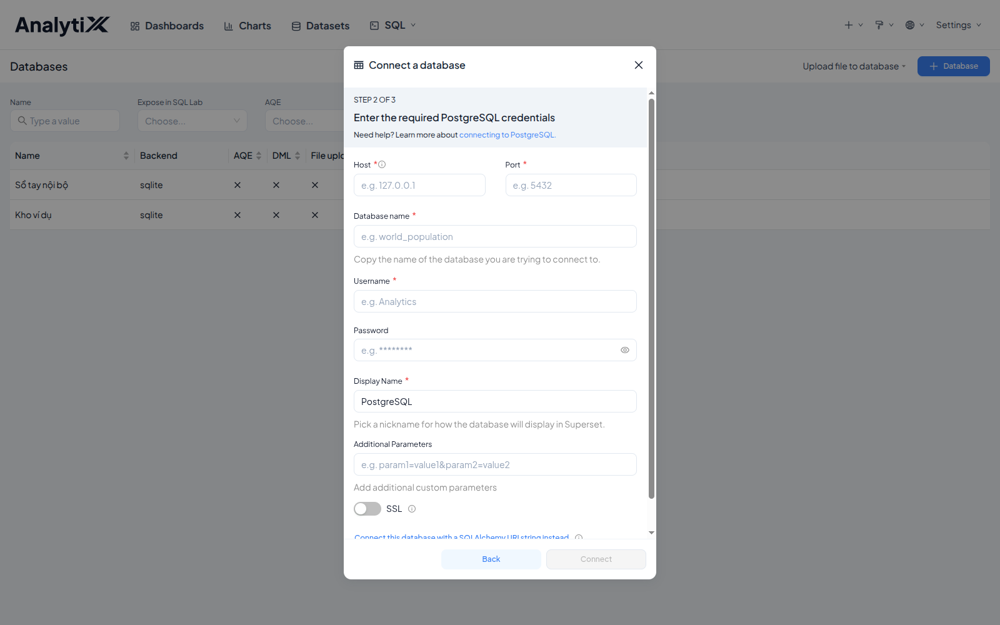

Điền đúng như sau:

```
Host            127.0.0.1
Port            5432
Database name   demo
Username        analytix_ro
Password        (xem từ điển dữ liệu)
Display Name    Demo Postgres
```

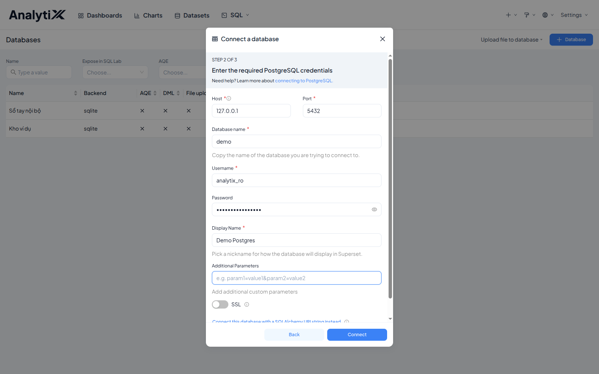

Ba điều về màn này, mỗi điều từng làm người ta mất thời gian:

**`Host` là `127.0.0.1`, không phải địa chỉ máy chủ.** Database chạy trên cùng máy với
Superset, và nó chỉ nghe trên địa chỉ nội bộ. Điền địa chỉ LAN vào đây sẽ báo không nối được.

**`Display Name` chỉ là cái tên hiển thị.** Đặt gì cũng được, nhưng đặt rõ ràng thì sau này
trong danh sách dataset bạn biết ngay cái nào đọc từ đâu.

**Nút `Connect` chỉ sáng sau khi bạn rời khỏi ô cuối cùng.** Điền xong ô `Display Name` mà
con trỏ vẫn nằm trong đó thì nút còn mờ. Bấm `Tab`, hoặc click ra chỗ trống, nút sẽ sáng.
Đây là chỗ dễ tưởng là form bị lỗi.

Bấm **Connect**.

### Bước 4 — Kiểm ba ô của SQL Lab

Kết nối thành công thì hộp thoại sang bước 3 trên 3.

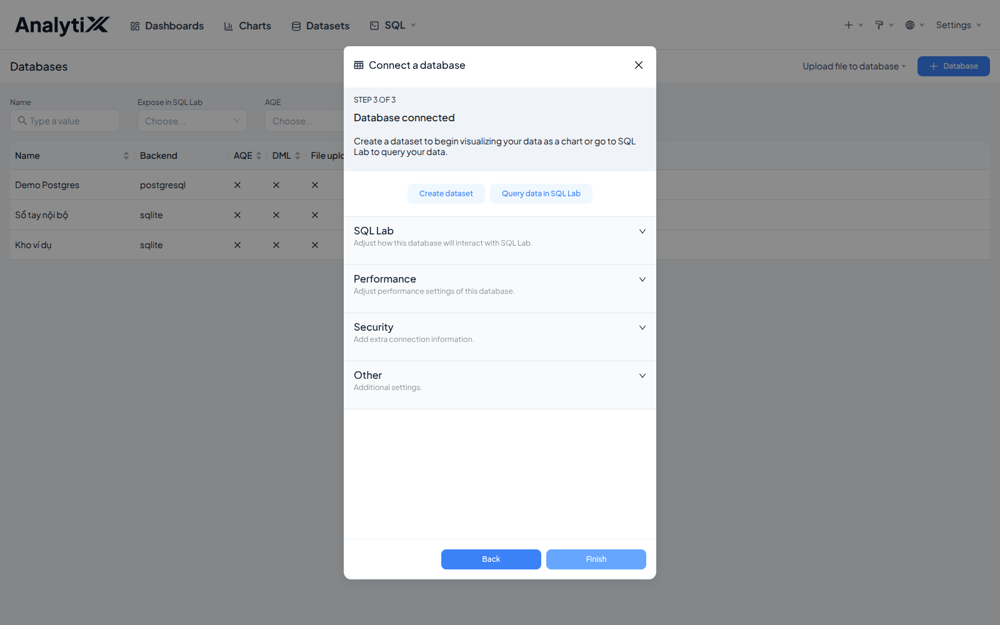

Chưa bấm **Finish** vội. Mở nhóm **SQL Lab** để xem ba ô quan trọng.

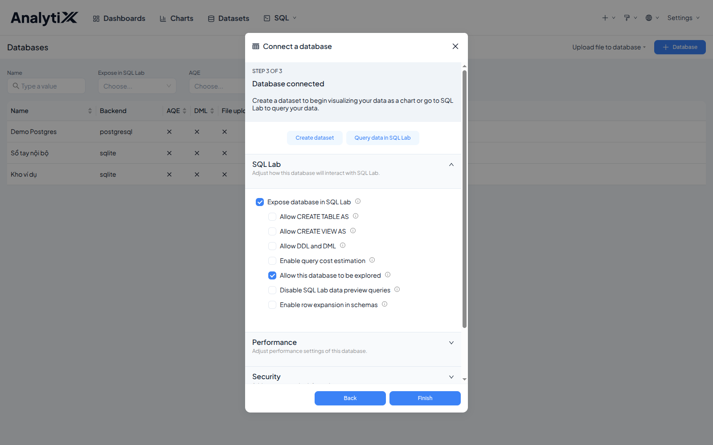

| Ô | Nên để | Vì sao |
|---|---|---|
| Expose database in SQL Lab | **bật** | Không bật thì SQL Lab không thấy database này, và Phần 2 không làm được |
| Allow this database to be explored | **bật** | Cho phép dựng dataset từ một câu SQL thay vì từ bảng có sẵn |
| Allow DDL and DML | **tắt** | Cho phép ghi. Tài khoản `analytix_ro` vốn không ghi được, nhưng tắt ở đây là lớp chặn thứ hai |

Superset 6.1.0 **bật sẵn hai ô đầu**, nên thường bạn không phải làm gì. Vẫn nên mở ra nhìn
một lần, vì nếu ai đó tắt đi thì Phần 2 sẽ hỏng mà không có thông báo rõ ràng.

Bấm **Finish**.

### Kết quả đúng trông thế nào

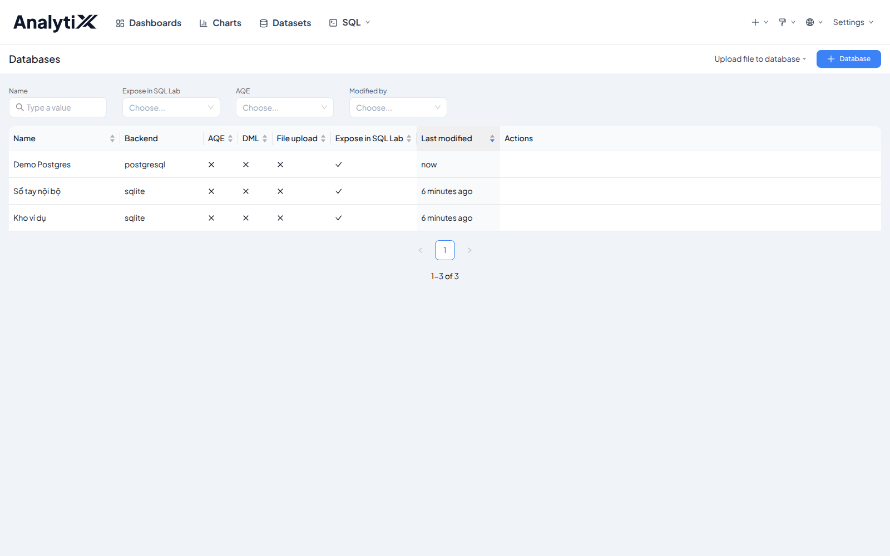

Dòng **Demo Postgres** xuất hiện đầu danh sách, `Backend` là `postgresql`, cột **Expose in
SQL Lab** có dấu tích.

## Phần 2 · Dataset

Dataset là lớp trung gian giữa database và biểu đồ. Nó trả lời câu hỏi "lấy dữ liệu từ đâu,
và cột tên là gì" — một lần, rồi mọi biểu đồ dùng lại.

### Bước 5 — Mở SQL Lab và chọn nguồn

Menu **SQL** trên thanh trên → **SQL Lab**.

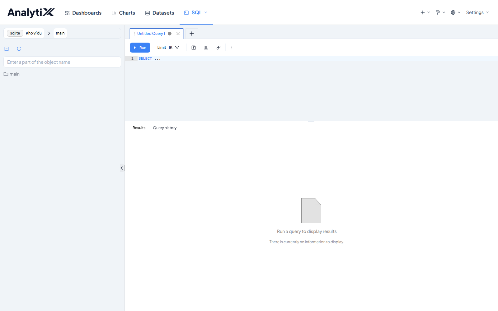

SQL Lab **nhớ lựa chọn của lần trước**, nên nhiều khả năng nó đang trỏ vào một database khác.
Bấm vào ô chọn database ở góc trên bên trái panel trái.

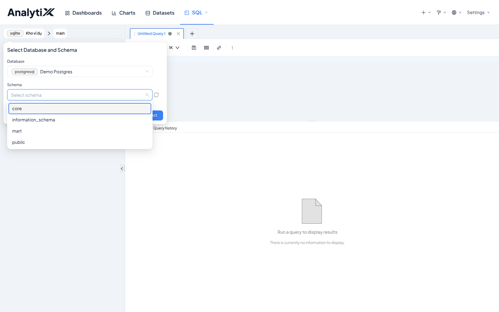

Chọn **Demo Postgres** ở ô Database, rồi **mart** ở ô Schema, rồi bấm **Select**.

Nhìn thấy bốn thư mục `core`, `information_schema`, `mart`, `public` ở panel trái nghĩa là
Phần 1 đã làm đúng. Nếu panel trống hoặc báo lỗi, quay lại kiểm ô *Expose database in SQL Lab*.

> **Chọn `mart`, không chọn `core`.** `core` là nơi dữ liệu thật nằm, có khóa ngoại và ràng
> buộc. `mart` là bảy view đã nối sẵn các bảng và đặt tên cột tiếng Việt. Biểu đồ nên đọc
> `mart`; `core` để dành cho lúc cần truy một con số về tới dòng Excel sinh ra nó.

### Bước 6 — Chạy thử truy vấn

Gõ câu này vào khung soạn SQL:

```sql
SELECT indicator_code, indicator_name, nhom, gia_tri_vn,
       value_numeric, trang_thai, canh_bao, phong_ban_loc,
       cap, unit_code, xa, ky
FROM   mart.chi_tieu
WHERE  cap = 'xa'
ORDER  BY nhom, indicator_code
```

Bấm **Run**.

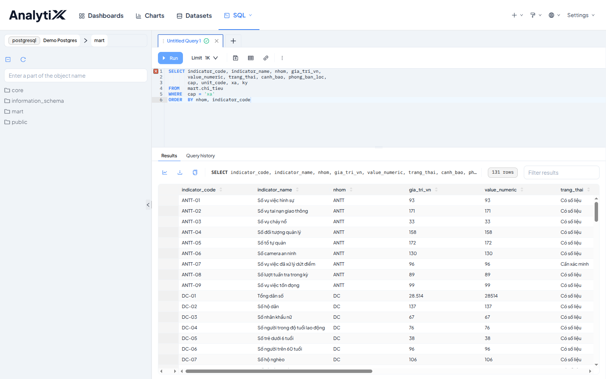

Đọc câu SQL trên từng mảnh:

| Mảnh | Làm gì |
|---|---|
| `mart.chi_tieu` | View chứa mọi chỉ tiêu, cả cấp xã lẫn cấp tỉnh |
| `WHERE cap = 'xa'` | **Bắt buộc.** View chứa cả hai cấp; bỏ dòng này thì mỗi chỉ tiêu bị đếm hai lần |
| `gia_tri_vn` | Giá trị viết kiểu Việt Nam — `28.514`, `94,95` — dùng để hiển thị |
| `value_numeric` | Cùng giá trị đó dạng số — dùng để tính toán và vẽ biểu đồ |
| `unit_code`, `ky` | Để sau này lọc theo đơn vị và theo kỳ |

Kết quả đúng: góc phải vùng Results ghi **131 rows**. Nhìn vài dòng để yên tâm — `DC-01`
(Tổng dân số) phải ra `28.514`, `ANTT-07` phải mang trạng thái `Cần xác minh`.

### Bước 7 — Lưu thành dataset

Bấm icon **Save dataset** trên thanh công cụ, bên phải nút Run.

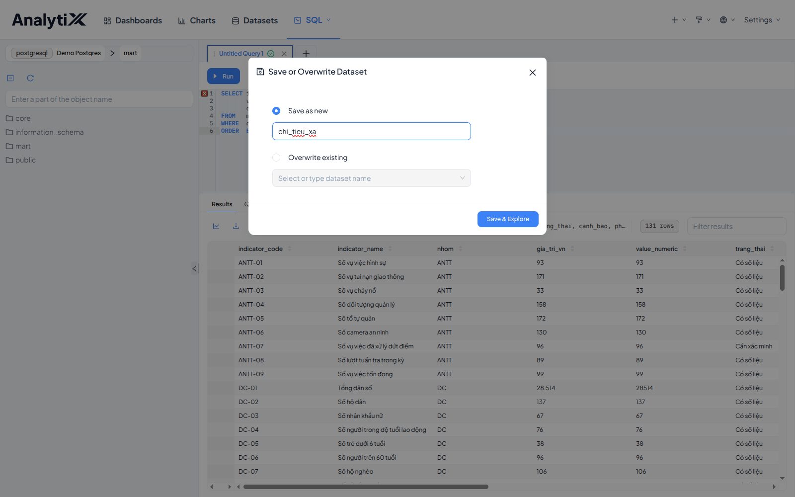

Chọn **Save as new**, xóa tên mặc định (`Untitled Query ...`) và gõ:

```
chi_tieu_xa
```

Bấm **Save & Explore**. Superset mở ngay màn vẽ biểu đồ ở tab mới.

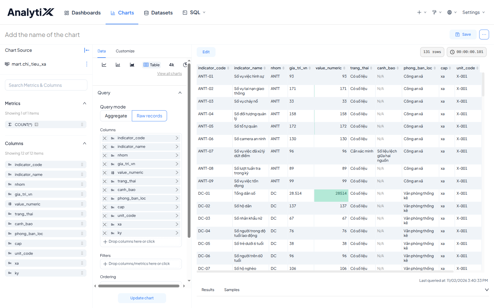

Hai điều về màn này:

**Tên dataset nên đặt theo nội dung, không theo thời điểm.** Tên mặc định mang dấu thời gian
của lúc bạn chạy truy vấn, và sáu tháng sau nó không nói lên điều gì.

**`Save as new` khác `Overwrite existing`.** Lần đầu luôn là `Save as new`. Về sau khi sửa
câu SQL, chọn `Overwrite existing` để mọi biểu đồ đang dùng dataset đó được cập nhật theo —
`Save as new` sẽ tạo một dataset thứ hai và các biểu đồ cũ vẫn đọc dataset cũ.

## Phần 3 · Chart

Bốn biểu đồ, bốn loại khác nhau. Chọn khác nhau là có chủ ý: xong phần này bạn đã gặp đủ bốn
cách Superset đòi khai dữ liệu, và biểu đồ thứ năm bạn tự dựng được.

```
Big Number   một con số          <- mart.chi_tieu   lọc xuống còn một chỉ tiêu
Bar Chart    nhiều nhóm          <- mart.coverage   một trục, nhiều chuỗi
Bar Chart    hai chuỗi so sánh   <- mart.kpi        hai metric trên cùng một trục
Table        bảng thô            <- mart.doi_soat   chọn cột, không tính toán
```

### Bước 8 — Chọn loại biểu đồ

Từ màn Explore, bấm **View all charts** dưới hàng icon.

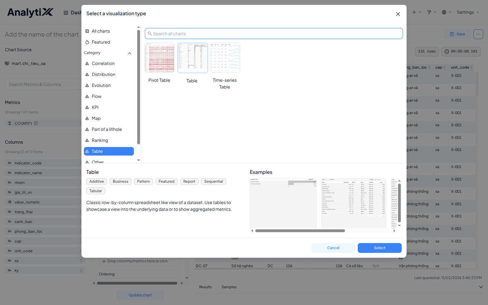

Gõ tên vào ô tìm kiếm thay vì lần theo danh mục — nhanh hơn nhiều.

### Bước 9 — Biểu đồ A: một con số

Chọn **Big Number**. Biểu đồ này cần đúng hai thứ: một metric, và một bộ lọc thu kết quả về
một dòng.

**Khai metric.** Bấm vào ô **Metric**.

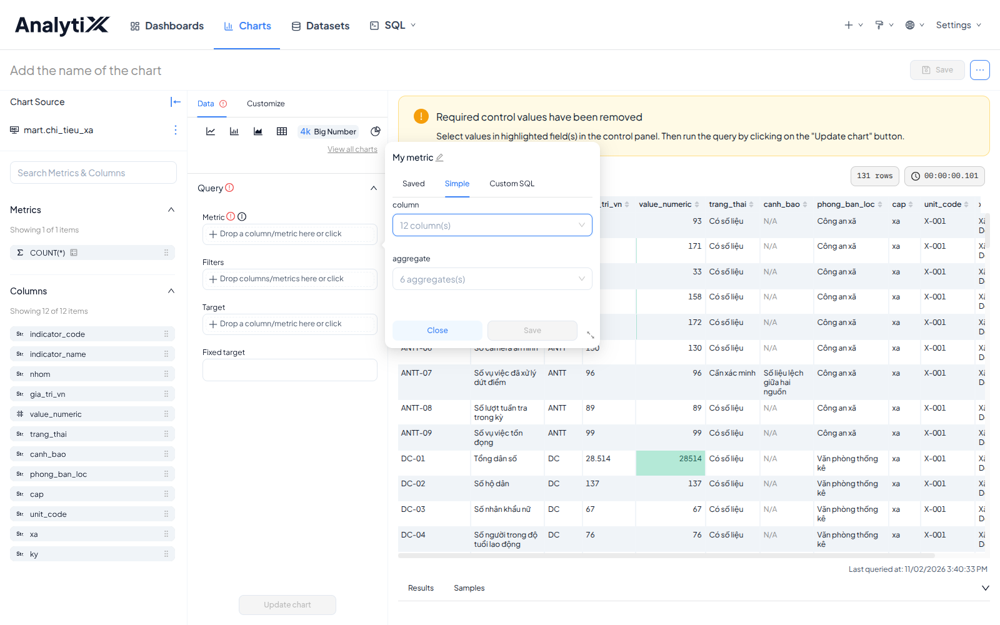

Ba tab, dùng vào ba việc khác nhau:

| Tab | Khi nào dùng |
|---|---|
| **Saved** | Metric đã khai sẵn ở tầng dataset, dùng lại cho nhiều biểu đồ |
| **Simple** | Một cột cộng một phép tổng hợp. Dùng cho hầu hết trường hợp |
| **Custom SQL** | Công thức riêng, ví dụ `SUM(a) / NULLIF(SUM(b), 0)` |

Chọn tab **Simple**, cột `value_numeric`, phép **MAX**.

> **Vì sao MAX chứ không phải SUM.** Sau khi lọc còn đúng một dòng thì MAX, MIN, SUM, AVG đều
> ra cùng kết quả. Nhưng nếu bộ lọc hụt và còn hai dòng, SUM sẽ cộng chúng lại và cho một con
> số sai mà trông vẫn hợp lý. MAX thì không — nó vẫn trả về một giá trị thật có trong dữ liệu.

**Thêm bộ lọc.** Bấm vào ô **Filters**.

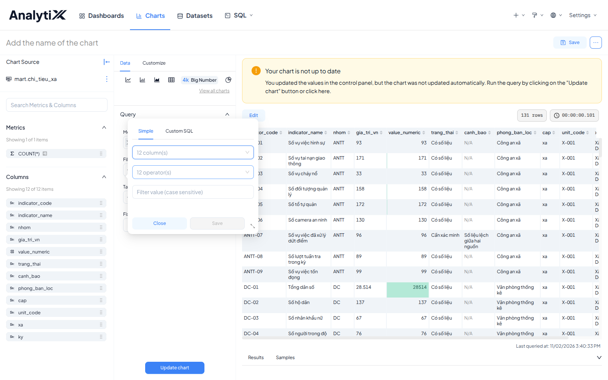

Chọn cột `indicator_code`, phép **IN**, giá trị `TTHC-04`.

Bấm **Create chart**.

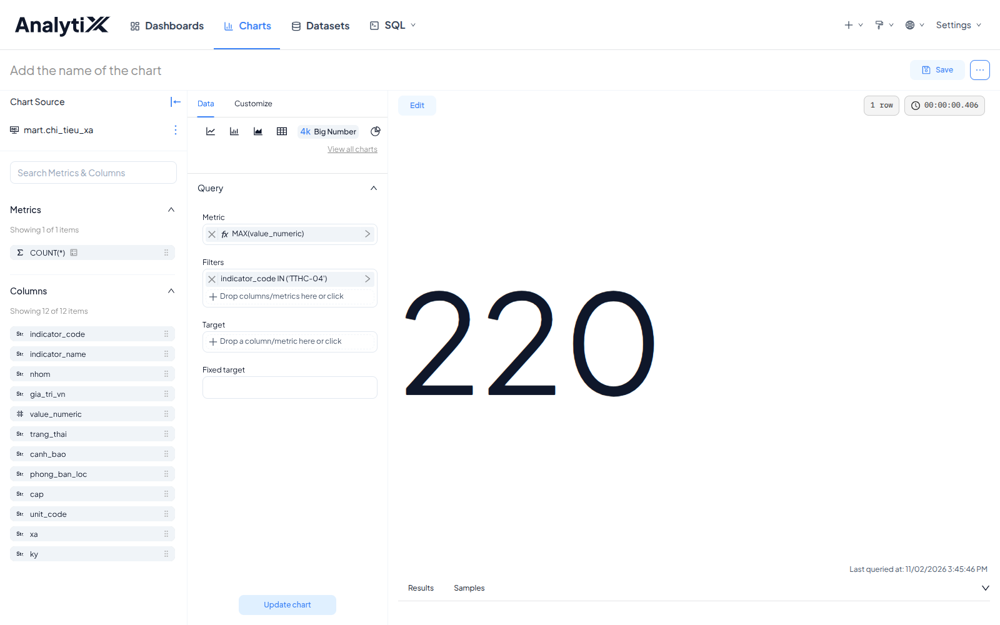

Kết quả đúng: con số **220**, và góc phải ghi `1 row`. Nếu ra số khác hoặc nhiều hơn một dòng,
bộ lọc chưa đủ chặt.

**Đặt tên và lưu.** Bấm **Save** ở góc trên phải.

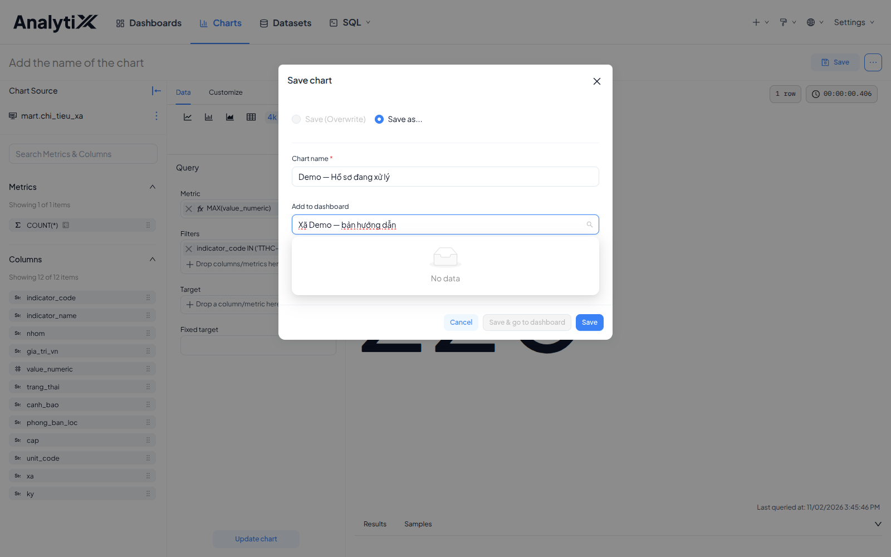

Đặt tên `Demo — Hồ sơ đang xử lý` rồi bấm **Save**.

> **Ô `Add to dashboard` chỉ chọn được dashboard đã tồn tại.** Ở bản 6.1.0 nó không còn tạo
> dashboard mới từ tên bạn gõ — gõ một tên chưa có thì danh sách trả về `No data`. Cứ lưu
> biểu đồ trước đã; dashboard dựng ở Phần 4, rồi quay lại gắn từng biểu đồ vào.

### Bước 10 — Biểu đồ B: nhiều nhóm

Lần này tạo dataset theo cách thứ hai: thẳng từ view, không qua SQL Lab.

**Datasets** trên thanh trên → **+ Dataset**.

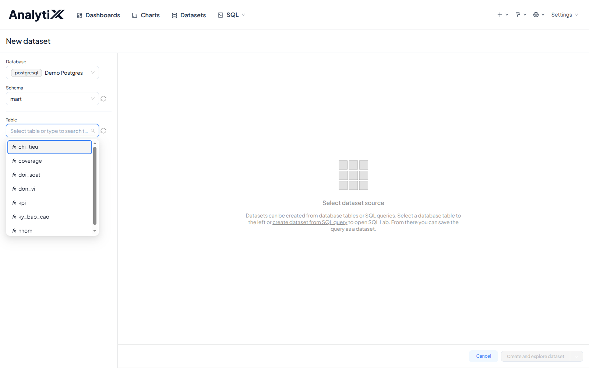

Chọn `Demo Postgres` → `mart` → `coverage` → **Create and explore dataset**.

> Đây là cách thứ hai trong [Hai cách tạo dataset](../explanation/hai-cach-tao-dataset.md) —
> dataset physical, trỏ thẳng vào view, không qua SQL Lab.

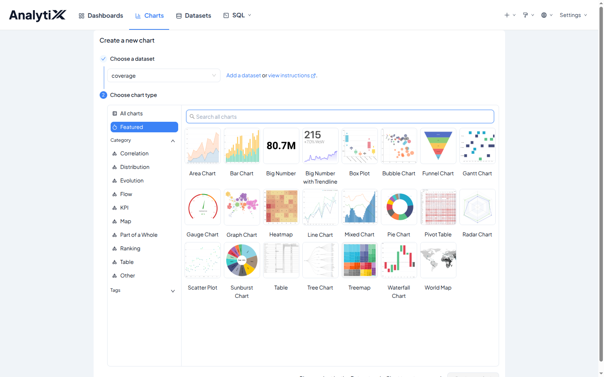

Chọn **Bar Chart**, rồi khai:

```
X-axis     nhom
Metrics    SUM(co_sach)     SUM(xac_minh)     SUM(chua_co)
Filters    cap = 'xa'
```

Ba metric thêm lần lượt, mỗi lần mở lại ô **Metrics**.

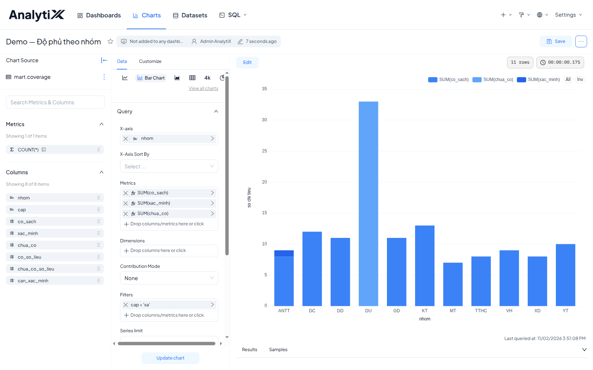

Kết quả đúng: 11 cột nhóm, ba chuỗi, và `11 rows` ở góc phải. Nhóm `DU` vọt lên 33 ở chuỗi
*chưa có số liệu* — đó là khối Đảng ủy, nhóm chưa điền gì trong phiếu này.

> **Ba cột này xếp chồng được, ba cột khác thì không.** `co_sach`, `xac_minh`, `chua_co` rời
> nhau và cộng lại đúng bằng tổng số chỉ tiêu của nhóm. Đừng thay bằng `co_so_lieu`,
> `chua_co_so_lieu`, `can_xac_minh` — ba cột đó chồng lấn, vì một chỉ tiêu bị gắn cờ thường
> vẫn có giá trị, nên biểu đồ sẽ vẽ ra tổng lớn hơn số chỉ tiêu thật.

Lưu với tên `Demo — Độ phủ theo nhóm`, thêm vào cùng dashboard.

### Bước 11 — Biểu đồ C: hai chuỗi so sánh

Tạo dataset từ view `mart.kpi`, chọn **Bar Chart**, khai:

```
X-axis     ten_kpi
Metrics    MAX(hien_trang)     MAX(nguong)
Filters    cap = 'xa'
```

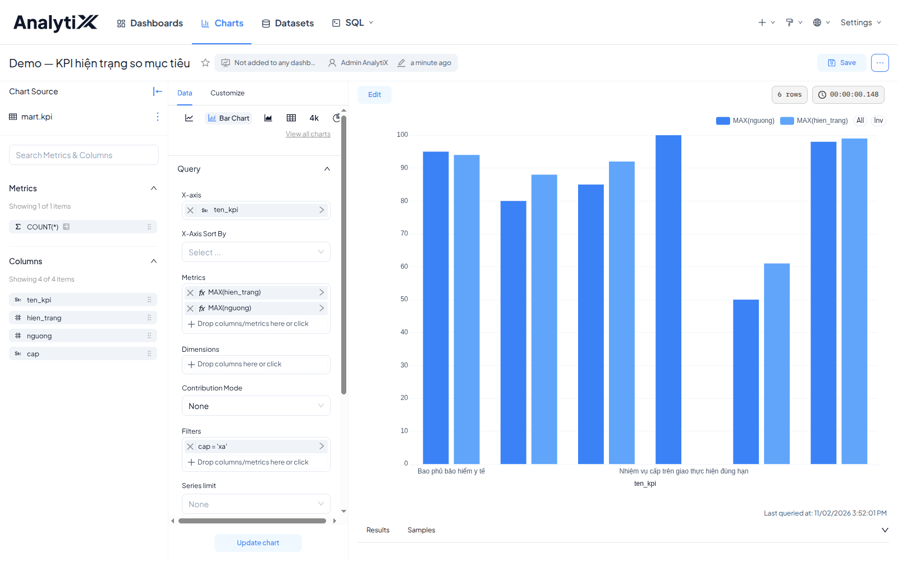

Mỗi KPI hai cột cạnh nhau — mục tiêu và hiện trạng. KPI nào có cột hiện trạng thấp hơn cột
mục tiêu là KPI chưa đạt; ở phiếu này đó là *Nhiệm vụ cấp trên giao thực hiện đúng hạn*, hiện
trạng bằng 0.

> **Radar Chart trông hợp hơn nhưng không dùng được ở đây.** Superset đọc Radar ngược với
> trực giác: **Metrics là các trục**, còn **Dimensions là các đường**. Khai `ten_kpi` làm
> Dimension và hai metric thì được sáu đường trên hai trục — một hình thù vô nghĩa. Muốn radar
> sáu trục KPI thì phải khai sáu metric riêng, mỗi metric một câu `CASE WHEN`. Không đáng.

Lưu với tên `Demo — KPI hiện trạng so mục tiêu`.

### Bước 12 — Biểu đồ D: bảng thô

Tạo dataset từ `mart.doi_soat`, chọn **Table**.

Chuyển **Query mode** sang **Raw records** — chế độ này không tính toán gì, chỉ hiện đúng các
dòng có trong dữ liệu. Rồi thêm bốn cột vào ô **Columns**:

```
nhom     kiem_tra     ket_qua     dien_giai
```

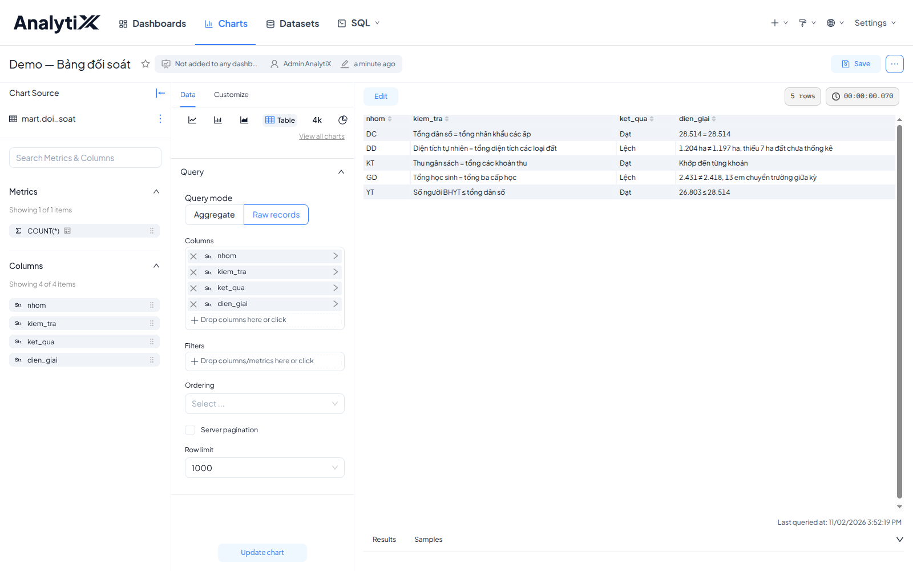

Kết quả đúng: 5 dòng, ba **Đạt** và hai **Lệch**. Cột `dien_giai` viết sẵn phép tính ra chữ,
nên người đọc hiểu ngay vì sao lệch mà không phải tra thêm.

> **Aggregate hay Raw records.** *Aggregate* nhóm dữ liệu rồi tính — dùng khi bạn cần tổng,
> trung bình, đếm. *Raw records* hiện nguyên dòng — dùng khi dữ liệu đã ở đúng mức chi tiết
> cần xem, như bảng đối soát này. Chọn sai chế độ là nguyên nhân phổ biến nhất khiến bảng ra
> một dòng duy nhất hoặc ra số liệu cộng dồn vô nghĩa.

## Phần 4 · Dashboard

Dashboard là trang xếp nhiều biểu đồ lại và cho người đọc lọc tất cả cùng lúc.

### Bước 13 — Trang đã có sẵn

Nếu bạn làm theo Phần 3, dashboard đã được tạo từ bước lưu biểu đồ đầu tiên, và cả bốn biểu
đồ đã nằm trong đó. Mở **Dashboards** trên thanh trên để vào.

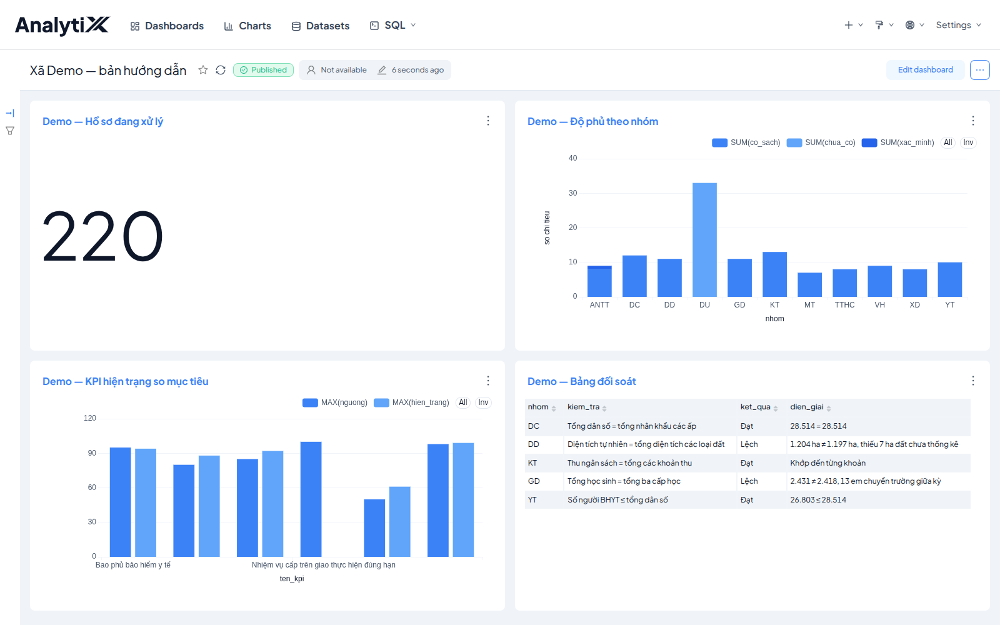

Superset tự xếp mỗi biểu đồ một ô theo thứ tự thêm vào. Muốn đổi bố cục thì bấm **Edit
dashboard** ở góc trên phải rồi kéo thả — kéo cạnh ô để đổi kích thước, kéo giữa ô để đổi
chỗ.

> **Kích thước ô là cố định, nội dung không đẩy nó to ra.** Bảng dài hơn ô sẽ sinh thanh cuộn
> bên trong, và trang vẫn trông bình thường cho tới khi có người cần đọc dòng cuối. Đặt ô cho
> bảng cao hơn bạn nghĩ là cần.

### Bước 14 — Thêm bộ lọc dùng chung

Bộ lọc trong biểu đồ chỉ tác động lên biểu đồ đó. Bộ lọc dashboard tác động lên **tất cả**
biểu đồ cùng lúc — đó là thứ biến bốn biểu đồ rời rạc thành một trang báo cáo.

Mở thanh **Filters and controls** bên trái (bấm mũi tên nếu nó đang thu lại), rồi bấm icon
bánh răng → **Add or edit filters and controls**.

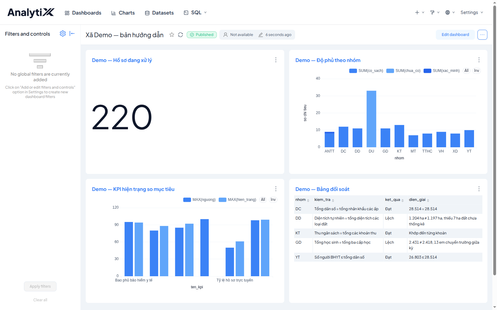

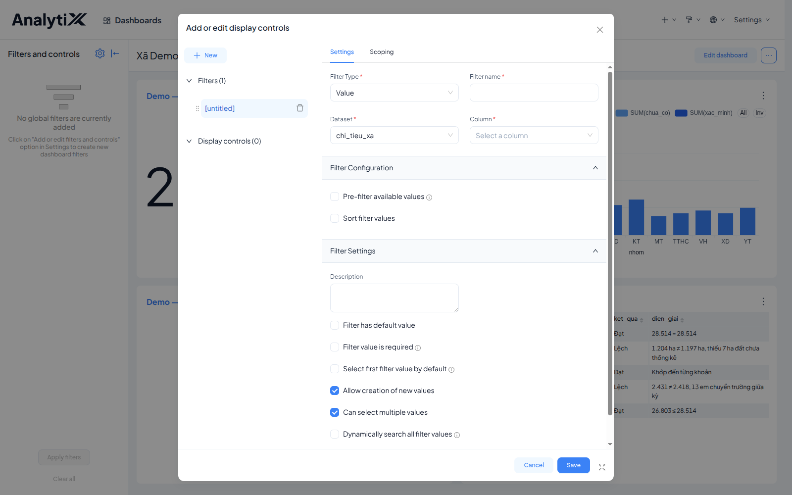

Khai một bộ lọc:

```
Filter Type    Value
Filter name    Kỳ báo cáo
Dataset        chi_tieu_xa
Column         ky
```

Bấm **Save**.


Ô **Kỳ báo cáo** xuất hiện trên thanh trái. Hiện chỉ có một lựa chọn vì database mới có một
kỳ; khi phiếu kỳ sau được nạp, ô này tự có thêm lựa chọn mà không phải sửa gì.

> **Bộ lọc chỉ chạm tới biểu đồ dùng chung dataset.** Bộ lọc khai trên `chi_tieu_xa` sẽ
> không lọc được biểu đồ đọc `mart.coverage`. Muốn một bộ lọc chạm tới cả bốn biểu đồ thì cả
> bốn phải đọc cùng một dataset, hoặc bạn khai bốn bộ lọc song song. Tab **Scoping** trong
> cùng hộp thoại cho phép chỉ định bộ lọc này áp vào biểu đồ nào.

Thêm bộ lọc **Đơn vị** trên cột `unit_code` theo đúng cách trên. Khi có xã thứ hai, đó là ô
để người đọc chuyển giữa các xã.

### Bước 15 — Đặt quyền và chia sẻ

Bấm **Edit dashboard** trước, rồi mới **⋯** góc trên phải → **Edit properties**.

:::note[Không vào chế độ sửa thì không thấy mục đó]
Menu **⋯** của trang ở chế độ xem chỉ có *Refresh dashboard*, *Set auto-refresh*,
*Enter fullscreen*, *Save as*, *Download*, *Share*. **Edit properties** chỉ xuất
hiện sau khi bấm **Edit dashboard**.
:::

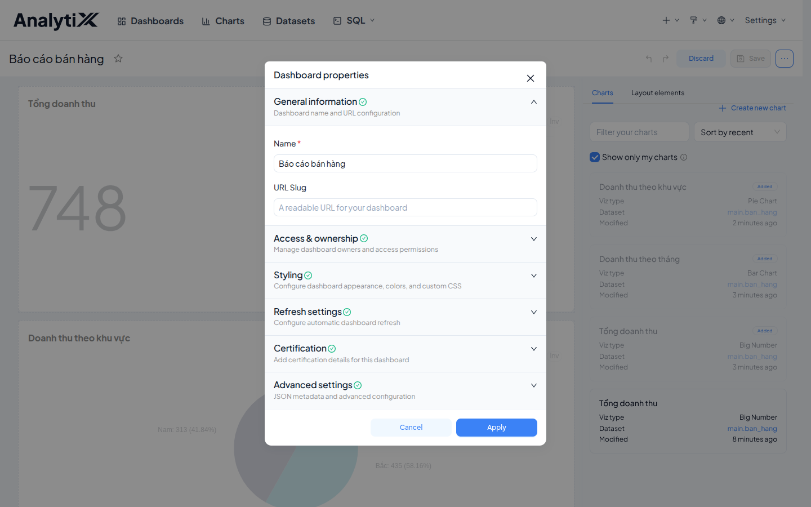

| Mục trong hộp thoại | Ý nghĩa |
|---|---|
| **General information** | Tên trang và URL slug |
| **Access & ownership** | Ai sửa được trang này |
| **Certification** | Đánh dấu trang đã được duyệt, hiện huy hiệu cạnh tiêu đề |

Trạng thái **Published / Draft** không nằm trong hộp thoại này — nó là nhãn cạnh
tiêu đề trang. Dashboard mới luôn ở **Draft**; bấm vào chữ đó để chuyển sang
*Published*. *Draft* chỉ người tạo thấy, *Published* mới hiện trong danh sách chung.


Chia sẻ bằng cách gửi thẳng URL. Người nhận phải có tài khoản Superset và có quyền đọc
dataset bên dưới — chia sẻ link không tự cấp quyền.
## Tự kiểm

Năm thứ phải đúng. Sai cái nào thì quay lại bước tương ứng.

| Kiểm | Đúng là | Sai thì xem |
|:---|:---|:---|
| Trang Databases | có dòng `Demo Postgres`, Backend `postgresql`, cột *Expose in SQL Lab* có dấu tích | Bước 1–4 |
| SQL Lab | câu truy vấn trả `131 rows` | Bước 6 |
| Danh sách Datasets | có `chi_tieu_xa`, `coverage`, `kpi`, `doi_soat` | Bước 7, 10–12 |
| Dashboard | bốn biểu đồ, Big Number hiện `220` | Bước 13 |
| Thanh lọc | có ô `Kỳ báo cáo`, chọn giá trị thì cả bốn biểu đồ đổi theo | Bước 14 |

Gặp thông báo lỗi cụ thể thì tra thẳng ở [Lỗi theo bước](../reference/loi-theo-buoc.md).

## Dọn dẹp

Làm xong để thử thì gỡ sạch theo thứ tự này — ngược lại sẽ vướng ràng buộc:

1. **Dashboards** → mở dashboard → `...` → *Delete*
2. **Charts** → xoá bốn biểu đồ `Demo — …`
3. **Datasets** → xoá `chi_tieu_xa`, `coverage`, `kpi`, `doi_soat`
4. **Databases** → xoá `Demo Postgres`

Xoá database khi còn dataset trỏ vào nó thì AnalytiX chặn lại — đó là chủ ý,
không phải lỗi.

## Bước tiếp theo

Mười lăm bước trên đây, mỗi việc còn một trang công thức riêng — mở thẳng trang
đó khi làm lại trên dữ liệu thật, đừng đọc lại cả bài:

| Việc | Trang |
|:---|:---|
| Nối vào một database khác | [Nối vào một database](../how-to/ket-noi/noi-vao-mot-database.md) |
| Tạo dataset | [Tạo dataset](../how-to/dataset/tao-dataset.md) |
| Vẽ thêm biểu đồ | [Tạo biểu đồ](../how-to/bieu-do/tao-bieu-do.md) |
| Xếp lên một trang mới | [Xếp biểu đồ thành dashboard](../how-to/dashboard/xep-bieu-do-thanh-dashboard.md) |
| Thêm ô lọc | [Thêm bộ lọc dùng chung](../how-to/dashboard/them-bo-loc-dung-chung.md) |
| Cho người khác xem | [Đặt quyền và chia sẻ dashboard](../how-to/dashboard/dat-quyen-va-chia-se-dashboard.md) |

Và bốn việc bài này không chạm tới:

- [Thêm driver cho nguồn dữ liệu](../how-to/cai-dat/them-driver-du-lieu.md) — nối vào MySQL, Trino, hay nguồn khác
- [Viết SQL an toàn](../how-to/dataset/viet-sql-an-toan.md) — trước khi mở SQL Lab cho người khác
- [Nhúng iframe đơn giản](../how-to/nhung/nhung-iframe-don-gian.md) — đưa dashboard sang hệ thống khác
- [Hai cách tạo dataset](../explanation/hai-cach-tao-dataset.md) — vì sao bài này dẫn bạn đi cả hai đường
